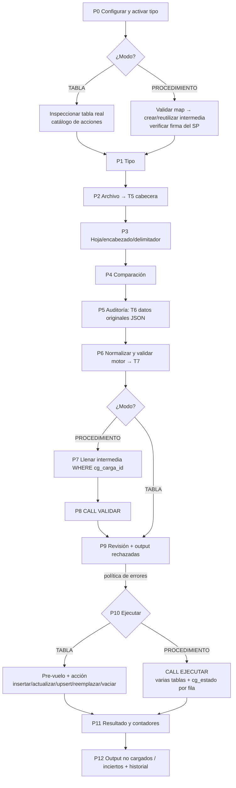

# 07 — Plan consolidado del módulo Cargues (revisión 3.3)

**Fecha:** 2026-10-14 · **Estado:** diseño + validación técnica acotada con datos sintéticos (`08`) + análisis del archivo de referencia de Envíos completos (`10`); **módulo no implementado**.
**Documento vigente.** Si `01`–`06` lo contradicen, prevalece este. La primera fase implementable está en `09`.

> **2026-10-14 — E1 implementada en desarrollo** (`11`). Lo que la implementación **precisó o cambió** respecto de este plan: (1) la intermedia se crea con `CREATE` + `ALTER` de llaves (§5.2) y se descarta si falla; (2) `texto` no admitido en llaves únicas (§5.6); (3) fila vacía = estado `vacia` (§9); (4) en modo procedimiento `vacio` no admite `default` (§4.4); (5) menú sin clave ACL y middleware antes del `admin` de Bagisto (§10 de `11`); (6) el contrato se revisa con análisis estático + confirmación humana + vigilancia en ejecución, con límites documentados (`11` §3). Todo lo demás de §3–§9 coincide con el código.

Marcas: **[APROBADO]** decidido por Camilo · **[PROPUESTO]** recomendación técnica sin aprobar · **[PENDIENTE]** decisión abierta · **[C]** comprobado en código/BD · **[V]** comprobado en la validación aislada de `08` · **[DOC]** según documentación oficial, no ejecutado · **[S]** supuesto.

> **Adjuntos.** El **mockup** se recibió el 2026-10-13 y está guardado en `docs/mockups/cargues_nuevo_cargue_relacionar_columnas.png` (contraste en `04` §1.1). **Envíos completos:** el adjunto "(2)" no llegó a la sesión. Se analizaron, en solo lectura, exportaciones reales del mismo reporte que estaban en el equipo (`10` §0). Sirven para **configurar ese tipo**; el motor no toma reglas de ellas. La hoja de **Cartera** no se ha recibido.

## 0. Requerimiento vigente

**[APROBADO]**
1. Motor de cargues masivos **parametrizable y dinámico**. Un tipo nuevo configura estructura, conexión y destino **sin reprogramar el motor**. Solo los procedimientos particulares se desarrollan, según las reglas de negocio. 99 Envíos y Clientes son **ejemplos**.
2. Configuración del tipo: nombre, descripción, activo, conexión, tabla destino o procedimiento, acción y `map` JSON. Se rechazan las configuraciones contradictorias.
3. **Modo TABLA:** destino existente y procedimiento vacío. Los campos de comparación salen de la **estructura real** de la tabla, consultada por backend. Acciones requeridas, incluidas **TRUNCATE** (vaciar y cargar) y **REPLACE**.
4. **Modo PROCEDIMIENTO:** procedimiento configurado y **estructura intermedia definida en `map` y creada dinámicamente por el motor**. No se admiten tablas fijas con migración manual por tipo. El procedimiento puede afectar **varias tablas**.
5. `tabla_destino` (modo tabla) ≠ `map.tabla` (tabla intermedia del modo procedimiento).
6. Conexión: debe existir y estar autorizada en `config/database.php`; **sin credenciales en la configuración del cargue**. Inicialmente MySQL/MariaDB, con separación por motor para ampliaciones futuras.
7. Cabecera de ejecución y **datos originales por fila en JSON** antes de aplicar cambios de negocio.
8. **Output descargable** de datos no cargados: datos originales, fila, campo, etapa, motivo y estado inequívoco. Los resultados inciertos no se presentan como "no cargados".
9. Solo administrador (visual y endpoints). Ejecución manual, cada 15 días o a demanda. Volumen por medir con archivos reales.
10. UI según el mockup aprobado (tarjetas a la izquierda; archivo y lectura a la derecha; Campo destino | Columna del archivo | Ejemplo; recuperar y guardar comparaciones; validar, ejecutar, resultado, historial).

## 1. Qué cambia respecto al plan anterior

| Tema | Plan anterior (rev. 2) | Ahora (rev. 3) | Motivo |
|---|---|---|---|
| Estructura intermedia | Staging generado al publicar, nombre `stg_<slug>_v<n>` decidido por el motor | **`map.tabla` define el nombre**; el motor la crea dinámicamente al **activar** el tipo y la verifica (o crea si falta) al **preparar** cada cargue. Registro de estructuras para reutilizarlas y archivarlas | Requisito explícito de creación dinámica a partir del map |
| Campos del modo tabla | Declarados en el JSON | Salen de `Schema::getColumns/getIndexes/getForeignKeys` de la tabla real | Requisito 3 |
| Acciones del modo tabla | insert / upsert / update | + **vaciar y cargar (TRUNCATE)** y **reemplazar (REPLACE)**, con semántica y ejecución segura auditadas (§6) | Confirmado por Camilo |
| Procedimiento | Un destino; parámetros carga + modo | Puede escribir **varias tablas**; contrato con `p_accion`, dos modelos transaccionales y resultados por fila en columnas `cg_*` de la intermedia (§8) | Requisito 4 |
| Configuración | JSON único | Columnas explícitas (nombre, descripción, activo, conexión, modo, tabla destino, procedimiento, acción) + `map`, con matriz de contradicciones (§3.3) | Requisito 2 |
| Motor SQL | Implícito MySQL | Interfaz por motor; solo MySQL/MariaDB habilitados (§3.4) | Requisito 6 |
| Estados del output | Fallidas / rechazadas por antigüedad | `rechazada`, `no_ejecutada`, `revertida`, `incierta`, separadas de `aplicada`, `sin_cambio` y `omitida_antigua` (§9) | Requisito 8 |
| Duplicados y llaves | Detectados en validación | Llave primaria, únicas e índices declarables en el map, creados como restricciones reales por carga. Las filas que las violarían se rechazan con su original intacto en la auditoría (§5.5) | Capacidad solicitada sin perder evidencia |
| Ejemplo de generalidad | Solo envíos | + auditoría de un tipo **Clientes** (§10) | Requisito del encargo |

### 1.1 Correcciones de la revisión 3.1 (sobre la 3)

| Punto | Corrección | Dónde |
|---|---|---|
| Documentos contradictorios | `03` pasa a ser **antecedente, no implementar**; en `01` §5 y §6 se retiran el staging fijo y los aplicadores por destino; `05` incluye "Configurar tipos" en el MVP y remite las fases a §12 | `01`, `03`, `05` |
| Llaves | Llave primaria, únicas e índices declarables como restricciones reales (con `cg_carga_id`), sin perder filas | §3.2, §5.2, §5.5 |
| Borrado al preparar | Solo antes de iniciar la ejecución; desde `ejecucion_token`, la intermedia y sus marcas son de solo lectura | §7 P7 |
| Cambio de estructura | Cargas abiertas resueltas antes de activar; copia congelada y hash del procedimiento; crear antes de renombrar; `RENAME` múltiple atómico; reconciliación | §5.4, §8.3 |
| Conexiones y transacciones | Dónde vive cada tabla; sin transacción global; evidencia junto al efecto; consolidación idempotente | §3.5 |
| Restauración tras `TRUNCATE` | Verificación de contenido (anti-join por PK + `CHECKSUM TABLE`), no de conteo; control de escrituras concurrentes | §6.2 |
| Recuperación | No se clasifica nada mientras el bloqueo con nombre de la carga siga tomado; tras un rollback, `no_ejecutada` salvo evidencia de procesamiento (`revertida`) | §8.3, §8.4, §9 |
| Obligatorios por acción | Calculados según insertar, actualizar, upsert, reemplazar o vaciar | §4.3 |
| Lector XLSX | Sin elección previa; comparación de rendimiento, fidelidad y mantenimiento; el lector propio no se elige por evitar una dependencia | §11.2, `01` §4 |

### 1.2 Precisiones de la revisión 3.2 (sobre la 3.1)

| Punto | Precisión | Dónde |
|---|---|---|
| Inmutabilidad | Tras iniciar la ejecución son inmutables los **datos de entrada** de la intermedia. Las **marcas de resultado** sí se actualizan, solo por el ejecutor autorizado y solo de vacío a final; las marcas ya confirmadas no se borran ni se reinician | §5.2, §7 P7, §8.2 |
| Obligatorios al insertar | No son todas las `NOT NULL`: se excluyen las que tienen default, las autoincrementales y las generadas. Celda vacía en una columna con default → `DEFAULT` | §4.3 |
| `RENAME` | Se separa la atomicidad en operación normal (comprobada) de la seguridad ante una caída del servidor (desde MariaDB 10.6.1; dev 10.4.28 no la tiene) | §5.4 |
| Bloqueo de ejecución | Ciclo completo: adquisición, mantenimiento, liberación y recuperación tras perder la conexión, validado con caídas reales | §8.4 |
| Hallazgos de la validación | Intercalación de identificadores, `UNIQUE` largo como `HASH`, error 1615, `sql_mode` en la huella, `wait_timeout` | `08` §5 |

### 1.3 Ajustes de la revisión 3.3 (sobre la 3.2)

| Punto | Ajuste | Dónde |
|---|---|---|
| Celda vacía, `NULL`, sin relacionar, `DEFAULT` | Cuatro situaciones distintas; regla `vacio` por campo (`rechazar`, `nulo`, `default`, `ignorar`); `""` se conserva en T6; columna de sistema `cg_ausentes` para que el procedimiento distinga "no tocar" de "poner `NULL`" | §4.4, §5.2 |
| Procesamiento | Lectura, validación, ejecución, consolidación y recuperación como **jobs** en la cola `cargues`, con `tries = 1`, `retry_after` mayor que el `timeout` y progreso consultable en T5 | §7, §11.1; `09` §2.1 |
| Política de errores | El motor implementa **las dos**; elegir una es requisito para **activar** un tipo, no para desarrollar el motor | §9, §14; `09` §1 |
| Configuración frente a ejecución | Se separan la configuración administrativa validada (versionada) y los parámetros permitidos al ejecutar (congelados en T5) | `09` §2.1 |
| Producción | Su verificación es requisito de **despliegue**, no de desarrollo aislado | §12; `09` §6 |
| Envíos completos | Archivo de referencia analizado; llave, regla de no retroceso y destino propuestos o pendientes; lector y límites recomendados | `10`; `09` §2.3, §5 |

## 2. Arquitectura

```
ByLopez\Cargues
├─ Configuración      Tipos y versiones, validador de map, matriz de contradicciones, catálogos autorizados
├─ Motores SQL        Contrato MotorSql → MySqlMariaDbMotor (único habilitado)
│                     inspeccionar tabla · crear/verificar intermedia · insertar lote · upsert · replace
│                     vaciar (transaccional / truncate seguro) · invocar procedimiento · leer resultados
├─ Lectura            Lectores XLSX / CSV-TXT (hoja, encabezado, delimitador, codificación)
├─ Auditoría          carga_general + carga_datos (JSON original) antes de cualquier cambio de negocio
├─ Validación         Por tipos de campo (map o estructura real) + validación del procedimiento (modo VALIDAR)
├─ Ejecución          Modo TABLA (acción) · Modo PROCEDIMIENTO (CALL)
├─ Resultados         Estados por fila, contadores, output de no cargados / inciertos
└─ UI Admin           Mockup aprobado; solo administrador
```

La DDL de la intermedia se genera con el **Schema Builder de Laravel** sobre la conexión del tipo (`Schema::connection($c)->create(...)`, presente en el Laravel 12.62 instalado [C]), a partir de un map ya validado. No se concatena SQL procedente del JSON.

## 3. Tablas consolidadas y configuración

### 3.1 Tablas del módulo (fijas; una sola migración del paquete)

Prefijo `bylopez_cg_` [PROPUESTO].

| # | Tabla | Equivale a | Propósito | Relaciones |
|---|---|---|---|---|
| T1 | `bylopez_cg_tipos` | *tbl_carga_tipo* | `nombre`, `descripcion`, `activo`, `version_vigente_id` | 1:N T2 |
| T2 | `bylopez_cg_tipo_versiones` | *tbl_carga_tipo* (configuración) | `conexion`, `modo`, `tabla_destino`, `procedimiento`, `accion`, `map` JSON, `map_huella`, `estructura_id`, **`procedimiento_definicion`** (copia de `SHOW CREATE PROCEDURE`) y **`procedimiento_huella`**, `estado` (`borrador`, `activa`, `retirada`), autor y fechas. **Inmutable al activarse** | N:1 T1; N:1 T3 |
| T3 | `bylopez_cg_estructuras` | — (nueva) | Registro de intermedias creadas: `conexion`, `nombre_tabla`, `estructura_huella`, `ddl_auditoria` (texto generado, solo lectura), `estado` (`activa`, `archivada`), `archivada_como`, fechas | 1:N T2 |
| T4 | `bylopez_cg_comparaciones` | *tbl_carga_comparaciones* | Relaciones columna del archivo → campo destino, reutilizables: `tipo_id`, `tipo_version_id`, `firma_encabezados`, `relaciones` JSON, `predeterminada` | N:1 T1, T2 |
| T5 | `bylopez_cg_cargas` | *tbl_carga_general* | Cabecera: tipo y versión, admin, archivo y metadatos (hash, hoja, encabezado, delimitador, codificación), **copia congelada** de configuración y comparación, estado, contadores, resultado del procedimiento, tiempos | 1:N T6, T7 |
| T6 | `bylopez_cg_carga_datos` | *tbl_carga_datos* | Una fila por fila del archivo: `fila_origen`, `datos_originales` JSON, `datos_normalizados` JSON, `estado_final`, `detalle` | N:1 T5 |
| T7 | `bylopez_cg_carga_incidencias` | — | Motivos por fila y campo: `etapa`, `campo`, `codigo`, `motivo`, `severidad` | N:1 T5, T6 |

**Dinámicas:**
- **Intermedias del modo procedimiento:** nombre = `map.tabla`, creadas por el motor (§5).
- **Respaldo transitorio de "vaciar y cargar"**, solo con la estrategia S2 (§6.2).

Por qué hay tablas adicionales a las cuatro del encargo:
- T3: hace posible la reutilización, el archivado y la limpieza seguros de estructuras dinámicas.
- T7: permite paginar y exportar motivos sin recorrer JSON.
- T2: permite que cambiar un tipo no altere la interpretación del historial.

### 3.2 Configuración de un tipo (columnas de T1/T2 + `map`)

| Campo | Modo TABLA | Modo PROCEDIMIENTO |
|---|---|---|
| `nombre`, `descripcion`, `activo` | sí | sí |
| `conexion` | obligatoria | obligatoria |
| `tabla_destino` | **obligatoria**; debe existir en la conexión | **vacía** |
| `procedimiento` | **vacío** | **obligatorio**; debe existir en la conexión con la firma del contrato (§8) |
| `accion` | `insertar`, `actualizar`, `insertar_o_actualizar`, `reemplazar`, `vaciar_y_cargar` | código libre de la lista que declara el map (`map.acciones`), que se pasa al procedimiento como `p_accion` |
| `map.tabla` | **prohibido** | **obligatorio** (nombre de la intermedia) |
| `map.campos` | **prohibido** (salen de la tabla real) | **obligatorio** |
| `map.llave` | columnas de coincidencia, obligatorias para actualizar, upsert y reemplazar; deben corresponder a la PK o a un índice único real del destino | — |
| `map.llaves` | — | `primaria` (lista de campos), `unicas` (lista de listas), `indices` (lista de listas, no únicos). Se crean como restricciones **reales** en la intermedia (§5.5) |
| `map.columnas` | opcional: columnas destino excluidas, formatos de lectura por columna | — |
| `map.campos[].obligatorio` | — | `true`, `false` o lista de acciones en las que se exige (§4.3) |
| `map.errores` | política por tipo/acción [PENDIENTE] | política por tipo [PENDIENTE] |

### 3.3 Configuraciones contradictorias (rechazo al guardar y al activar)

1. Modo tabla con `procedimiento`, `map.tabla` o `map.campos` informados.
2. Modo procedimiento con `tabla_destino` informada, o sin `map.tabla`/`map.campos`.
3. `map.tabla` igual a `tabla_destino` de cualquier tipo, a una tabla del módulo o a una tabla existente **no registrada en T3**.
4. Conexión inexistente en `config('database.connections')`, fuera de la lista autorizada o con un driver sin motor habilitado.
5. `tabla_destino` inexistente o fuera del catálogo autorizado; acción no permitida para esa tabla (§6.4).
6. `actualizar`, `insertar_o_actualizar` o `reemplazar` sin una llave que coincida exactamente con la PK o un índice único real. `insertar_o_actualizar` y `reemplazar` sobre tablas con **más de un** índice único, salvo aceptación explícita registrada (§6.3).
7. Procedimiento inexistente, o con parámetros distintos del contrato (verificado en `information_schema.PARAMETERS`).
8. `accion` del modo procedimiento fuera de `map.acciones`.
9. Campos con nombre inválido o reservado, tipos fuera de la lista, longitudes fuera de rango, fila de la intermedia por encima del límite de InnoDB, índice que supera la longitud máxima de clave (§5.6).

### 3.4 Conexión y separación por motor

- **Conexión:** se guarda solo el **nombre**. Debe existir en `config/database.php` y en `config('cargues.conexiones_autorizadas')`. Las credenciales siguen en `.env`/`database.php` [APROBADO].
- **Conexiones definidas hoy [C]:** `mysql` (por defecto), `mariadb`, `pgsql`, `sqlite`, `sqlsrv`, todas sin `options` PDO extra. Que existan en la configuración no significa que estén operativas.
- **Motores:** contrato `MotorSql` con una implementación `MySqlMariaDbMotor` para los drivers `mysql` y `mariadb`.
  - Una conexión `pgsql` **no queda habilitada** por estar en la lista. Haría falta otra implementación con su DDL, sus upserts (`ON CONFLICT`), su vaciado, su llamada a procedimientos (`CALL`/funciones) y su lectura de resultados.
  - El resto del motor (lectura, auditoría, validación, UI, output) no depende del driver.
- Dentro de MySQL/MariaDB hay diferencias por versión. Dev es **MariaDB 10.4.28** [C]; producción, por verificar. Ejemplos: `VALUES()` frente al alias de fila de MySQL ≥ 8.0.19, y `JSON_TABLE`, que no existe en MariaDB 10.4. El motor detecta la versión y usa la sintaxis común.

### 3.5 Dónde vive cada tabla y qué garantiza cada transacción

| Tabla | Conexión |
|---|---|
| T1–T7 (configuración, cabecera, auditoría JSON, incidencias) | **Principal** de la aplicación (`database.default`) |
| Intermedia (`map.tabla`), marcas `cg_*`, destinos y procedimiento | **Conexión del tipo** |
| Tabla de marcas del modo tabla `bylopez_cg_marcas` (`carga_id`, `fila_origen`, `estado`, `detalle`, `codigo`, `mensaje`, `procesado_en`) | **Conexión del tipo**; el motor la crea al activar el primer tipo de tabla en esa conexión |

- Laravel abre **una conexión PDO por nombre de conexión**, y `DB::connection($x)->transaction()` solo cubre esa conexión. Dos nombres distintos son dos conexiones aunque apunten al mismo servidor. **No existe transacción global** entre la principal y la del tipo (no se usa XA), y el plan no la promete.
- **Regla:** la **evidencia durable de la ejecución vive con el efecto**, en la conexión del tipo y dentro de la misma transacción (marcas `cg_*` en la intermedia; `bylopez_cg_marcas` en modo tabla). La auditoría de la conexión principal (T5–T7) se actualiza **después**, en un paso de **consolidación** idempotente que relee esas marcas.
- **Caída entre el commit de negocio y la consolidación:** la carga queda `consolidando`. Al recuperar, se repite la consolidación leyendo las marcas, nunca se reejecuta el negocio.
- **Si la conexión del tipo es la principal:** la misma regla aplica igual. No se depende de que la auditoría y el negocio compartan transacción.

## 4. Ejemplos JSON (ilustrativos; el motor no contiene ningún campo de negocio)

### 4.1 Modo PROCEDIMIENTO, ejemplo "Clientes nuevos"

```json
{
  "nombre": "Clientes nuevos",
  "descripcion": "Alta de clientes con teléfono y dirección",
  "activo": true,
  "conexion": "mysql",
  "modo": "procedimiento",
  "tabla_destino": null,
  "procedimiento": "sp_cg_clientes_nuevos",
  "accion": "alta",
  "map": {
    "tabla": "bylopez_cgi_clientes_nuevos",
    "acciones": ["alta"],
    "campos": [
      { "nombre": "nombres",    "etiqueta": "Nombres",    "tipo": "texto",         "longitud": 120, "nulo": false, "sinonimos": ["nombre"] },
      { "nombre": "apellidos",  "etiqueta": "Apellidos",  "tipo": "texto",         "longitud": 120, "nulo": false },
      { "nombre": "telefono",   "etiqueta": "Teléfono",   "tipo": "identificador", "longitud": 20,  "nulo": false },
      { "nombre": "correo",     "etiqueta": "Correo",     "tipo": "texto",         "longitud": 191, "nulo": true },
      { "nombre": "direccion",  "etiqueta": "Dirección",  "tipo": "texto",         "longitud": 255, "nulo": true },
      { "nombre": "municipio",  "etiqueta": "Municipio",  "tipo": "texto",         "longitud": 120, "nulo": true },
      { "nombre": "cupo",       "etiqueta": "Cupo",       "tipo": "decimal",       "precision": 14, "escala": 2, "nulo": true,
        "formato": { "decimal": ",", "miles": "." } }
    ],
    "llaves": {
      "primaria": null,
      "unicas": [["telefono"]],
      "indices": [["correo"]]
    },
    "duplicados": "rechazar_todas",
    "transaccion": "motor",
    "errores": { "politica": "PENDIENTE" }
  }
}
```

### 4.2 Modo TABLA, ejemplo genérico

```json
{
  "nombre": "Tarifas de referencia",
  "activo": true,
  "conexion": "mysql",
  "modo": "tabla",
  "tabla_destino": "bylopez_lg_tarifas_referencia",
  "procedimiento": null,
  "accion": "insertar_o_actualizar",
  "map": {
    "llave": ["codigo"],
    "columnas": { "excluir": ["created_at", "updated_at"], "formatos": { "vigente_desde": ["d/m/Y"] } },
    "orden_vigencia": { "columna": "vigente_desde", "regla": "no_retroceder" },
    "errores": { "politica": "PENDIENTE" }
  }
}
```

La tabla del ejemplo es hipotética; solo ilustra la forma. En modo tabla **no hay `campos`**: el backend los obtiene de la estructura real. La obligatoriedad depende de la acción (§4.3).

**Tipos de campo admitidos** (lista cerrada → columna generada):

| Tipo | Columna | Rango permitido |
|---|---|---|
| `texto` | `VARCHAR(n)` | n ∈ [1, 1000] |
| `texto_largo` | `TEXT` | sin índice |
| `identificador` | `VARCHAR(n)` | n ∈ [1, 191]; nunca numérico |
| `entero` | `BIGINT` | — |
| `decimal` | `DECIMAL(p,s)` | p ≤ 38, s ≤ 10, s ≤ p |
| `fecha` | `DATE` | — |
| `fecha_hora` | `DATETIME` | — |
| `booleano` | `TINYINT(1)` | — |
| `opcion` | `VARCHAR(n)` | + `valores` |

`nulo: false` genera `NOT NULL`. El valor por defecto no se admite desde el JSON, para no aceptar expresiones.

### 4.3 Obligatoriedad según la acción

Un campo obligatorio para insertar no lo es necesariamente para actualizar. El backend calcula los obligatorios **según la acción del tipo**; la UI los marca con ese criterio y el backend los vuelve a comprobar.

**Clasificación de columnas de la tabla real (modo tabla)**, a partir de `information_schema.COLUMNS` (`IS_NULLABLE`, `COLUMN_DEFAULT`, `EXTRA`, `IS_GENERATED`). Comportamiento comprobado en MariaDB 10.4.28 [V]:

| Columna | ¿Relacionable? | ¿Obligatoria al insertar? | Celda vacía en una columna relacionada |
|---|---|---|---|
| `NOT NULL` **sin** default | sí | **sí** | fila `rechazada` ("obligatorio vacío") |
| `NOT NULL` **con** default (literal o `CURRENT_TIMESTAMP`) | sí | no: si no se relaciona, toma su default | se envía `DEFAULT`, porque un `NULL` explícito da **error 1048** [V] |
| Nulable (con o sin default) | sí | no | `NULL`, o `DEFAULT` si se configura [PROPUESTO: `vacio = nulo | default`] |
| `AUTO_INCREMENT` (`EXTRA = auto_increment`) | **no** en `insertar`/`vaciar_y_cargar`, salvo autorización explícita del catálogo para conservar ids; sí como llave en `actualizar` y `reemplazar` | no | — |
| Generada `VIRTUAL`/`STORED` (`IS_GENERATED = ALWAYS`) | **nunca**: escribirla da **error 1906** [V] | no | — |
| `ON UPDATE CURRENT_TIMESTAMP` | sí, pero se advierte que el motor la reescribe al actualizar | no | `DEFAULT` |

| Acción | Obligatorio en la comparación (columna del archivo) | Obligatorio por fila |
|---|---|---|
| `insertar` | Solo las columnas `NOT NULL` **sin** default, no autoincrementales ni generadas (tabla anterior). Las `NOT NULL` con default **no** son obligatorias | Lo mismo |
| `vaciar_y_cargar` | Igual que `insertar` | Igual que `insertar` |
| `actualizar` | Las columnas de `map.llave` **y al menos una columna a actualizar**. Las demás son opcionales: si no se relacionan, **no se tocan** | Llave no vacía; si una columna relacionada viene vacía, por defecto no se aplica [PROPUESTO: configurable `vacio = ignorar | anular`] |
| `insertar_o_actualizar` | Llave + al menos una columna | Para filas cuya llave **no existe** en el destino (consulta de solo lectura en la validación, repetida al ejecutar): las de `insertar`. Para filas cuya llave existe: las de `actualizar`. La UI las muestra como "obligatoria para filas nuevas" |
| `reemplazar` | Llave + las `NOT NULL` **sin** default (no autoincrementales ni generadas) | Lo mismo. Aviso: toda columna **no relacionada** volverá a su valor por defecto en las filas reemplazadas |
| Procedimiento | Campos con `obligatorio: true`, o los que incluyen la acción del tipo en `obligatorio: [..]` | Lo mismo. Un campo `nulo: false` es siempre obligatorio. Si se quiere obligatorio solo en algunas acciones, debe declararse `nulo: true` (el validador rechaza la combinación contradictoria) |

### 4.4 Celda vacía, `NULL`, columna sin relacionar y `DEFAULT` (rev. 3.3) [PROPUESTO]

Son cuatro situaciones distintas y el motor no las mezcla.

| Situación | Qué es | En T6 (`datos_originales`) | Normalizado (`datos_normalizados`) |
|---|---|---|---|
| **Columna sin relacionar** | El campo destino no tiene columna del archivo en la comparación. Es una propiedad **de la carga**, no de la fila | No aplica: T6 guarda todas las columnas **del archivo**, relacionadas o no | El campo está **ausente** (la clave no existe en el JSON normalizado) |
| **Celda vacía** | La columna está relacionada y en esa fila no hay valor: celda inexistente en el XLSX, cadena vacía o campo vacío del CSV. Una celda con solo espacios cuenta como vacía tras `trim` | La clave existe con `""` (lo que se leyó, sin convertirlo en `null`) | Se resuelve con la regla `vacio` del campo (abajo) |
| **`NULL`** | Ausencia de valor **en la base de datos**. Ningún archivo trae `NULL`: el texto `NULL`, `null` o `\N` en una celda es **texto** y se trata como tal | Texto literal | Solo aparece si la regla `vacio` lo produce |
| **`DEFAULT`** | Valor por defecto de la **columna destino** (o de la columna de la intermedia). Nunca viene del archivo | — | Lo aplica la base de datos: el motor omite la columna o envía la palabra `DEFAULT` |

**Regla `vacio` por campo** (en `map.campos[]` del modo procedimiento o en `map.columnas` del modo tabla):

| Valor | Efecto de una celda vacía | Permitido en |
|---|---|---|
| `rechazar` | Fila `rechazada` ("obligatorio vacío") | Siempre. **Único válido** para campos obligatorios en la acción (§4.3) |
| `nulo` | `NULL` explícito | Columnas nulables |
| `default` | `DEFAULT` de la columna (en una `NOT NULL` con default es obligatorio usar `DEFAULT`, porque `NULL` da error 1048 [V]) | Columnas con default |
| `ignorar` | No se toca el valor existente | Solo `actualizar` y la parte de actualización de `insertar_o_actualizar` |

**Columna sin relacionar, por acción:**
- **Insertar:** la columna se omite del `INSERT` y la base de datos aplica su `DEFAULT` (o `NULL` si es nulable sin default). Una `NOT NULL` sin default no puede quedar sin relacionar (§4.3).
- **Actualizar:** la columna no se toca.
- **Reemplazar:** vuelve a su default (aviso de §4.3).
- **Procedimiento:** la columna de la intermedia queda `NULL`. Para que el procedimiento distinga "no tocar" de "poner `NULL`", el motor escribe en la columna de sistema **`cg_ausentes`** (JSON con los nombres de los campos) los campos de esa fila que estaban sin relacionar o vacíos con regla `ignorar`. El procedimiento no debe interpretar `NULL` por sí solo.

**Ejemplo real** (archivo de referencia de Envíos completos, `10` §2):
- `valor_seguro_99` vacía en 11 de 152 filas;
- `aplica_contrapago` vacía en 1 fila, aunque la columna gemela `Aplica Contrapago` dice "No" en esa misma fila;
- `valor_servicio` vacía en 1 fila.

Qué hacer con cada caso lo decide la configuración del tipo, no el motor.

## 5. Estructura intermedia dinámica (modo procedimiento)

### 5.1 Tabla intermedia "de uso temporal" vs. `TEMPORARY TABLE`

| | Tabla intermedia persistente de uso temporal (**recomendada**) | `CREATE TEMPORARY TABLE` |
|---|---|---|
| Vida | Persiste; sus **filas** se limpian por política | Muere al cerrar la conexión |
| Visibilidad | Cualquier conexión: validación, ejecución, soporte | Solo la sesión que la creó |
| Validar y ejecutar en peticiones distintas | Sí | No: P5 y P8 son peticiones o jobs distintos |
| Usarla varias veces en una misma consulta del procedimiento | Sí | **No**: "Can't reopen table". Rompe autouniones típicas de deduplicación (doc MySQL; aplica también dentro de rutinas) |
| Trazabilidad posterior | Se puede auditar qué recibió el procedimiento | Se pierde |
| Concurrencia | Aislada por `carga_id` | Aislada por sesión |
| Caída a mitad | Datos recuperables | Se pierden (se pueden recrear desde T6) |

**Recomendación:** tabla persistente creada dinámicamente desde el map. `TEMPORARY` cumple "crear dinámicamente", pero no sobrevive entre validar y ejecutar y limita la lógica del procedimiento.

### 5.2 Columnas que crea el motor

> **[IMPLEMENTADO] Orden de creación:** MySQL/MariaDB exigen que la columna autoincremental `cg_id` sea una llave dentro del `CREATE`, y Laravel emite los índices como sentencias aparte. Se crea la tabla con `cg_id` como llave primaria y después se agregan, en este orden, `UNIQUE (cg_id)`, `DROP PRIMARY KEY`, la primaria de negocio `(cg_carga_id, …)` y los demás índices. El resultado final es el de `08` §3.1. Si un paso falla, se descarta la tabla parcial.

- Columnas de sistema (prefijo reservado `cg_`): `cg_id` (autoincremental), `cg_carga_id`, `cg_carga_dato_id`, `cg_fila_origen`, `cg_duplicado` (bool), `cg_ausentes` (JSON nulable, §4.4; rev. 3.3), `cg_estado`, `cg_detalle`, `cg_codigo`, `cg_mensaje`, `cg_procesado_en`.
- Más **una columna por cada `map.campos[]`**, con su tipo, longitud y nulabilidad.
- **Intercalación [PROPUESTO, hallazgo V2c]:** los campos `identificador` se crean con `utf8mb4_nopad_bin` (comparación exacta). Con `utf8mb4_unicode_ci`, la BD trata `G100`, `g100` y `G100 ` como iguales y la detección previa en PHP no coincide con la restricción [V]. Si un tipo quiere comparar sin distinguir mayúsculas, lo declara y la detección normaliza con la misma regla.

**Dos grupos de columnas con reglas distintas:**

| Grupo | Columnas | Quién escribe | Desde que la carga tiene `ejecucion_token` |
|---|---|---|---|
| **Datos de entrada** | `cg_carga_id`, `cg_carga_dato_id`, `cg_fila_origen`, `cg_duplicado`, `cg_ausentes` y todas las de `map.campos` | El motor, en P7 | **Inmutables.** Nadie las borra ni las modifica: ni revalidar, ni preparar, ni reanudar, ni el procedimiento |
| **Marcas de resultado** | `cg_estado`, `cg_detalle`, `cg_codigo`, `cg_mensaje`, `cg_procesado_en` | El procedimiento (o el motor en el modelo tabla) **dentro de la sesión que tiene el bloqueo de ejecución** de esa carga (§8.4), al ejecutar o al reanudar | **Se actualizan** solo de vacío (`cg_estado IS NULL`) a un estado final. Una marca **confirmada** (con `COMMIT`) no se borra, no se reinicia a `NULL` y no se sobrescribe. Las `rechazada` de `VALIDAR` también son marcas confirmadas |

- Las marcas que el procedimiento escribe en un lote que luego se revierte desaparecen con el rollback; no son marcas confirmadas, así que no rompen la regla.
- **Comprobación [PROPUESTO]:** al iniciar la ejecución, el motor guarda en T5 una huella de los datos de entrada de la carga (agregado de hashes por fila). Al terminar o reanudar comprueba:
  1. que esa huella no cambió;
  2. que toda marca confirmada antes de la reanudación sigue idéntica. Así se verificó en V4 [V].

  Si alguna falla, la carga queda `incierta` para revisión. Opcionalmente, triggers `BEFORE UPDATE/DELETE` generados por el motor en la intermedia; no se proponen como requisito porque añaden DDL por tabla.
- Llaves e índices (detalle en §5.5):
  - sin `map.llaves.primaria`: PK = `cg_id`;
  - con `map.llaves.primaria`: PK = `(cg_carga_id, <campos de la primaria>)`, y `cg_id` queda como `UNIQUE`, porque InnoDB exige que la columna autoincremental esté indexada;
  - siempre `UNIQUE (cg_carga_id, cg_fila_origen)` e índice `(cg_carga_id, cg_estado)`;
  - por cada `map.llaves.unicas[i]`: `UNIQUE (cg_carga_id, <campos>)`;
  - por cada `map.llaves.indices[i]`: `INDEX (cg_carga_id, <campos>)`.

### 5.3 Momento de creación

| Opción | Pros | Contras |
|---|---|---|
| Al **activar** el tipo | Errores de estructura visibles antes del primer cargue; el desarrollador del procedimiento tiene la tabla real | Requiere permiso DDL en la activación |
| Al **preparar** cada cargue | Se autorepara si alguien la borró | La DDL hace commit implícito; si falla, falla en plena operación |
| **Ambas (recomendada)** | Se crea al activar; al preparar se verifica existencia y huella, y se crea si falta, **antes** de abrir cualquier transacción de negocio | — |

### 5.4 Reutilización y cambios del JSON

- `estructura_huella` = hash canónico de tabla + campos (nombre, tipo, longitud, nulo) + llaves e índices. Etiquetas, sinónimos, formatos y política de errores **no** forman parte de la huella.
- **Misma huella:** se reutiliza la tabla y la nueva versión del tipo apunta a la misma estructura (T3). Ejemplo: cambiar sinónimos o una etiqueta.

**Cambio estructural (huella distinta).** Requisitos previos a la activación:

1. **Cargas abiertas resueltas.** No puede haber cargas de la estructura vigente en estado `preparada`, `validando`, `lista`, `ejecutando`, `interrumpida` o `consolidando`.
   - Las no ejecutadas se **cancelan** (quedan en el historial; para cargarlas con la nueva versión se crea una carga nueva desde el mismo archivo).
   - Las `interrumpida` se resuelven antes (§8.4): no se puede cambiar la estructura mientras el resultado de una ejecución está sin cerrar.
   - Las cargas completadas no bloquean.
2. **Versión del procedimiento.** La versión del tipo guarda una **copia congelada de la definición del procedimiento**: `SHOW CREATE PROCEDURE` y su hash, tomados al activar.
   - La copia del JSON no conserva por sí sola la lógica SQL; esta copia sí, para auditoría.
   - Si el procedimiento cambia en la base sin una nueva versión del tipo, la siguiente ejecución lo detecta (hash distinto) y se **bloquea** hasta reactivar.
   - Recomendación: el procedimiento nuevo se despliega **antes** de activar y la activación verifica su firma contra la nueva estructura.

**Secuencia de activación (sin ventana sin tabla):**
1. Registrar en T3 la operación `en_cambio`, en la conexión principal.
2. Crear la nueva estructura como `map.tabla__nueva` (DDL). **Si falla, nada cambió:** se borra lo que haya quedado de `__nueva` y la versión sigue en borrador.
3. `RENAME TABLE map.tabla TO map.tabla__a<n>, map.tabla__nueva TO map.tabla` en **una sola sentencia**.
4. Activar la versión y registrar en T3 `activa` / `archivada como __a<n>`.
5. **Reconciliación:** si el proceso cae entre los pasos 1 y 4, al reintentar el motor compara T3 (`en_cambio`) con `information_schema.TABLES`:
   - vigente, archivo y sin `__nueva`: el `RENAME` se aplicó, así que se completa T3;
   - vigente y sin archivo: no se aplicó, así que se descarta `__nueva` y la versión sigue en borrador;
   - **cualquier otro estado** (p. ej. sin vigente, con archivo y `__nueva`): **intervención manual**; no se adivina y las ejecuciones del tipo quedan bloqueadas.

**Atomicidad del `RENAME`: dos garantías distintas.**

| Situación | Garantía | Evidencia | MariaDB 10.4.28 (dev) |
|---|---|---|---|
| **Operación normal**: el servidor sigue vivo y la sentencia falla (destino existente, origen inexistente) | Si un par falla, ninguno queda aplicado | [V] `08` §3.7: segundo par inválido (1146 y 1050), primer par no aplicado | Cumple |
| **Lectores concurrentes** durante el intercambio | Nunca ven la tabla ausente | [V] 6887 consultas en 200 intercambios, ningún 1146. Sí 24 errores **1615** transitorios con sentencias preparadas en servidor → reintento acotado (≤ 3) en los lectores del motor [PROPUESTO] | Cumple |
| **Caída del proceso PHP** entre pasos | La reconciliación (paso 5) completa o deshace | [V] `08` §3.7 | Cumple |
| **Caída del servidor** durante el `RENAME` | DDL atómico y seguro ante caídas, con registro de recuperación DDL, **desde MariaDB 10.6.1**. Antes, un renombrado múltiple podía quedar a medias | [DOC] MariaDB, *Atomic DDL*. No ejecutado | **No garantizado.** La reconciliación detecta el estado parcial y exige intervención manual |
| MySQL 8.0 | DDL atómico por diseño | [DOC] no verificado aquí | — |

La versión de producción **no está verificada** (`F0`). Con MariaDB ≥ 10.6.1 la reconciliación no cambia; solo se vuelve improbable el estado parcial.

**Históricos:** las filas de cargas anteriores quedan en `map.tabla__a<n>`, junto con la copia del map y del procedimiento de su versión. No se reejecutan cargas antiguas con la estructura nueva. **No** se usa `ALTER TABLE` en caliente.

### 5.5 Aislamiento, trazabilidad y duplicados

- Toda operación del motor y del procedimiento filtra `WHERE cg_carga_id = ?`. Dos cargas conviven en la misma tabla sin mezclarse.
- Trazabilidad: `cg_carga_dato_id` y `cg_fila_origen` enlazan cada fila intermedia con su fila original en T6 y con el archivo.
**Llaves primarias, únicas y duplicados.** El administrador puede declarar llave primaria, únicas e índices en el map, y se crean como **restricciones reales** (§5.2) sin perder filas.

- Cada restricción incluye `cg_carga_id`. Una llave primaria solo sobre campos de negocio impediría que dos cargas con la misma guía convivan en la tabla compartida. La unicidad es **por carga**; la unicidad global entre cargas es una regla del destino y la resuelve el procedimiento.
- Los campos de la llave primaria deben ser `nulo: false` (el validador lo exige). En las únicas, MySQL/MariaDB admiten varios `NULL`, lo que se advierte al configurar.
- **Sin pérdida de evidencia:**
  1. Todas las filas del archivo se guardan antes en T6 (`carga_datos`, JSON original).
  2. Antes de llenar la intermedia, el motor detecta las filas que violarían una primaria o única según `map.duplicados`:
     - `rechazar_todas` (por defecto propuesto): rechaza todas las filas del grupo;
     - `primera`: conserva la primera fila por número de origen y rechaza el resto;
     - `ultima`: conserva la última y rechaza el resto.
  3. Las filas rechazadas quedan en T6 como `rechazada`, con motivo "llave duplicada en el archivo" y los números de fila del conflicto en T7, y salen en el output. Solo las aceptadas entran a la intermedia.
  4. La restricción real es la **garantía final**: si algo escapara a la detección, la inserción falla y la fila se marca `rechazada`. Nunca se descarta en silencio, y nunca se usa `INSERT IGNORE`.
- Para conservar **todas** las repetidas en la intermedia y dejar que el procedimiento decida, se declara un **índice no único** (`map.llaves.indices`). El motor marca `cg_duplicado = 1` en las repetidas.

### 5.6 Validación estricta del map (sin SQL arbitrario)

- **`map.tabla`:** regex `^bylopez_cgi_[a-z0-9_]{1,40}$` [PROPUESTO prefijo obligatorio]. El prefijo garantiza que la DDL, el archivado y la limpieza solo toquen tablas del módulo. No puede coincidir con una tabla existente fuera de T3.
- **Campos:** regex `^[a-z][a-z0-9_]{0,50}$`; no pueden empezar por `cg_` ni ser palabras reservadas de MySQL/MariaDB; máximo de campos configurable (p. ej. 150).
- **Tipos y rangos:** solo los de §4. No se admiten expresiones, valores por defecto, `GENERATED`, `CHECK` ni texto libre que termine en la DDL.
- **Límites de InnoDB:**
  - tamaño de fila ≤ 65.535 bytes, contando 4 bytes por carácter en `utf8mb4`;
  - clave de índice ≤ 3.072 bytes, por lo que un `VARCHAR` indexable en `utf8mb4` tiene como máximo 768 caracteres;
  - un índice compuesto suma las longitudes de sus columnas.

  El validador lo calcula **antes** de generar la DDL.
- **No delegar en el motor de BD [V]:** en MariaDB 10.4, un `UNIQUE` que supera la longitud de clave **no da error 1071** (MySQL sí): se crea en silencio como clave única larga de tipo `HASH`. Para tener el mismo comportamiento en ambos motores, el validador rechaza por sus propios límites.
- La DDL se construye con Blueprint y se guarda en T3 (`ddl_auditoria`) solo como registro.

### 5.7 Limpieza y conservación

- Las filas de la intermedia se borran por `cg_carga_id`, en lotes, según la retención [PENDIENTE]. T5, T6 y T7 conservan el rastro.
- Las tablas archivadas (`__a<n>`) se eliminan cuando ya no las referencia ninguna carga dentro de la retención, siempre con confirmación del administrador.
- Nunca `TRUNCATE` sobre una intermedia compartida, porque borraría otras cargas.

## 6. Modo TABLA: acciones auditadas

### 6.1 Estructura real
Se obtiene con `Schema::connection($c)->getColumns($tabla)`, `getIndexes()` y `getForeignKeys()` (Laravel 12, `Illuminate/Database/Schema/Builder.php:397/416/472` [C]), más una consulta a `information_schema.KEY_COLUMN_USAGE` para las **llaves foráneas entrantes**, que Laravel no reporta y que son decisivas para vaciar y reemplazar. Los campos de comparación son las columnas reales, excepto las autoincrementales y generadas.

### 6.2 `vaciar_y_cargar` (TRUNCATE)

**Significado:** al terminar, el destino contiene **exactamente** las filas válidas del archivo, y nada de lo que tenía antes.

**Qué hace `TRUNCATE TABLE`** (doc MySQL y MariaDB):
- Es DDL: commit implícito, **no se revierte**.
- **Falla** si otra tabla tiene una FK que referencia al destino.
- Reinicia `AUTO_INCREMENT`, así que los ids se reutilizan.
- **No** dispara triggers `ON DELETE`.
- Requiere el privilegio `DROP`.

Hoy, por ejemplo, `customers` está referenciada por **17 llaves foráneas** [C]: un `TRUNCATE` sobre ella es imposible.

**Riesgos si la carga falla después del vaciado:** el destino queda vacío o con una carga parcial, sin rollback. Además, con ids reiniciados, cualquier referencia sin FK (JSON, logs, otras bases) apunta a registros distintos.

**Ejecución segura propuesta** (conserva la capacidad):
1. **Pre-vuelo obligatorio:**
   - validar el 100 % del archivo;
   - comprobar que la política de errores es **bloquear todo**, porque vaciar y cargar solo las válidas pierde datos;
   - inspeccionar FKs entrantes, triggers y conteo actual;
   - mostrar "se eliminarán N registros y se cargarán M" y pedir confirmación reforzada.
2. **Estrategia S1, transaccional (por defecto):** `BEGIN` → `DELETE FROM destino` → inserciones por lotes → `COMMIT`. Ante cualquier error, `ROLLBACK` y el destino queda intacto.
   - Estados tras el rollback (§9): las filas de lotes que PHP **ya había enviado** quedan `revertida`, porque consta que se ejecutaron; las de lotes no alcanzados quedan `no_ejecutada`.
   - Concurrencia: el `DELETE` dentro de la transacción bloquea las filas y, en `REPEATABLE READ`, los huecos del índice recorrido. Los escritores concurrentes esperan hasta el `COMMIT` o el `ROLLBACK`, así que no hay escrituras intercaladas que se pierdan.
   - No reinicia `AUTO_INCREMENT`: diferencia documentada frente a `TRUNCATE`.
   - Respeta FKs. Si hay hijos con `RESTRICT`, falla y revierte. Si hay `ON DELETE CASCADE`, **borraría hijos**: el pre-vuelo lo detecta y lo bloquea salvo autorización explícita en el catálogo de esa tabla.
   - Costo: deshacer grande y bloqueo de la tabla durante la operación. Aceptable para el volumen que se mida.
3. **Estrategia S2, `TRUNCATE` real:** solo para tablas **sin FKs entrantes** y **con llave primaria**, cuando S1 resulte inviable por volumen medido.
   - **Control de escrituras concurrentes:** `TRUNCATE`, `CREATE TABLE` y `LOCK TABLES` hacen commit implícito, así que no hay una transacción que las proteja. Opciones:
     - (a) `LOCK TABLES destino WRITE, <respaldo> WRITE, <fuente> READ` durante respaldo, vaciado, carga y verificación. La doc de `LOCK TABLES` indica que con un bloqueo `WRITE` la sesión puede hacer `TRUNCATE`; la página de `TRUNCATE` sugiere una restricción con bloqueos activos. Esta contradicción **se verifica en la prueba T1** contra el motor real antes de habilitar S2. Con `LOCK TABLES` hay que bloquear todas las tablas que la sesión toque.
     - (b) Si (a) no funciona, S2 solo se permite sobre tablas que el catálogo declare **escritas únicamente por Cargues**, o dentro de una ventana de mantenimiento con los escritores detenidos.
   - **Pasos:**
     1. Pre-vuelo.
     2. `CREATE TABLE bylopez_cg_resp_<carga> LIKE destino` (fuera del bloqueo).
     3. Bloqueo según (a) o (b).
     4. `INSERT … SELECT` al respaldo y verificación de que el **contenido** coincide (ver abajo).
     5. `TRUNCATE`.
     6. Carga por lotes.
     7. Verificación de que el contenido final es exactamente el cargado.
     8. Desbloqueo.
   - **Si falla tras el vaciado:** se hace **compensación**, no rollback: vaciar y restaurar desde el respaldo.
     - **Verificación de contenido**, no de conteo: comparación por llave primaria en ambos sentidos con igualdad segura frente a `NULL` (`<=>`) en todas las columnas (anti-join destino→respaldo y respaldo→destino; ambos deben dar 0 diferencias), más `CHECKSUM TABLE` de ambas tablas como control adicional. La doc advierte que `CHECKSUM TABLE` no es libre de colisiones y depende del formato de fila, por eso no es el único criterio.
     - Si la verificación pasa, las filas quedan `revertida` (enviadas) o `no_ejecutada` (no alcanzadas). Si la restauración falla o no verifica, la carga queda `incierta`, se alerta y el respaldo se conserva.
   - El respaldo se conserva hasta que el administrador lo libera.
4. **Variante con intercambio** (cargar `destino__nuevo` y luego `RENAME TABLE` atómico): evita la ventana con la tabla vacía. **No sirve** con FKs entrantes, porque las FK hijas seguirían a la tabla renombrada, ni con triggers o permisos por tabla. Queda como optimización condicionada.

### 6.3 `reemplazar` (REPLACE)

**Qué hace `REPLACE INTO`** (doc MySQL): intenta insertar; si choca con la PK o un índice único, **borra** la fila existente e **inserta** la nueva.
- Las columnas no enviadas toman su **valor por defecto**: no es una actualización parcial.
- Si el choque es por índice único y la PK autoincremental no viene en el archivo, la fila nueva recibe **otro id**. Las FK hijas con `CASCADE` **se borran**; con `RESTRICT`, falla; sin FK, quedan huérfanas.
- Con varios índices únicos, **una sola fila puede borrar varias**.
- Dispara triggers de DELETE e INSERT; filas afectadas = borradas + insertadas.
- Requiere privilegios INSERT y DELETE.

**Diferencias:**

| Acción | Fila existente | Columnas no enviadas | Id | Fila nueva |
|---|---|---|---|---|
| `actualizar` (UPDATE … JOIN por llave) | se modifica en sitio | se conservan | se conserva | no se crea: la fila queda `rechazada` (sin coincidencia) |
| `insertar_o_actualizar` (upsert, `ON DUPLICATE KEY UPDATE`) | se modifica en sitio | se conservan | se conserva | se inserta |
| `reemplazar` (REPLACE) | **se borra y se reinserta** | **vuelven a su default** | puede cambiar | se inserta |

**Ejecución segura:**
- Solo con exactamente un índice único de coincidencia (o la PK incluida en el archivo).
- El pre-vuelo bloquea si hay FKs entrantes con `CASCADE` o `RESTRICT`, salvo autorización explícita en el catálogo.
- Exige que el archivo aporte todas las columnas `NOT NULL` sin default.
- Informa cuántas filas existentes se reemplazarán y qué columnas volverán a su valor por defecto.
- Se ejecuta por lotes en transacción. Al ser DML, el lote fallido se revierte.

### 6.4 `insertar`, `actualizar`, `insertar_o_actualizar`

- **`insertar`:** `INSERT` multifila por lotes. Si un lote falla, se reintenta fila a fila con `SAVEPOINT` para identificar la fila culpable y marcarla `rechazada` con su motivo. No se usa `INSERT IGNORE`, que oculta errores.
- **`actualizar`:** `UPDATE destino JOIN` contra los datos normalizados de la carga.
- **`insertar_o_actualizar`:** `ON DUPLICATE KEY UPDATE` sobre un único índice único.
  - Opcionalmente con "no retroceder" (`map.orden_vigencia`): la columna de orden se asigna al final.
  - Filas afectadas: 1 inserción, 2 actualización, 0 sin cambio (MySQL; depende de `CLIENT_FOUND_ROWS`).

**Catálogo de tablas autorizadas** (`config/cargues.php`): qué tablas pueden ser destino y qué acciones admite cada una. Ejemplo: `vaciar_y_cargar` y `reemplazar` prohibidos por defecto sobre tablas del core de Bagisto y de otros módulos ByLopez. El contenido concreto del catálogo es [PENDIENTE].

**Límite del modo TABLA:** escribe SQL directo, así que **no dispara eventos, observers ni servicios** de Bagisto o ByLopez. Es adecuado para tablas propias de datos de referencia, no para entidades con invariantes de servicio (§10).

## 7. Flujo paso a paso

| # | Acción del administrador | Backend | Tablas | Fallos |
|---|---|---|---|---|
| P0 | Configura el tipo y lo **activa** | Valida el map y las contradicciones (§3.3). En modo tabla, inspecciona la tabla real. En modo procedimiento, crea o reutiliza la intermedia (§5) y verifica la firma del procedimiento | T1, T2, T3, intermedia | Configuración rechazada con motivo; la versión queda en borrador |
| P1 | Elige una tarjeta de tipo | Devuelve los campos destino (modo tabla: estructura real; modo procedimiento: `map.campos`) y la comparación guardada | lectura T1–T4 | Sin tipos activos: estado vacío |
| P2 | Sube el archivo | Valida tamaño, extensión y firma; lo guarda en disco privado; calcula el hash; crea la cabecera `recibido` | T5 | Inválido: mensaje claro. Archivo ya cargado antes: aviso |
| P3 | Hoja y fila de encabezado (XLSX); delimitador, entrecomillado y codificación (CSV/TXT) | Lee encabezados y ejemplos | T5 | Archivo corrupto o vacío |
| P4 | Relaciona Campo destino ↔ Columna del archivo; recupera o guarda la comparación | Valida obligatorios y ambigüedades; **revalida todo en backend** | T5, T4 | "Validar" deshabilitado con la razón |
| P5 **Auditoría** | Pulsa "Validar archivo" | **Antes de cualquier cambio de negocio:** lee todas las filas → T6 `datos_originales` (texto fiel, fila de origen) | T6 | Error de lectura: la carga queda `fallida_lectura`, sin efectos |
| P6 Normalización y validación del motor | — | Tipa según los campos (map o tabla real) → `datos_normalizados`; obligatorios, tipos y longitudes; marca duplicados | T6, T7 | Motivos por fila y campo en T7 |
| P7 Llenado intermedio (solo procedimiento) | — | Verifica o crea la intermedia (antes de cualquier transacción de negocio). **Solo si la carga nunca inició ejecución** (sin `ejecucion_token`; estados `preparada`, `validada` o `lista`), borra sus filas previas `WHERE cg_carga_id` para reconstruirlas tras un cambio de archivo, hoja o comparación. Luego inserta las filas aceptadas (§5.5) | intermedia | Fallo de DDL o inserción: `fallida_preparacion`, sin efectos. **Desde que existe `ejecucion_token`, los datos de entrada de la intermedia son inmutables** y no se borra ninguna fila de la carga. Las marcas de resultado solo las escribe el ejecutor autorizado, de vacío a final, al ejecutar o reanudar; las confirmadas no se borran ni se reinician (§5.2). Para cambiar datos se crea una carga nueva |
| P8 Validación de negocio (solo procedimiento) | — | `CALL sp(carga, accion, 'VALIDAR', …)`: el procedimiento marca `cg_estado = rechazada` y su motivo **sin tocar tablas de negocio** | intermedia → T6, T7 | Error del procedimiento: `fallida_validacion` |
| P9 | Revisa el resumen y descarga el output de rechazadas | Calcula contadores y `validacion_huella` | lectura | Política de errores [PENDIENTE] → "Ejecutar" bloqueado, o solo las válidas con confirmación |
| P10 **Ejecución** | Confirma "Ejecutar cargue" | Compare-and-set `listo → ejecutando` con la misma huella. **Tabla:** acción §6 (pre-vuelo + estrategia). **Procedimiento:** `CALL sp(carga, accion, 'EJECUTAR', …)` según el contrato §8 | destino(s), intermedia, T5 | Doble clic: no relanza. Errores: `revertida`, `incierta` o por fila (§8.4) |
| P11 Resultado | Ve contadores por estado | Consolida `cg_estado` o el resultado de la acción en T6 y T7; los contadores cuadran | T5–T7 | Si no cuadran: `fallida` con detalle |
| P12 Output e historial | Descarga los datos no cargados y, si los hay, los inciertos; consulta el historial | Genera los archivos (§9) | lectura | Solo administrador; contenido neutralizado contra fórmulas |

**Segundo plano (rev. 3.3) [PROPUESTO]:**
- **Jobs:** P5–P6, P7–P8, P10 y P11 se ejecutan como jobs en la cola `cargues`. La petición web solo valida, registra y encola.
- **Progreso:** cada job escribe en T5 su etapa y su progreso (`filas_procesadas`/`filas_total`, `progreso_actualizado_en`). La UI lo consulta por un endpoint de solo lectura, restringido al administrador.
- **Sin reintentos automáticos:** `tries = 1`. Un fallo deja la carga en su estado de fallo, y la reanudación es explícita (§8.4).
- **Contra la doble entrega:** `retry_after` de la conexión de cola mayor que el `timeout` del job. El valor por defecto de la cola `database` es 90 s [C]. El bloqueo con nombre y el CAS siguen siendo la barrera final.
- Detalle y criterios en `09` §2.1 y F1-B1–B5.



## 8. Contrato del procedimiento

> **Actualización 2026-10-14 (E1, `12`):** `VALIDAR` ya no depende solo de detectar cambios después. Corre con una **cuenta de BD restringida** y antes de cada ejecución se leen del servidor sus privilegios efectivos, el `SQL SECURITY`/`DEFINER` del procedimiento y de toda rutina ejecutable, y los triggers/FK de la intermedia. **Un procedimiento `SQL SECURITY DEFINER` corre con los privilegios de su definidor, así que una cuenta con `SELECT` no lo limita** [V]; solo se admite `INVOKER`. Lo que `EJECUTAR` (E2) deba exigir queda por diseñar.

### 8.1 Firma
```sql
PROCEDURE <procedimiento>(
  IN  p_carga_id  BIGINT,        -- única fuente de filas: WHERE cg_carga_id = p_carga_id
  IN  p_accion    VARCHAR(40),   -- valor de map.acciones
  IN  p_modo      VARCHAR(10),   -- 'VALIDAR' | 'EJECUTAR'
  OUT p_resultado VARCHAR(10),   -- 'OK' | 'PARCIAL' | 'ERROR'
  OUT p_mensaje   VARCHAR(500)
)
```
El motor verifica la firma en `information_schema.PARAMETERS` al activar el tipo. El nombre de la intermedia no se pasa: es `map.tabla`, estable gracias al archivado de §5.4.

### 8.2 Responsabilidades
- Lee **solo** su carga. Puede escribir en **varias tablas** de negocio [APROBADO]. Resuelve inserciones, actualizaciones, reprocesos y "no retroceder" según sus reglas.
- `VALIDAR`: no modifica tablas de negocio. Solo marca en la intermedia `cg_estado = 'rechazada'` + `cg_codigo` + `cg_mensaje`.
- `EJECUTAR`: por cada fila procesada escribe `cg_estado` (`aplicada`, `sin_cambio`, `omitida_antigua`, `rechazada`), `cg_detalle` (p. ej. `insertada`, `actualizada`) y `cg_procesado_en`, **en la misma transacción que los efectos de negocio de esa fila o lote**. Solo procesa y marca filas con `cg_estado IS NULL`; **no modifica los datos de entrada** ni las marcas confirmadas (§5.2). Validado con un procedimiento sintético sobre dos tablas [V] (`08` §3.4).
- Errores de una fila: se registran en `cg_*` y el procedimiento continúa, según la política. Error fatal: `SIGNAL SQLSTATE '45000'` con mensaje.

### 8.3 Modelos transaccionales (declarado por tipo en `map.transaccion`)

| Modelo | Regla para el procedimiento | Quién confirma | Ante un fallo |
|---|---|---|---|
| **`motor`** (todo o nada en la conexión del tipo) | Sin `COMMIT`, `ROLLBACK` ni DDL internos | PHP, **en la conexión del tipo**: `BEGIN` → `CALL` → leer `cg_*` → `COMMIT`. Después, consolidación en la conexión principal (§3.5) | `ROLLBACK`: no queda **ningún** efecto ni marca de la carga. Las marcas también se revierten, así que no se sabe qué filas alcanzó a procesar el procedimiento: todas las filas elegibles quedan **`no_ejecutada`**, con motivo "ejecución revertida: \<error\>". Si el error identifica la fila culpable, esa queda `rechazada` (etapa ejecución) |
| **`procedimiento`** (por lotes) | Confirma por lotes. **Cada `COMMIT` incluye los efectos y sus marcas `cg_*`** | El procedimiento | Filas con `cg_estado`: resultado cierto. Filas sin marca: ver §8.4, **nunca** clasificadas antes de confirmar que el procedimiento terminó |

Si un procedimiento no cumple la regla de su modelo (por ejemplo, confirma efectos sin marcar o tiene efectos externos), las filas sin certeza quedan **`incierta`**. El motor no reintenta solo y el administrador revisa.

**Comprobación de definición:** antes de cada `EJECUTAR`, el motor compara el hash de `SHOW CREATE PROCEDURE` **más el `sql_mode` de la rutina** (`information_schema.ROUTINES.SQL_MODE`) con la copia congelada de la versión del tipo (§5.4). Si difieren, bloquea. Comprobado [V]: el mismo cuerpo conserva el hash y un cuerpo distinto lo cambia. El `sql_mode` se añade porque cambia el comportamiento sin cambiar el cuerpo.

### 8.4 Recuperación

**Ciclo de vida del bloqueo de ejecución** (bloqueo con nombre del servidor de la **conexión del tipo**, donde corre el procedimiento). Validado con caídas reales en MariaDB 10.4.28 [V] (`08` §3.5).

**1. Adquisición**
1. El ejecutor abre una conexión PDO **dedicada** a la conexión del tipo:
   - sin conexión persistente;
   - **sin reconexión automática**. Si Laravel reconectara en silencio, la nueva sesión no tendría el bloqueo.
2. Fija `SET SESSION wait_timeout = <N>` [PROPUESTO: N = 300 s, configurable]. `wait_timeout` solo cuenta mientras la sesión está **inactiva** entre sentencias, no durante un `CALL` largo.
3. `GET_LOCK('<nombre>', 0)`:
   - el nombre es `cg:<esquema>:<carga_id>`, con como máximo 64 caracteres; incluir el esquema evita choques entre entornos que comparten servidor;
   - `0` = no esperar;
   - si devuelve `0`, otro ejecutor la tiene: no se ejecuta y se informa el estado actual.
4. Con el bloqueo tomado, compare-and-set en T5 (`lista → ejecutando`, con `ejecucion_token`, `conexion_ejecutor = CONNECTION_ID()` y la huella de entrada). Si el CAS falla, `RELEASE_LOCK` y se informa.

**2. Mantenimiento**
- El bloqueo vive mientras viva **esa sesión**. Todo el trabajo (el `CALL` y, en el modelo `motor`, el `COMMIT`) va por esa misma conexión.
- Antes de cada paso posterior al `CALL` (leer `OUT`, `COMMIT`), el ejecutor verifica `IS_USED_LOCK('<nombre>') = CONNECTION_ID()`.
- Si la conexión se pierde (`2006`/`2013`), el ejecutor **no reintenta ni asume** nada: el `COMMIT` pudo no aplicarse. Es lo que se vio en S5 [V]: `2006 MySQL server has gone away` y la transacción revertida. Deja la carga para recuperación.

**3. Liberación**
- **Normal:** `RELEASE_LOCK` después del `COMMIT` (modelo `motor`) o del fin del `CALL` (modelo `procedimiento`). Luego se consolida, y la consolidación no requiere el bloqueo porque es idempotente y no ejecuta negocio.
- **Automática:** el servidor la libera al terminar la sesión por cualquier causa. Comprobado [V]:
  - cierre del socket al morir PHP estando la sesión inactiva (S3: 0,27 s);
  - `KILL CONNECTION` (S6: < 1 s);
  - `wait_timeout` con el cliente colgado (S5: 5 s);
  - fin del `CALL` que seguía corriendo tras morir PHP (S1/S2).

  Un reinicio del servidor también elimina los bloqueos e InnoDB revierte las transacciones no confirmadas [DOC].
- **Importante [V]:** si PHP muere **durante** el `CALL`, el servidor **sigue ejecutando el procedimiento hasta terminar** (con `SLEEP` y con trabajo de CPU) y el bloqueo sigue tomado todo ese tiempo.

**4. Recuperación tras perder la conexión** (proceso de recuperación, manual o programado):
1. Leer T5: carga en `ejecutando` y su `conexion_ejecutor`.
2. Consultar `IS_USED_LOCK('<nombre>')` en el servidor del tipo:
   - **no `NULL`:** alguien la tiene. Si es `conexion_ejecutor`, el procedimiento **sigue en ejecución** aunque PHP haya muerto; si es otro id, otro ejecutor (p. ej. una reanudación) la tomó. **No se clasifica ninguna fila**: la carga queda `ejecutando (sin supervisión)`. El administrador espera o, por decisión explícita, ejecuta `KILL CONNECTION <id>`. Así se revierte solo el lote en curso, que queda sin marca y sin efecto [V S6]. Después se vuelve a consultar.
   - **`NULL`:** la sesión terminó. Se confirma además que `conexion_ejecutor` ya no está en `information_schema.PROCESSLIST`, y **solo entonces** se leen las marcas y se clasifica.
3. Con un cliente colgado (red caída sin aviso), el bloqueo se mantiene hasta `wait_timeout`. Con el valor por defecto de dev (**28800 s = 8 h** [C]) la recuperación esperaría 8 horas. Por eso se fija el `wait_timeout` de la sesión en el paso 1.2.

**Limitaciones:**
- Los bloqueos con nombre son **por servidor**: con una réplica o un clúster (Galera), el bloqueo no se replica. En ese caso, el ejecutor y la recuperación deben usar el mismo nodo primario [S; topología de producción sin verificar].
- `GET_LOCK` no sustituye al CAS de T5: el CAS evita una doble ejecución lógica y el bloqueo dice si la sesión física sigue viva.

**Clasificación tras confirmar que terminó:**
- **Modelo `motor`:** si la transacción no llegó a `COMMIT`, el servidor la revierte al cerrar la sesión. Las filas elegibles quedan `no_ejecutada` (efecto revertido o nunca alcanzado, indistinguibles). Si llegó a `COMMIT` pero la consolidación no se hizo, las marcas existen y se consolidan.
- **Modelo `procedimiento`:** las filas marcadas quedan con su estado. Las no marcadas quedan `no_ejecutada` **solo si** el tipo declara que cumple el contrato (cada commit incluye efecto y marca); si no, `incierta`.
- **Reanudar** solo si el tipo declara `reanudable: true`, es decir, si el procedimiento procesa únicamente `cg_estado IS NULL` y es idempotente para esas filas. Reanudar nunca borra ni reescribe marcas existentes.
- **Respuesta perdida** (el `CALL` terminó pero PHP no recibió el `OUT`): se reconstruye desde `cg_*`, que es la evidencia durable.
- **Doble ejecución:** cambio de estado atómico por carga + el bloqueo con nombre; opcionalmente un bloqueo por tipo [PROPUESTO].

## 9. Output de datos no cargados

| Estado final | Significado | ¿Va al output "no cargados"? |
|---|---|---|
| `rechazada` | Falló la validación del motor o del procedimiento, o la ejecución la rechazó con motivo (p. ej. sin coincidencia) | **Sí** |
| `no_ejecutada` | Con certeza **no tiene efecto**: no se ejecutó (política "bloquear todo", carga cancelada, no alcanzada) o su efecto se revirtió sin evidencia de que se hubiera procesado (rollback del modelo `motor`). El motivo lo distingue | **Sí** |
| `revertida` | Con certeza **se procesó y se revirtió**: hay evidencia fuera de la transacción revertida de que se ejecutó (p. ej. lotes que PHP ya había enviado en S1, o la restauración verificada en S2) | **Sí** |
| `incierta` | Falla técnica sin evidencia del resultado | **No**: archivo aparte, "Resultado incierto: verificar antes de recargar" |
| `aplicada` | Insertada, actualizada o reemplazada | No |
| `sin_cambio` | Coincidió y no había nada que cambiar | No (aparece en el resumen) |
| `omitida_antigua` | No se aplicó por "no retroceder" | No como fallo; hoja informativa |

**Columnas del output:** `fila_origen` · `estado_final` · `etapa` (`lectura`, `validacion_motor`, `validacion_procedimiento`, `ejecucion`) · `campo` · `codigo` · `motivo` · todas las **columnas originales** con su encabezado y orden. XLSX con celdas de texto explícito; CSV sin precálculo y con neutralización de fórmulas.

**Política de errores [PENDIENTE por tipo]** (rev. 3.3):
- El motor implementa y prueba **las dos políticas** ("bloquear todo" y "procesar las válidas").
- Cada tipo debe declarar la suya, sin valor por defecto. Sin ella, el tipo no se **activa**, pero el desarrollo del motor no se detiene.
- No está decidida para ningún tipo.

Recomendación por tipo y acción:

| Acción | Recomendación | Razón |
|---|---|---|
| `vaciar_y_cargar` | **Bloquear todo** (obligatorio) | Vaciar y cargar solo las válidas elimina datos sin reemplazo |
| `reemplazar` | Bloquear todo por defecto | Reemplazos parciales dejan el destino mezclado |
| `insertar`, `actualizar`, `insertar_o_actualizar` | Procesar las válidas con confirmación explícita | Las filas son independientes |
| Procedimiento | Declarada por tipo; el procedimiento la aplica | Depende de si las filas son independientes (envíos: sí; asientos con totales: no) |

## 10. Ejemplo Clientes: invariantes de Bagisto y ByLopez

Comprobado en BD dev y en el código [C]:
- **`customers`:** `NOT NULL` sin default en `first_name` y `last_name`. Índices únicos: `email`+`channel_id`, `phone`, `api_token`. FK a `customer_groups`. Referenciada por 17 FKs (direcciones, carritos, pedidos, pagos de VentasAsesor, teléfonos de VentasAsesor, …).
- **`addresses`:** `NOT NULL` sin default en `address_type`, `first_name`, `last_name`, `address` y `city`; FK `customer_id`; dirección por defecto.
- **Índice de teléfonos de ByLopez** `bylopez_va_customer_phones`: reflejo normalizado del teléfono principal, mantenido por `TelefonosClienteService`.
- **Alta oficial ByLopez:** `VentasAsesor/Services/Clientes/CrearClienteComercialService.php`.
  - Normaliza el teléfono; valida el grupo comercial (sin grupo por defecto).
  - Detecta duplicados y conflictos de identidad (teléfono de A + email de B).
  - Escribe cliente + teléfono en **una transacción**; sin contraseña, `is_verified = 0`, email `NULL` si falta.
  - Dispara `customer.create.before` y, **tras el commit**, `customer.create.after`. **No** dispara `customer.registration.*`, que envía verificación y bienvenida.
- **Listener del core:** `customer.create.after` → `Admin\Listeners\Customer::afterCreated` (correo al administrador según configuración).

**Qué omite un procedimiento que escriba directo:** normalización y unicidad de teléfono según las reglas de ByLopez, el índice `bylopez_va_customer_phones`, la validación de grupo, la detección de conflictos de identidad, los eventos `customer.create.*` y sus listeners, y cualquier observer o efecto futuro de los módulos.

**Cómo cubrirlo sin cambiar el alcance en silencio** (opciones; [PENDIENTE] por tipo cuando se configure):
- **A. Solo procedimiento:** el procedimiento replica en SQL las reglas necesarias (normalización, índice de teléfonos, conflictos). Los eventos no se disparan. Riesgo: dos implementaciones de la misma regla que divergen.
- **B. Híbrido (recomendado para entidades con servicios):** el procedimiento hace la validación de negocio y la deduplicación en `VALIDAR`, y deja en la intermedia la decisión por fila (crear, actualizar, omitir, más los ids resueltos). En `EJECUTAR`, un **post-proceso PHP** registrado por tipo invoca el servicio oficial (`CrearClienteComercialService`) fila a fila, con sus eventos.
  - Es más lento.
  - Mantiene el motor parametrizable: el post-proceso es la contraparte PHP del procedimiento particular, no un cambio del motor.
- **C. Procedimiento + reemisión:** el procedimiento escribe y luego PHP reconstruye el índice de teléfonos y emite los eventos `after` por cada id creado. Frágil: el orden de los eventos y su semántica `before` se pierden.

## 11. Rendimiento

### 11.1 Hechos del entorno [C]
- PHP 8.3, `memory_limit` 128M (CLI).
- MariaDB 10.4.28: `max_allowed_packet` 1 MB, `innodb_buffer_pool_size` 16 MB, `local_infile` ON en el servidor.
- PhpSpreadsheet 1.30.6: carga el XML completo de la hoja aunque haya filtro (`Reader/Xlsx.php:812-813`), y la doc estima ~1,6 KB por celda en 64 bits.
- OpenSpout no está instalado en el proyecto. Para la validación se evaluó la versión 5.3.0 (MIT, requiere PHP 8.3–8.5 y las extensiones `dom`, `xmlreader` y `zip`) **solo en el *scratchpad***; `composer.json` no cambió.
- Las conexiones no definen `PDO::MYSQL_ATTR_LOCAL_INFILE`.
- `wait_timeout` = 28800 s, `lock_wait_timeout` = 86400 s, `innodb_lock_wait_timeout` = 50 s, aislamiento `REPEATABLE-READ` (dev, solo lectura) [C].
- **Colas:** `QUEUE_CONNECTION=sync` en dev. `config/queue.php` usa `database` por defecto, con `retry_after` = 90 s, y existen las migraciones de `jobs`, `failed_jobs` y `job_batches` [C].
- Laravel + Bagisto arrancan el kernel con **42 MB** [V] (`10` §5.4).

### 11.2 Alternativas por etapa

| Etapa | Alternativas compatibles | Observaciones |
|---|---|---|
| **Lectura XLSX** | (a) PhpSpreadsheet completo o por ventanas; (b) OpenSpout (dependencia nueva); (c) lector propio en streaming con `ZipArchive` + `XMLReader` | **Ninguno está elegido.** Se comparan en tres ejes (`01` §4.2): **rendimiento** (memoria y tiempo medidos), **fidelidad** (100 % en el conjunto de casos: fechas por formato, 1904, ceros, cadenas compartidas, inline y enriquecidas, fórmulas en caché, celdas vacías) y **costo de mantenimiento** (código propio frente a una dependencia mantenida). (a) Con la cifra de la doc, ~1,6 KB por celda, su memoria crece con las celdas: estimación, no medición. (c) **No se elige solo por evitar una dependencia**: su costo de mantenimiento y su riesgo de fidelidad son mayores |
| *Evidencia XLSX (`08` §3.8)* [V] | PhpSpreadsheet completo: fidelidad 100 %, el más rápido en total, memoria ~0,5 KB por celda (1052 MB con 2M celdas; con 128M, hasta ~200k celdas). Por ventanas: menos memoria, tiempo casi cuadrático. OpenSpout 5.3.0: memoria constante (16 MB) y vista previa inmediata, pero 3 diferencias de fidelidad y un tiempo que se multiplica por ~6 cuando las cadenas únicas superan `memory_limit / 12 KB` | **Decisión pendiente (§14.6).** Faltan archivos generados por Excel real para conocer la proporción de cadenas únicas |
| *Evidencia del archivo real de Envíos completos (`10` §5)* [V] | Exportación SheetJS: todo texto, sin fórmulas ni cadenas compartidas. PhpSpreadsheet y OpenSpout leen **4271/4271** celdas iguales al XML crudo. Con 28 columnas: PhpSpreadsheet ~0,55–0,63 KB por celda; OpenSpout memoria constante, más lento hasta ~10k filas y más rápido por encima | **Recomendación [PROPUESTO]:** PhpSpreadsheet detrás de `LectorArchivo`, con `max_celdas` 300 000 y un worker de 512M (`09` §5) |
| **Lectura CSV** | `fgetcsv` con longitud 0 y `escape` explícito | Memoria constante. [V] Fidelidad 100 % (UTF-8 con BOM y Windows-1252) y entre 3 y 6 veces más rápido que OpenSpout CSV (`08` §3.9) |
| **Auditoría T6** | `INSERT` multifila por bytes (≤ ~512 KB con `max_allowed_packet` de 1 MB), con una transacción por lote | Cuesta escribir el JSON; es obligatorio por requisito |
| **Llenado intermedio** | (a) PHP inserta filas tipadas en la misma pasada; (b) `INSERT … SELECT` desde T6 con `JSON_VALUE`/`JSON_EXTRACT` (disponibles en MariaDB 10.4) | (b) evita un segundo viaje de datos por PHP; a medir |
| **`LOAD DATA LOCAL INFILE`** | Solo **CSV/TXT**. Un XLSX tendría que convertirse primero a CSV, lo que exige leerlo con (a), (b) o (c), así que no ahorra la lectura | Requiere `local_infile` en el servidor y `PDO::MYSQL_ATTR_LOCAL_INFILE` en el cliente; por seguridad, limitar a un directorio con `PDO::MYSQL_ATTR_LOCAL_INFILE_DIRECTORY` (PHP ≥ 8.1, a verificar). Para **preservar los datos**: cargar en una tabla cruda de columnas texto con `CHARACTER SET` y `FIELDS TERMINATED BY / ENCLOSED BY / ESCAPED BY ''` explícitos; numerar filas con `SET fila = (@n := @n + 1)`; construir el JSON original con `INSERT … SELECT JSON_OBJECT(...)`. Revisar `SHOW WARNINGS`: los truncamientos se reportan como advertencias. Candidato **solo para CSV grandes** tras medir |
| **Índices de la intermedia** | Los mínimos de §5.2 | Al ser compartida, no se eliminan índices para cargar |
| **Procedimiento** | Operaciones por conjuntos (`INSERT … SELECT`, `UPDATE … JOIN`), sin cursores fila a fila, por rangos de `cg_fila_origen` en el modelo `procedimiento` | Revisar con `EXPLAIN` los cruces sobre los destinos |
| **Modo tabla** | Lotes de upsert/insert por bytes; `SAVEPOINT` para aislar filas fallidas | `vaciar_y_cargar` S1: bloqueo durante toda la transacción |

### 11.3 Pruebas y su estado

Con **datos sintéticos**, en una **instancia o esquema desechable autorizado**: sin tocar el proyecto ni sus bases (`lpz_saas`).

**Estado a la revisión 3.2** (detalle y cifras en `08`):

| Prueba | Estado |
|---|---|
| L1 lectura XLSX | **Ejecutada en parte:**<br>- fidelidad (V7a);<br>- rendimiento con 10k, 50k y 100k filas × 20 columnas (V7b);<br>- **archivo real de Envíos completos y su formato a 1k–100k filas × 28 columnas** (`10` §5).<br>Faltan 60 columnas y archivos generados por Excel real |
| L2 lectura CSV | **Ejecutada** (V7c) |
| I1, I2 | No ejecutadas |
| P1 procedimiento sintético | **Ejecutada** con 2000 filas (V3); no con 10k–100k |
| T1 acciones de tabla (S1/S2, `REPLACE`) | **No ejecutada.** S2 sigue pendiente de validación |
| C1 corrección | Ejecutada en parte (V2, V7a) |
| C2 fallos | **Ejecutada** (V4, seis escenarios; V5) |
| C3 cambio de estructura | **Ejecutada** (V6), salvo la caída del **servidor** durante el `RENAME` |
| C4 restauración S2 | No ejecutada (depende de T1) |

| Prueba | Variantes | Métricas | Criterio |
|---|---|---|---|
| L1 Lectura XLSX | 1k / 10k / 50k / 100k filas × 20 y 60 columnas; muchas cadenas únicas; fechas; los tres lectores en entorno aislado | memoria pico, tiempo total, tiempo hasta la vista previa, **fidelidad celda a celda**, código propio requerido | Fidelidad del 100 % obligatoria; entre los que la cumplan, mejor relación rendimiento/mantenimiento. Luego `max_filas`/`max_bytes` por tipo con margen ≤ 50 % del `memory_limit` real |
| L2 Lectura CSV | mismas filas; UTF-8 con BOM y Windows-1252; campos con comillas y saltos de línea | memoria, tiempo, filas exactas | Fidelidad del 100 % |
| I1 Auditoría T6 | tamaños de lote por bytes | filas/s | Elegir lote |
| I2 Llenado intermedio | PHP vs `INSERT … SELECT JSON_VALUE` vs `LOAD DATA` (solo CSV) | tiempo, advertencias | Igual contenido tipado |
| P1 Procedimiento sintético | `VALIDAR`/`EJECUTAR` sobre intermedia con 10k–100k filas y duplicados | tiempo, bloqueos | Marcas `cg_*` completas |
| T1 Acciones de tabla | S1 transaccional vs S2 `TRUNCATE` con respaldo; `REPLACE` con hijos con `CASCADE`/`RESTRICT` (sintéticos) | tiempo, estado final | Coincide con §6 |
| C1 Corrección | ceros a la izquierda, teléfonos `+57`, decimales, fechas Excel, filas vacías, encabezados duplicados, fórmulas | comparación original vs. T6 vs. intermedia | Sin pérdidas ni alteraciones |
| C2 Fallos | caída simulada de PHP antes y después del `COMMIT` en ambos modelos; procedimiento aún en ejecución con PHP muerto; intermedia y destino en una conexión distinta de la principal | estados finales; comportamiento de `IS_FREE_LOCK` tras matar la conexión | Ninguna clasificación mientras el bloqueo siga tomado; `revertida`, `no_ejecutada` o `incierta` correctos; nunca un "no cargada" falso |
| C3 Cambio de estructura | falla forzada en la creación de `__nueva` y caída entre `RENAME` y la activación | tablas existentes, T3 | La tabla vigente nunca desaparece; la reconciliación completa o deshace |
| C4 Restauración S2 | restaurar con una fila alterada a propósito | resultado de la verificación | Detecta la diferencia aunque el conteo coincida |

Ninguna cifra se publica sin la ejecución correspondiente.

## 12. Fases

**La primera fase implementable, con alcance y criterios de aceptación concretos, está en `09_FASE1_PLAN.md`.** Agrupa F1, F2 y parte de F3–F4 y F6, sin S2 ni `reemplazar`. La tabla siguiente es la secuencia general.

| Fase | Entregable |
|---|---|
| F0 | Hojas de referencia (mockup recibido; Envíos completos analizado en `10`; Cartera pendiente); catálogo inicial de tablas autorizadas. **La verificación de producción** (versión, topología, permisos, `wait_timeout`, worker de colas) **es requisito de despliegue, no de desarrollo** (`09` §6, rev. 3.3) |
| F1 | Paquete, acceso solo administrador, tablas T1–T7, disco privado, subida segura |
| F2 | Validador de map y contradicciones, motor `MySqlMariaDbMotor`, inspección de tablas, **creación, reutilización y archivado de intermedias**, verificación de la firma del procedimiento, "Configurar tipos" |
| F3 | Pruebas L1/L2 → elección de lector; lectores; comparaciones |
| F4 | Auditoría T6, normalización y validación, llenado intermedio, `VALIDAR`, output de rechazadas |
| F5 | Modo TABLA: insertar, actualizar, upsert, **reemplazar** y **vaciar y cargar** (S1, más S2 si lo justifica la medición) |
| F6 | Modo PROCEDIMIENTO: contrato, modelos transaccionales, recuperación, output de inciertas; primer tipo real con su procedimiento desarrollado |
| F7 | Historial, retención, limpieza de intermedias y respaldos |
| F8 | Otros tipos (envíos, cartera, clientes), cada uno con su configuración y, si aplica, su procedimiento o post-proceso |

## 13. Riesgos concretos

| Riesgo | Mitigación |
|---|---|
| `TRUNCATE` irreversible, imposible con FKs entrantes, reinicia ids | S1 transaccional por defecto; S2 solo sin FKs entrantes, con respaldo y compensación |
| `REPLACE` borra hijos en cascada, resetea columnas o cambia ids | Pre-vuelo bloqueante, un solo índice único, catálogo por tabla |
| Vaciar y cargar con política "procesar válidas" pierde datos | Bloquear todo obligatorio en esa acción |
| DDL dinámica mal formada o maliciosa | Lista cerrada de tipos, regex, prefijo obligatorio, Blueprint, límites de InnoDB calculados |
| Procedimiento que confirma sin marcar filas | Contrato §8.3; si no lo cumple, estado `incierta` y revisión manual |
| Procedimiento sobre entidades con servicios (clientes) omite eventos e invariantes | Opción híbrida §10 |
| Modo tabla sin eventos de Bagisto | Catálogo de tablas autorizadas |
| Diferencias MariaDB 10.4 / MySQL 8 | Motor detecta la versión; verificar producción |
| Archivos grandes con PhpSpreadsheet | Prueba L1 y lector en streaming |
| Permisos de producción (DDL, `DROP`, `local_infile`) | Verificar en F0; alternativas documentadas |
| Hojas de referencia no recibidas | No se derivan reglas de ellas hasta recibirlas |
| Cliente colgado retiene el bloqueo y la transacción hasta `wait_timeout` (8 h por defecto) | `wait_timeout` de sesión acotado en el ejecutor (§8.4) [V] |
| Producción con MariaDB < 10.6: un `RENAME` múltiple puede quedar a medias si cae el servidor | Reconciliación con intervención manual; verificar la versión en F0 [DOC] |
| Detección de duplicados distinta de la restricción por la intercalación | `utf8mb4_nopad_bin` en los identificadores (§5.2) [V] |
| Job de cargue reentregado mientras sigue vivo (`retry_after` = 90 s por defecto) | `retry_after` mayor que el `timeout`, `tries = 1`, bloqueo con nombre (§7, `09` F1-B4) |
| T6 guarda datos personales de destinatarios (Envíos completos) | Acceso solo administrador; decisión de **retención** (§14.4) más urgente (`10` §2) |
| El formato del proveedor cambia (25 → 28 columnas entre 2025 y 2026) | Firma de encabezados en T4; la comparación guardada no se aplica en silencio a otro formato (`10` §1) |

## 14. Decisiones pendientes (únicas)

1. **Política de errores** por tipo y acción: **procesar las filas válidas o bloquear todo** ante filas rechazadas (recomendación en §9; **no aprobada, sin respuesta**). El motor implementa las dos. Elegirla bloquea **activar** el tipo, no desarrollar el motor (`09` §1, R3).
2. **Catálogo de tablas destino autorizadas** y qué acciones admite cada una (en especial `vaciar_y_cargar` y `reemplazar` sobre tablas de Bagisto u otros módulos).
3. **Tipos que crean entidades con servicios** (p. ej. Clientes): opción A, B o C de §10.
4. **Retención** de datos originales, filas intermedias y respaldos.
5. **Aprobación de las recomendaciones técnicas:**
   - prefijo `bylopez_cg_` y prefijo obligatorio `bylopez_cgi_` para `map.tabla`;
   - intermedia persistente frente a `TEMPORARY`;
   - creación al activar + verificación al preparar;
   - cambio estructural (cargas abiertas resueltas, crear y luego `RENAME` atómico, copia del procedimiento);
   - llaves por carga y `duplicados` por defecto `rechazar_todas`;
   - estrategias S1/S2 y control de escrituras en S2;
   - bloqueo con nombre para la recuperación, con su ciclo de vida (§8.4) y `wait_timeout` de sesión;
   - inmutabilidad de los datos de entrada y regla de marcas (§5.2), con huella de entrada;
   - intercalación `utf8mb4_nopad_bin` para los identificadores;
   - `sql_mode` dentro de la huella del procedimiento.
6. **Lector XLSX** (PhpSpreadsheet, OpenSpout o propio): evidencia en `08` §3.8 y, con el archivo real, en `10` §5. **Recomendación [PROPUESTO]:** PhpSpreadsheet detrás de `LectorArchivo`, con `max_celdas`, sin dependencia nueva. **La decisión sigue siendo de Camilo.** OpenSpout requiere aprobar una dependencia nueva y cubrir sus tres diferencias de fidelidad. El lector propio no se construyó.
7. **Envíos completos (R4 de `09`):** destino del estado, llave, regla de no retroceso, guía reutilizada, transportadoras, columnas gemelas y vacíos, y enlace con Logística (`10` §7, D-ENV-1 a D-ENV-7).
