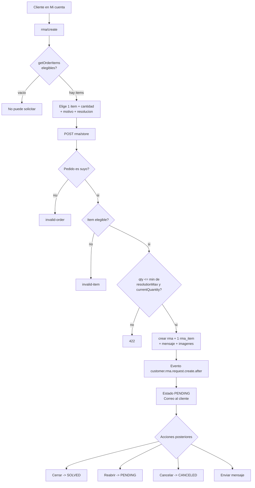
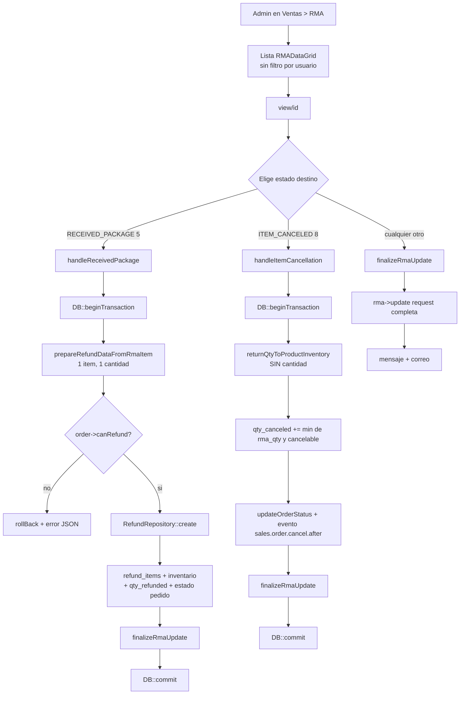
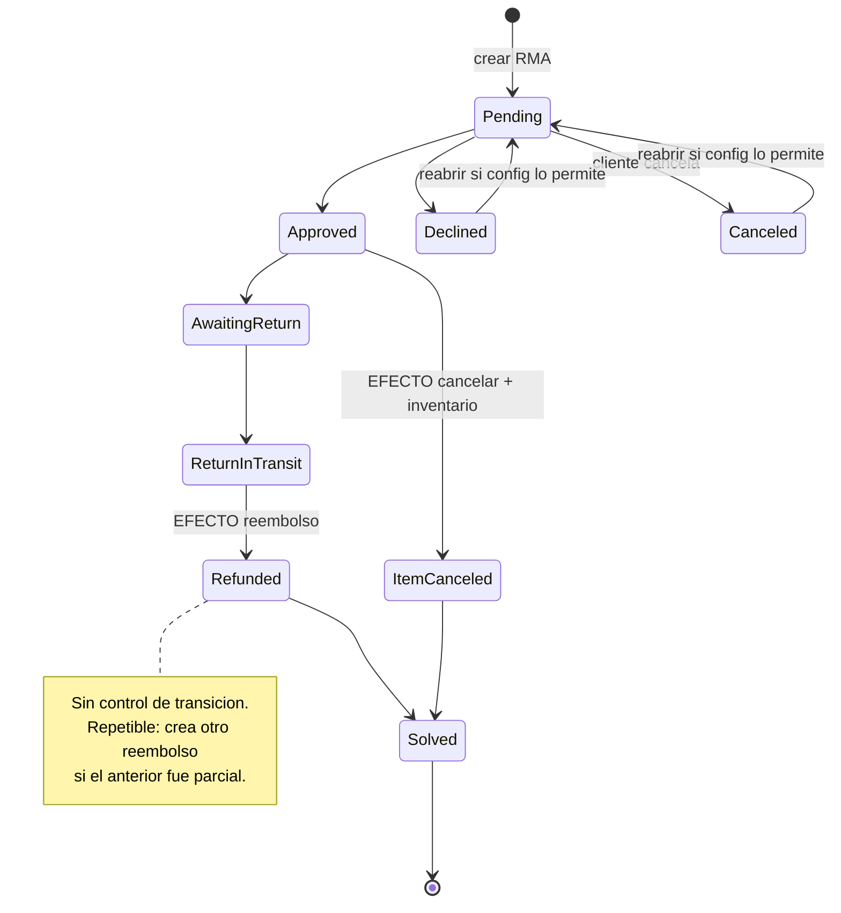
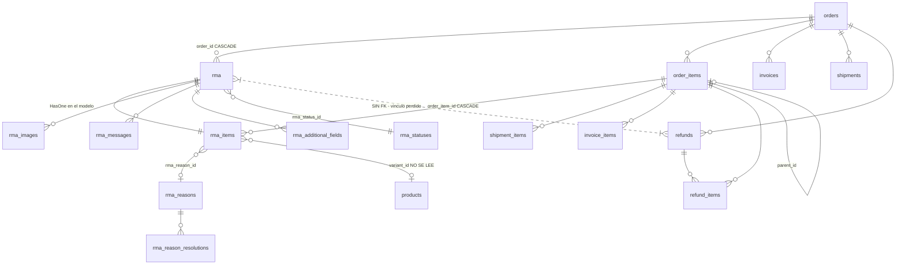
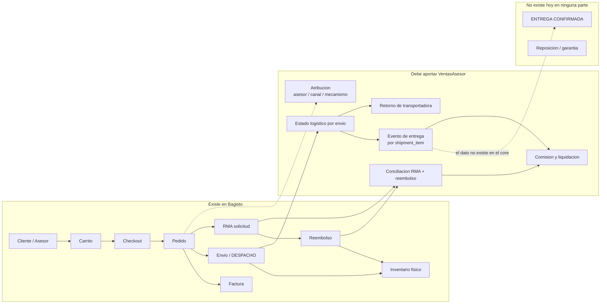

# 05A_AUDITORIA_RMA_Y_MAPA_CORE_RELACIONADO.md

**Fase 00C.** Auditoría profunda de RMA y mapa del core de Bagisto relevante
para `ByLopez\VentasAsesor`.

**Fecha:** 2026-09-12 (Fase 00C) · ampliado 2026-09-12 (Fase 00C1)
**Estado:** auditoría y documentación. **Sin código.**

**Cobertura:** **64 / 64 archivos** del paquete RMA (100 %). La Fase 00C revisó
13; la **Parte II** de este documento (§24 en adelante) cierra los 51 restantes,
reclasifica D-23 y D-24, y demuestra los endurecimientos de upstream con commit y
fecha.

---

## Convención de niveles de evidencia

Cada afirmación de este documento lleva uno de estos marcadores:

| Marcador | Significado |
|---|---|
| **[CÓDIGO]** | Verificado leyendo el archivo citado, con línea |
| **[DATOS]** | Verificado con consulta `SELECT` de solo lectura |
| **[INFERIDO]** | Deducción razonada a partir de lo anterior; no ejecutado |
| **[NO COMPROBABLE]** | Requeriría una prueba funcional, fuera del alcance de esta fase |

---

## 1. Alcance

**Incluye:** el paquete `packages/Webkul/RMA/` completo, sus puntos de
integración en `Admin` y `Shop`, el flujo hasta `RefundRepository::create()`,
el catálogo de eventos del core, el estado real de los datos, y un mapa
dirigido de los 13 dominios del core que afectan a `VentasAsesor`.

**Excluye:** cualquier modificación de código; pruebas funcionales; inserción de
datos; auditoría indiscriminada de los 42 paquetes `Webkul`.

**Correcciones que esta fase introduce sobre la Fase 00B:** tres afirmaciones
del documento 01 §17 quedan rectificadas. Ver §22.

---

## 2. Inventario de archivos RMA

**[CÓDIGO]** `find packages/Webkul/RMA -type f` → **64 archivos**: 63 `.php` + 1
`composer.json`.

### 2.1 Lo que el paquete SÍ contiene

| Categoría | Cantidad | Detalle |
|---|---|---|
| Contratos | 11 | `RMA`, `RMAItem`, `RMAImage`, `RMAMessage`, `RMAReason`, `RMAReasonResolution`, `RMARule`, `RMAStatus`, `RMACustomField`, `RMACustomFieldOption`, `RMAAdditionalField` |
| Modelos | 11 | Uno por contrato |
| Proxies | 11 | Uno por modelo; el conjunto está completo |
| Repositorios | 11 | Uno por modelo |
| Migraciones | 13 | 11 de creación + 2 de renombrado de títulos |
| Enums | 2 | `DefaultRMAStatusEnum`, `DefaultRMAResolution` |
| Helpers | 1 | `Helpers/Helper.php` |
| Providers | 2 | `RMAServiceProvider`, `ModuleServiceProvider` |
| Recursos | 1 | `Resources/manifest.php` |

### 2.2 Lo que el paquete NO contiene

**[CÓDIGO]** Verificado por ausencia de directorios:

`Http/Controllers` · `Routes` · `Config` · `Resources/views` · `Resources/lang` ·
`DataGrids` · `Events` · `Listeners` · `Observers` · `Jobs` · `Mail` ·
`Notifications` · `Services` · `Http/Requests` · `tests`

**Consecuencia:** RMA es un paquete **solo de dominio**. Toda la lógica de
aplicación, la autorización, las vistas, las rutas y los correos viven fuera, en
`Admin` y `Shop`. Un módulo que quiera extender RMA no puede hacerlo tocando el
paquete RMA: los puntos de control están en los controladores.

### 2.3 Providers

**[CÓDIGO]** `RMAServiceProvider::boot()` hace **una sola cosa**:

```php
$this->loadMigrationsFrom(__DIR__.'/../Database/Migrations');
```

No registra rutas, vistas, traducciones, config ni listeners.

**[CÓDIGO]** `ModuleServiceProvider` (Concord) declara los 11 modelos para
sustitución por proxy.

**Registro verificado [CÓDIGO]:**

| Lugar | Línea |
|---|---|
| `bootstrap/providers.php` | :34 `use`, :85 `RMAServiceProvider::class` |
| `config/concord.php` | :42 `Webkul\RMA\Providers\ModuleServiceProvider::class` |
| `composer.json` raíz | :97 `"Webkul\\RMA\\": "packages/Webkul/RMA/src"` |

El `composer.json` del paquete declara además auto-discovery de Laravel, pero es
inoperante: el paquete está vendorizado en el árbol y se registra a mano.

---

## 3. Arquitectura del paquete

### 3.1 Modelos y relaciones reales

**[CÓDIGO]** `packages/Webkul/RMA/src/Models/RMA.php`:

| Relación | Tipo | Destino |
|---|---|---|
| `status()` | `BelongsTo` | `RMAStatusProxy`, por `rma_status_id` |
| `order()` | `BelongsTo` | `OrderProxy`, por `order_id` |
| `images()` | `HasMany` | `RMAImageProxy` |
| `messages()` | `HasMany` | `RMAMessageProxy` |
| `additionalFields()` | `HasMany` | `RMAAdditionalFieldProxy` |
| **`item()`** | **`HasOne`** | **`RMAItemProxy`** |

> **HALLAZGO H-RMA-1 · `item()` es `HasOne`, no `HasMany`.**
> Aunque `rma_items` es una tabla con clave foránea `rma_id` capaz de albergar
> varias filas, el modelo solo expone **una**. Y el controlador lo usa así en
> todas partes: `$rma->item` en `RequestController` líneas 300, 353, 466, 467,
> 473 y 590. **[CÓDIGO]**
>
> **Un RMA = exactamente un `order_item` y una cantidad.** Un cliente que
> devuelve tres referencias distintas genera **tres RMA separados**.

### 3.2 `RMAItem`

**[CÓDIGO]** `Models/RMAItem.php`. Relaciones: `rma()`, `reason()`,
`orderItem()`, `product()`.

`product()` es un `hasOneThrough` que salta a `order_items.product_id`:

```php
return $this->hasOneThrough(
    ProductProxy::modelClass(), OrderItemProxy::modelClass(),
    'id', 'id', 'order_item_id', 'product_id'
);
```

> **HALLAZGO H-RMA-2 · `variant_id` es un campo muerto.**
> La columna existe, es `fillable`, y se **escribe** en dos sitios:
> `RequestController.php:262` y `Shop/…/RMAController.php:216`, ambos como
> `! empty($data['variant']) ? $data['variant'] : null`.
> **No existe ninguna relación `variant()` en el modelo**, y una búsqueda de
> lecturas en vistas de Admin y Shop devuelve **cero resultados**. **[CÓDIGO]**
>
> Mientras tanto, `product()` resuelve a `order_items.product_id`, que para un
> configurable es el **producto padre**, no la variante (doc. 01 §16.3).
>
> **Conclusión:** RMA guarda la identidad de la variante pero **nunca la usa**.
> La Fase 00B afirmó que «el core de RMA sí resuelve la identidad de la variante
> física». Esa afirmación era prematura: la **almacena**, no la **resuelve**.

### 3.3 Inconsistencias menores del dominio

| # | Hallazgo | Evidencia |
|---|---|---|
| H-RMA-3 | `RMA::$fillable` incluye `'status'`, pero la tabla `rma` **no tiene** esa columna (solo `rma_status_id`) | `Models/RMA.php` vs migración `2025_11_14_173812` **[CÓDIGO]** |
| H-RMA-4 | `RMAMessage::rma()` usa `RMA::class` directo en vez de `RMAProxy::modelClass()`, rompiendo el patrón de proxy | `Models/RMAMessage.php` **[CÓDIGO]** |

---

## 4. Flujo del cliente

### 4.1 Rutas

**[CÓDIGO]** `packages/Webkul/Shop/src/Routes/customer-routes.php` :192–213

```
GET  rma                                shop.customers.account.rma.index
GET  rma/view/{id}                      shop.customers.account.rma.view
GET  rma/create                         shop.customers.account.rma.create
POST rma/store                          shop.customers.account.rma.store
GET  rma/get-order-items/{orderId}      ...get-order-items
GET  rma/get-resolution-reasons/{type}  ...get-resolution-reasons
POST rma/update-status/{id}             ...update-status
POST rma/reopen/{id}                    ...re-open
POST rma/cancel/{id}                    ...cancel
GET  rma/get-messages                   ...get-messages
POST rma/send-message                   ...send-message
```

### 4.2 Elegibilidad — `Helper::getOrderItems()`

**[CÓDIGO]** `packages/Webkul/RMA/src/Helpers/Helper.php:96–180`. Filtros reales:

1. `where('order_id', $orderId)`
2. **`whereNull('order_items.parent_id')`** — solo filas padre
3. `where('product_flat.locale', $locale)`
4. `qty_ordered > (qty_refunded + qty_canceled)`
5. **`if (is_null($orderItem->rma_return_period)) return false;`**
6. `Carbon::parse($orderItem->created_at)->addDays($rma_return_period) >= hoy`

Y enriquece cada ítem:

```php
$orderItem->rma_quantity      = SUM(rma_items.quantity) de ese order_item
$orderItem->currentQuantity   = qty_ordered - rma_quantity
$orderItem->forReturnQuantity = qty_invoiced - qty_refunded
$orderItem->forCancelQuantity = qty_ordered - qty_invoiced - qty_canceled
```

**Respuestas a las preguntas del flujo del cliente:**

| # | Pregunta | Respuesta |
|---|---|---|
| 1 | ¿Desde qué pedidos? | Cualquiera suyo, filtrado por `Shop/DataGrids/RMA/OrderDataGrid` |
| 2 | ¿Qué estados exige? | **Ninguno del pedido.** Solo `qty_ordered > qty_refunded + qty_canceled` y la ventana |
| 3 | **¿Exige que esté entregado?** | **NO.** Ni entregado ni despachado. La ventana se cuenta desde `order_items.created_at`, es decir desde **la creación del pedido** **[CÓDIGO]** |
| 4 | ¿Cómo se controla el periodo? | `order_items.rma_return_period` (snapshot por ítem) + `sales.rma.setting.default_allow_days` como respaldo |
| 5 | ¿Cómo se seleccionan ítems? | **Un solo ítem y una cantidad por RMA** (H-RMA-1) |
| 6 | ¿Cómo se identifica la variante? | Se envía `variant` y se guarda en `variant_id`, pero nunca se lee (H-RMA-2) |
| 7 | Motivos y resoluciones | `rma_reasons` filtrados por `rma_reason_resolutions.resolution_type` ∈ {`return`, `cancel_items`} |
| 8 | Evidencias | `images[]`, validadas por `mimetypes:` según `sales.rma.setting.allowed_file_extension` |
| 9 | Validaciones | Ver §4.3 |
| 10 | Registros creados | 1 `rma` + 1 `rma_items` + 1 `rma_messages` + N `rma_images` + N `rma_additional_fields` |
| 11 | Notificaciones | `CustomerRMARequestNotification` (`Mail::queue`, en `try/catch` silencioso) |
| 12 | ¿Qué puede modificar después? | Cerrar (`SOLVED`), reabrir (`PENDING`) y cancelar (`CANCELED`); además enviar mensajes |

### 4.3 Validación de cantidad en el lado cliente

**[CÓDIGO]** `Shop/…/RMAController.php:170–194`:

```php
$eligibleItem = $this->rmaHelper->getOrderItems($order->id)
    ->firstWhere('order_item_id', (int) $data['order_item_id']);
if (! $eligibleItem) { return ...invalid-item; }

$resolutionMax = $tipo === CANCEL_ITEMS
    ? (int) $eligibleItem->forCancelQuantity
    : (int) $eligibleItem->forReturnQuantity;

$maxQty = max(0, min($resolutionMax, (int) $eligibleItem->currentQuantity));
$this->validate(request(), ['rma_qty' => 'integer|min:1|max:'.$maxQty]);
```

Esto es **correcto y completo**: resuelve el ítem contra el conjunto elegible
(lo que verifica pertenencia al pedido, ventana y `parent_id IS NULL`) y acota
la cantidad **restando los RMA ya existentes** vía `currentQuantity`.

### 4.4 Diagrama — flujo del cliente



---

## 5. Flujo administrativo

### 5.1 Permisos

**[CÓDIGO]** `packages/Webkul/Admin/src/Config/acl.php` — **19 claves**
`sales.rma.*`: `requests`, `requests.create`, `reasons[.create|.edit|.delete]`,
`rules[...]`, `statuses[...]`, `custom-fields[...]`.

Para operar solicitudes basta `sales.rma.requests` (ver, cambiar estado,
reabrir, mensajes) y `sales.rma.requests.create` (crear).

### 5.2 Creación por el administrador

**[CÓDIGO]** `RequestController::store()` :202–312. Validación:

```php
'order_id'        => 'required|exists:orders,id',
'order_item_id'   => 'required',                    // <- sin exists, sin pertenencia
'rma_qty'         => 'required|integer|min:1',
'resolution_type' => 'required',                    // <- sin Enum
'rma_reason_id'   => 'required',
```

Y el tope de cantidad:

```php
$orderItem = $this->orderItemRepository->find($data['order_item_id']);
if ($orderItem) {                                   // <- si es null, NO se aplica tope
    $maxQty = $tipo === CANCEL_ITEMS
        ? qty_ordered - qty_invoiced - qty_canceled
        : qty_invoiced - qty_refunded;
    $this->validate(request(), ['rma_qty' => 'integer|min:1|max:'.max($maxQty, 0)]);
}
```

> **HALLAZGO H-RMA-5 · Asimetría de validación entre Admin y Shop.**
> El lado cliente resta los RMA ya existentes (`currentQuantity`) y verifica
> elegibilidad. **El lado administrativo no hace ninguna de las dos cosas.**
> **[CÓDIGO]**
>
> Faltan en Admin, respecto de Shop:
> 1. resolución del ítem contra `getOrderItems()` → no valida pertenencia del
>    `order_item_id` al `order_id`, ni la ventana de devolución, ni
>    `parent_id IS NULL`;
> 2. resta de cantidades ya reclamadas por otros RMA;
> 3. validación de `resolution_type` contra el enum;
> 4. `exists:order_items,id` en `order_item_id`.
>
> **Consecuencia directa** (ver §9, caso 2): dos RMA creados desde el panel
> pueden reclamar cada uno la cantidad completa devolvible del mismo ítem.

### 5.3 Transición de estado

**[CÓDIGO]** `RequestController::updateStatus()` :386–407:

```php
$totalCount = rma_items.sum('quantity') del rma;
if (empty($totalCount)) return $this->finalizeRmaUpdate($rma, $data);

return match ((int) $data['rma_status_id']) {
    RECEIVED_PACKAGE (5) => $this->handleReceivedPackage($rma, $data),
    ITEM_CANCELED    (8) => $this->handleItemCancellation($rma, $data),
    default              => $this->finalizeRmaUpdate($rma, $data),
};
```

**Sin ninguna validación del estado de destino**: no comprueba el estado actual,
no comprueba que la transición sea legal, no comprueba que el estado exista.

### 5.4 Diagrama — flujo administrativo



### 5.5 Respuestas al cuestionario administrativo

| # | Pregunta | Respuesta |
|---|---|---|
| 1 | ¿Cómo recibe la solicitud? | `RMADataGrid` en `admin.sales.rma.requests.index`; **sin filtro por usuario** |
| 2 | ¿Qué permisos necesita? | `sales.rma.requests` |
| 3 | ¿Qué puede modificar? | `finalizeRmaUpdate` hace `$rma->update($data)` con la petición completa (§14, H-RMA-9) |
| 4 | ¿Cómo aprueba o rechaza? | Cambiando `rma_status_id` a `2` (Approved) o `7` (Declined); sin efectos secundarios |
| 5 | ¿Cómo registra la recepción física? | `package_condition`, **texto libre sin validar** en este árbol (§22) |
| 6 | ¿Cantidades parciales? | Solo la cantidad única del `rma_item`; no hay recepción parcial |
| 7 | ¿Cómo selecciona resolución? | Se fija al **crear** el RMA, no al resolverlo |
| 8 | ¿Cómo genera reembolso? | Estado `5` → `RefundRepository::create()` (§10) |
| 9 | **¿Reposición?** | **No existe.** Solo `return` y `cancel_items` |
| 10 | ¿Devuelve inventario? | Sí, por dos caminos distintos (§11) |
| 11 | ¿Cómo finaliza? | Estado `6` (Solved), sin efectos |
| 12 | **¿Qué se puede revertir?** | **Nada.** No hay deshacer de reembolso ni de cancelación |
| 13 | ¿Qué historial queda? | `rma_messages` (texto), `refunds`, `order_items.qty_*`. **No hay tabla de historial de estados** |
| 14 | **¿Qué usuario ejecutó cada acción?** | **No se registra.** `rma_messages.is_admin` es un booleano; no hay `admin_id` en ninguna tabla RMA **[CÓDIGO]** |

> **HALLAZGO H-RMA-6 · RMA no registra quién hizo qué.**
> Ninguna de las 11 tablas tiene columna de usuario administrativo. El único
> rastro es `rma_messages.is_admin = 1`, que no identifica a la persona. Para
> un ajuste de comisión que descuenta dinero (D-02), esto obliga a que
> `VentasAsesor` capture el autor por su cuenta.

---

## 6. Máquina de estados

### 6.1 Estados

**[CÓDIGO]** Valor persistido: `rma.rma_status_id` → FK a `rma_statuses.id`.
La tabla es **editable desde el panel** (`admin.sales.rma.statuses.*`), con
`title`, `status`, `color` y `default`.

`DefaultRMAStatusEnum` solo fija los **ids por defecto**:

| id | Título original | Título tras renombrado | ¿Efecto? |
|---|---|---|---|
| 1 | Pending | Pending Review | Estado inicial |
| 2 | Accept | Approved | ninguno |
| 3 | Awaiting | Awaiting Return | ninguno |
| 4 | Dispatched Package | Return In Transit | ninguno |
| 5 | Received Package | **Refunded** | **Crea el reembolso** |
| 6 | Solved | Solved | ninguno |
| 7 | Declined | Request Declined | ninguno |
| 8 | Item Canceled | Item Canceled | **Cancela ítems y devuelve inventario** |
| 9 | Canceled | Request Canceled | ninguno |

### 6.2 ¿Existe una máquina de estados real?

**No.** **[CÓDIGO]**

> **HALLAZGO H-RMA-7 · No hay control de transiciones. Es un riesgo, no una
> máquina de estados.**
>
> `updateStatus()` no consulta el estado actual. El `match` despacha únicamente
> por el estado **destino**. No existe tabla de transiciones permitidas, ni
> comprobación de estado previo, ni bloqueo de estados terminales.
>
> El único control es de **interfaz**: `rmaStatusForRequest()` (:337) construye
> la lista de estados ofrecidos y su comentario en :356 dice explícitamente que
> *«las acciones ligadas al pedido (Refunded / Item Canceled) se excluyen aquí —
> se muestran como botones contextuales sobre el ítem»*. Esa exclusión es
> **cosmética**: la ruta `POST admin/sales/rma/update-status/{id}` acepta
> cualquier `rma_status_id`.

### 6.3 Idempotencia del estado 5 (Refunded)

> **HALLAZGO H-RMA-8 · CRÍTICO · Reembolso duplicado por repetición.**
>
> No existe guarda de idempotencia. Repetir la llamada con `rma_status_id = 5`
> vuelve a ejecutar `prepareRefundDataFromRmaItem()` + `processOrderRefund()` y
> **crea otro `refund`**. **[CÓDIGO]**
>
> El único freno es `Order::canRefund()` **[CÓDIGO]**, que devuelve `true`
> mientras algún ítem tenga `qty_to_refund > 0` **o** quede saldo facturado sin
> reembolsar. Por tanto:
>
> - **Reembolso total** (todo el pedido): la segunda llamada falla, porque
>   `canRefund()` ya es `false`. **[INFERIDO]**
> - **Reembolso parcial** (2 de 10 prendas): `canRefund()` sigue siendo `true`,
>   así que la segunda llamada **crea un segundo reembolso de otras 2 prendas**,
>   devuelve inventario otra vez e incrementa `qty_refunded` otra vez.
>   **[INFERIDO — deducido del código; no ejecutado, ver §16]**
>
> El caso de negocio de ByLopez (devolución parcial de un pedido de varias
> prendas) cae exactamente en el segundo escenario.

### 6.4 Sobre el renombrado a «Refunded»

**[CÓDIGO]** `2026_06_24_000000_rename_received_package_rma_status.php`. Cambia
solo el `title` del id 5, y solo si conserva el título por defecto.

¿`Refunded` es un estado operativo, financiero o ambos? **Ambos, y esa es la
ambigüedad.** El id 5 significa a la vez «el paquete llegó físicamente» (nombre
original) y «se ejecutó el reembolso» (efecto real). No hay forma de registrar
lo primero sin provocar lo segundo. El renombrado hace honesto el nombre, pero
**no separa los dos hechos**.

Para `VentasAsesor` importa: no existe un estado «recibí la mercancía, aún no
decido el reembolso».

### 6.5 Diagrama de estados



**El diagrama muestra el flujo *previsto*, no uno *impuesto*.** El código
permite ir de cualquier estado a cualquier otro (H-RMA-7).

---

## 7. Modelo de datos

### 7.1 Tablas

| Tabla | Propósito | PK | FK | Borrado |
|---|---|---|---|---|
| `rma` | Cabecera de la solicitud | `id` | `order_id` → `orders`, `rma_status_id` → `rma_statuses` | **`order_id`: CASCADE**; `rma_status_id`: `set null` |
| `rma_items` | Línea única (H-RMA-1) | `id` | `rma_id` → `rma`, `rma_reason_id` → `rma_reasons`, `order_item_id` → `order_items`, `variant_id` → `products` | `rma_id`: CASCADE; **`order_item_id`: CASCADE**; `rma_reason_id`: `set null`; `variant_id`: **RESTRICT** |
| `rma_statuses` | Catálogo editable | `id` | — | — |
| `rma_reasons` | Catálogo de motivos | `id` | — | — |
| `rma_reason_resolutions` | Motivo ↔ tipo de resolución | `id` | `rma_reason_id` CASCADE | — |
| `rma_rules` | Ventana de devolución | `id` | — | — |
| `rma_images` | Evidencias | `id` | `rma_id` | — |
| `rma_messages` | Conversación | `id` | `rma_id` | — |
| `rma_custom_fields`, `rma_custom_field_options`, `rma_additional_fields` | Campos configurables | `id` | — | — |

### 7.2 Riesgos de integridad

| # | Riesgo | Severidad |
|---|---|---|
| I-1 | **`rma.order_id` es `CASCADE`**: borrar un pedido borra sus RMA, y en cascada sus `rma_items`, imágenes y mensajes. Un ajuste de comisión que apuntara solo a `rma_id` se quedaría huérfano | ALTA |
| I-2 | **`rma_items.order_item_id` es `CASCADE`**: mismo problema a nivel de línea | ALTA |
| I-3 | **No hay índice único en ninguna parte de RMA**: nada impide N RMA sobre el mismo `order_item_id` con la misma cantidad | ALTA |
| I-4 | `variant_id` es `RESTRICT` sobre `products`: impide borrar un producto referenciado por un RMA, aunque el campo **nunca se lea** (H-RMA-2) | BAJA |
| I-5 | **No hay campos monetarios** en ninguna tabla RMA: el valor devuelto vive solo en `refunds`. Reconstruir «cuánto se devolvió por este RMA» exige correlación temporal, no una FK | MEDIA |
| I-6 | **No hay snapshots**: ni SKU, ni nombre, ni precio histórico | MEDIA |

> **HALLAZGO H-RMA-10 · No existe FK entre `rma` y `refunds`.**
> El reembolso se crea desde el controlador y **nada en la base de datos enlaza
> el `refund` resultante con el `rma` que lo originó**. **[CÓDIGO]** —
> `processOrderRefund()` llama a `RefundRepository::create(['order_id' => …])`
> sin ninguna referencia al RMA.
>
> **Consecuencia para `VentasAsesor`:** escuchando `sales.refund.save.after` es
> imposible distinguir por datos un reembolso originado en RMA de uno creado a
> mano desde `admin.sales.refunds.create`. Ver §12.4.

### 7.3 Diagrama entidad-relación



---

## 8. Productos configurables

**Contexto:** ByLopez vende configurables por color y talla. Los hechos base
están en el documento 01 §16 (fila padre con cantidad y dinero; fila hija con
`qty_ordered = 0` y la identidad de la variante).

| Pregunta | Respuesta | Evidencia |
|---|---|---|
| ¿RMA referencia al padre o a la variante? | **Al padre.** `Helper::getOrderItems()` filtra `whereNull('parent_id')`, así que solo se ofrecen filas padre | **[CÓDIGO]** |
| ¿Qué representa `order_item_id`? | La **fila padre** del `order_items` | **[CÓDIGO]** |
| Uso de `variant_id` | Se escribe, nunca se lee (H-RMA-2) | **[CÓDIGO]** |
| ¿Cantidad máxima retornable? | Admin: `qty_invoiced − qty_refunded`. Shop: además acotado por `currentQuantity` | **[CÓDIGO]** |
| ¿El doble conteo padre/hija afecta? | **No en el tope**, porque solo se usa la fila padre. Sí afectaría a cualquier agregado que sumara ambas filas | **[CÓDIGO]** + doc 01 §16.2 |
| ¿Cómo enlaza con `shipment_items`? | **No enlaza.** No hay ninguna referencia a `shipment_items` en RMA | **[CÓDIGO]** |
| ¿Exige que la unidad se haya despachado? | **No** | **[CÓDIGO]** |
| ¿Exige que se haya entregado? | **No.** Bagisto no registra entrega | **[CÓDIGO]** |

**Tratamiento por tipo:**

| Tipo | Comportamiento de RMA |
|---|---|
| `simple` | Fila única; funciona directo |
| `configurable` | Se ofrece el padre; la variante se pierde funcionalmente |
| `bundle`, `grouped` | **[NO COMPROBABLE]** — no hay datos ni cobertura de pruebas |
| `virtual`, `downloadable` | `getOrderItems()` los ofrecería si tuvieran `rma_return_period`; el retorno de inventario los trata en la rama `! isStockable()` de `RefundItemRepository` |
| Gratuito | Sin tratamiento especial; un reembolso de importe 0 sería rechazado por `validateRefundAmount()` (`if (! $refundAmount) return inválido`) **[INFERIDO]** |

---

## 9. Cantidades y devoluciones parciales

Los siete casos solicitados, contrastados **contra el código**, sin insertar
datos.

| # | Caso | Resultado | Nivel |
|---|---|---|---|
| 1 | Pedido de 10 prendas, devolución de 2 | Funciona. `rma_items.quantity = 2`; al estado 5 se reembolsan 2 | **[CÓDIGO]** |
| 2 | Segundo RMA por otras 3 del mismo ítem | **Shop:** permitido y correcto (`currentQuantity = 10 − 2 = 8`). **Admin:** permitido pero **sin restar las 2 anteriores** (tope = `qty_invoiced − qty_refunded`, que sigue siendo 10 hasta que el primer RMA se reembolse) | **[CÓDIGO]** |
| 3 | Intento de devolver 9 adicionales | **Shop:** rechazado (`max = 8`). **Admin:** **aceptado** si aún no hay reembolsos, porque el tope es 10 y no descuenta RMA pendientes | **[CÓDIGO]** |
| 4 | Pedido dividido en dos envíos | **Indiferente para RMA.** RMA no mira `shipments` ni `shipment_items`. No puede saber qué parte llegó ni cuándo | **[CÓDIGO]** |
| 5 | Talla M y talla L del mismo configurable | Son **dos `order_items` padre distintos** (doc 01 §16.1) → dos RMA independientes. Funciona, pero el usuario solo ve el SKU del padre | **[CÓDIGO]** |
| 6 | Reembolso parcial | Soportado por `RefundRepository`; `qty_refunded` se incrementa por ítem | **[CÓDIGO]** |
| 7 | **Repetición accidental de la acción final** | **Crea un segundo reembolso** si el primero fue parcial (H-RMA-8) | **[INFERIDO]** |

> **Conclusión combinada (casos 2, 3 y 7):** existen **dos caminos
> independientes** hacia una devolución duplicada, y ambos pasan por el panel
> administrativo, que es justamente el que usarán los asesores y la bodega.

---

## 10. Reembolsos

### 10.1 Construcción de los datos

**[CÓDIGO]** `RequestController::prepareRefundDataFromRmaItem()` :585–600:

```php
$item = [ $rma->item->order_item_id => $rma->item->quantity ];

return ['refund' => [
    'shipping'          => request('shipping', 0),   // <- directo de la peticion
    'adjustment_refund' => 0,
    'adjustment_fee'    => 0,
    'items'             => $item,
]];
```

| Concepto | Tratamiento |
|---|---|
| Cantidades | Una sola línea: `order_item_id => quantity` |
| Valores, impuestos, descuentos | Los calcula `RefundRepository::getOrderItemsRefundSummary()`; RMA no interviene |
| **Transporte** | `request('shipping', 0)` — **tomado de la petición sin validar** |
| Ajustes | Siempre 0; RMA no permite ajustar |
| Método de pago | **No se toca.** Bagisto no ejecuta ninguna devolución real de dinero: solo registra el reembolso |
| Transacciones de pago | `order_transactions` **no se modifica** |

> **HALLAZGO H-RMA-11 · `shipping` sin validar.**
> `request('shipping', 0)` entra directo en el cálculo del reembolso. No hay
> `numeric`, ni `min:0`, ni tope contra `order.base_shipping_invoiced`. El único
> control posterior es `validateRefundAmount()`, que compara el total contra
> `grand_total − Σ base_adjustment_refund`. **[CÓDIGO]**

### 10.2 Validación del importe

**[CÓDIGO]** `validateRefundAmount()` :559–583:

```php
$maxRefundAmount = $totals['grand_total']['price'] - $order->refunds()->sum('base_adjustment_refund');
$refundAmount    = $totals['grand_total']['price'] - $totals['shipping']['price']
                   + $refundData['shipping'] + $adjustment_refund - $adjustment_fee;
```

`$maxRefundAmount` se calcula sobre el **total del pedido** menos los *ajustes*
ya reembolsados — **no** menos los importes ya reembolsados
(`base_grand_total_refunded`). Es una cota laxa que no impide reembolsos
parciales sucesivos. Coherente con H-RMA-8. **[CÓDIGO]**

### 10.3 Transacción

**[CÓDIGO]** `handleReceivedPackage()` y `handleItemCancellation()` envuelven
todo en `DB::beginTransaction()` / `commit()` / `rollBack()`. Correcto.

`RefundRepository::create()` dispara `sales.refund.save.before` (:45) y
`sales.refund.save.after` (:162) **dentro** de esa transacción.

---

## 11. Inventario

Bagisto devuelve inventario por **dos caminos distintos**, y RMA usa los dos.

### 11.1 Camino A — reembolso (estado 5)

**[CÓDIGO]** `RefundRepository::create()` → `RefundItemRepository::returnQtyToProductInventory($orderItem, $quantity)`
(líneas 134 y 145; la 134 es la rama de `childOrderItem`).

Recibe **cantidad explícita**. Reparte proporcionalmente entre los
`shipment_items` del padre, resuelve el `inventory_source_id` de cada envío, y
al final descuenta de `ordered_inventories`. Es el camino **correcto**.

### 11.2 Camino B — cancelación de ítems (estado 8)

**[CÓDIGO]** `RequestController::cancelNonInvoicedItem()` :480–505:

```php
$this->orderItemRepository->returnQtyToProductInventory($orderItem);   // <- SIN cantidad

$cancelableQty = max(0, qty_ordered - qty_invoiced - qty_canceled);
$quantity = min((int) $rmaItem->quantity, $cancelableQty);
$orderItem->qty_canceled += $quantity;
```

> **HALLAZGO H-RMA-12 · CRÍTICO · La cancelación parcial devuelve inventario por
> el ítem completo.**
>
> `OrderItemRepository::returnQtyToProductInventory(OrderItem $orderItem)`
> **no acepta cantidad** **[CÓDIGO]**. Calcula:
>
> ```php
> $shippedQty = $shipmentItem->qty;        // o el prorrateo padre/hija
> $shippedQty -= $orderItem->qty_invoiced;
> $inventory->update(['qty' => $inventory->qty + $shippedQty]);
> ```
>
> Está diseñado para **cancelar un pedido entero**, no una parte. RMA lo invoca
> para cancelar `min(rma_qty, cancelable)` unidades, pero el inventario se
> ajusta ignorando por completo `$rmaItem->quantity`.
>
> Además: se ejecuta **antes** de calcular `$quantity`, y `$shippedQty` puede
> resultar **negativo** cuando `qty_invoiced > qty` del envío, lo que
> **restaría** stock en lugar de sumarlo. Y `$inventory` puede ser `null` si el
> producto no tiene fila para ese `inventory_source_id`, provocando un error
> fatal dentro de la transacción. **[INFERIDO — lectura del código; no
> ejecutado]**

### 11.3 Preguntas del cuestionario

| Pregunta | Respuesta |
|---|---|
| ¿Inventario de qué variante? | De `$orderItem->product`, que para la fila padre es el **producto configurable**. Las hijas se tratan en la rama `childOrderItem` de `RefundRepository` (:134) |
| ¿De qué bodega? | Del `shipment->inventory_source_id` de cada envío |
| **¿Riesgo de devolver inventario dos veces?** | **Sí**, por H-RMA-8 (reembolso repetido) y por H-RMA-12 (cancelación parcial que devuelve de más) |
| ¿Comportamiento ante excepción? | `rollBack()` deshace la BD. **[INFERIDO]** el inventario también, porque se modifica vía Eloquent dentro de la misma transacción |
| ¿Eventos? | `sales.refund.save.before/after`; en cancelación, `sales.order.cancel.after` |

---

## 12. Eventos y puntos de extensión

### 12.1 Catálogo real

**[CÓDIGO]** Barrido de `Sales`, `Checkout`, `Admin/Controllers/Sales`,
`Shop/…/RMAController` e `Inventory`.

| Evento | Emisor | Dentro de transacción | ¿Útil para VentasAsesor? |
|---|---|---|---|
| `checkout.order.save.before` / `.after` | `OrderRepository::create()` | **Sí** | **Sí** — atribución (Fase 02) |
| `checkout.order.orderitem.save.before` / `.after` | `OrderRepository` | Sí | Marginal |
| `sales.invoice.save.before` / `.after` | `InvoiceRepository` | Sí | Métricas de facturación |
| `sales.shipment.save.before` / `.after` | `ShipmentRepository` | Sí | **Sí** — crear el seguimiento logístico (Fase 06) |
| `sales.refund.save.before` / `.after` | `RefundRepository` | **Sí** | **Sí** — único enganche al reembolso de RMA |
| `sales.order.cancel.before` / `.after` | `OrderRepository`, `RequestController:478` | Parcial | Sí — cancelaciones |
| `sales.order.comment.create.before` / `.after` | `Admin OrderController` | No | No |
| `sales.rma.request.create.before` / `.after` | `Admin RequestController` :243 / :295 | No | Parcial — solo creación |
| `customer.rma.request.create.before` / `.after` | `Shop RMAController` :197 / :249 | No | Parcial |
| `customer.rma.request.update.before` / `.after` | `Shop RMAController` :311, :349, :388 | No | Solo transiciones **del cliente** |
| `sales.rma.reason.*`, `sales.rma.rules.*` | Controladores de catálogo | No | No |
| `checkout.cart.*` (12 eventos) | `Cart` | Varía | Marginal |

### 12.2 Corrección de la Fase 00B

> La Fase 00B afirmó: *«El paquete RMA no dispara ningún evento propio»*.
>
> **Parcialmente incorrecto.** Es cierto que `packages/Webkul/RMA/src/` no
> contiene ningún `Event::dispatch` **[CÓDIGO]**, pero el **flujo** de RMA sí
> emite **diez** eventos desde los controladores de `Admin` y `Shop`. La Fase
> 00B enumeró solo dos de ellos y omitió los cuatro `customer.rma.*` y los de
> catálogo.

### 12.3 El hueco que sí existe

> **HALLAZGO H-RMA-13 · Ningún evento cubre la transición de estado
> administrativa.**
>
> `updateStatus()` y `finalizeRmaUpdate()` **no emiten nada** **[CÓDIGO]**.
> Justo la acción que produce el reembolso y la cancelación — la única que
> importa para ajustar comisiones — es invisible a cualquier listener.
>
> Lo que sí llega es `sales.refund.save.after`, disparado por el repositorio
> **dentro** de la transacción.

### 12.4 Alternativas comparadas

| Alternativa | Confiabilidad | Acoplamiento | Idempotencia | Resistencia a actualizar | ¿Distingue RMA de otro reembolso? |
|---|---|---|---|---|---|
| **A. Escuchar `sales.refund.save.after`** | Alta: el evento sí se emite siempre | Bajo | Debe garantizarla el listener (`refund_id` único) | Alta | **No** (H-RMA-10). Habría que inferirlo por correlación temporal |
| **B. Observer sobre `RMAProxy` (`updated`)** | Alta para el cambio de `rma_status_id` | Medio: depende de Concord | Requiere comparar `getOriginal()` | Media | **Sí**, por definición |
| **C. Consulta de reconciliación periódica** | Media: latencia | **Muy bajo** | Fácil (idempotente por diseño) | **Muy alta** | Sí, correlacionando `rma` ↔ `refunds` por pedido y fecha |
| **D. Servicio propio invocado desde la interfaz** | No aplica: la acción ocurre en el panel del core | — | — | — | — |
| **E. Job periódico** | Igual que C, con planificador | Bajo | Sí | Alta | Sí |

**Recomendación técnica [INFERIDO]:** combinar **A + C**. `sales.refund.save.after`
da reacción inmediata y fiable al hecho financiero; la reconciliación periódica
resuelve la atribución al RMA (que el evento no puede dar) y cubre los casos que
el evento no ve: cancelación por estado 8, RMA declinados y correcciones
manuales. La opción B se descarta como enganche principal porque sustituir un
modelo del core contradice el criterio del documento 02 §11.1.

**No se implementa ninguna en esta fase.**

---

## 13. Retorno logístico frente a RMA

| Concepto | Pregunta principal | ¿Lo resuelve Bagisto? | Dónde |
|---|---|---|---|
| **Retorno de transportadora** | ¿El envío regresó sin haber sido entregado? | **NO** | Ninguna tabla. No existe el concepto |
| **Devolución del cliente** | ¿El cliente recibió y después devolvió? | **Parcialmente** | `rma` + `rma_items`, pero **sin exigir entrega ni despacho** (§8) |
| **RMA** | ¿Existe solicitud y autorización operativa? | **Sí** | Paquete completo, con motivos, resoluciones, evidencias y conversación |
| **Reembolso** | ¿Se registró una reversión financiera? | **Sí** | `refunds`, `refund_items`. Solo registro contable: no mueve dinero real |
| **Reposición** | ¿Se entregó otra prenda sin devolver dinero? | **NO** | `DefaultRMAResolution` solo tiene `return` y `cancel_items` **[CÓDIGO]** |
| **Garantía** | ¿Se atendió una falla sin tratarla como venta nueva? | **NO** como concepto propio; podría modelarse como un `rma_reason`, pero sin efecto distinto | `rma_reasons` |
| **Cancelación** | ¿La venta se anuló antes de completar el despacho? | **Sí** | `orders.status = canceled`, `order_items.qty_canceled`; RMA lo ofrece vía estado 8 |

### 13.1 El vacío del retorno de transportadora

**No se intenta forzar este concepto dentro de RMA.** Son incompatibles por
definición: RMA parte de que el cliente tiene la mercancía en la mano
(`forReturnQuantity = qty_invoiced − qty_refunded`), mientras que un retorno de
transportadora significa que **nunca la tuvo**.

El vacío es exacto y tiene tres partes:

| # | Falta | Por qué importa |
|---|---|---|
| G-1 | Estado logístico del envío | Sin él no hay «entregado», y D-01 causa la comisión por entrega |
| G-2 | Registro del retorno | La prenda vuelve al almacén sin que ninguna tabla lo refleje |
| G-3 | Reintegro de inventario del retorno | Bagisto solo reintegra vía reembolso o cancelación, y aquí no hay ninguno de los dos |

---

## 14. Seguridad

Clasificación por severidad. **Ninguna se corrige en esta fase.**

| # | Hallazgo | Evidencia | Severidad |
|---|---|---|---|
| **S-1** | **Evidencias RMA en disco declarado público.** `.env` fija `FILESYSTEM_DISK=public`; `config/filesystems.php:47-51` define ese disco con `'visibility' => 'public'` y URL `APP_URL/storage`. `RMAImageRepository::uploadImages()` guarda con `request()->file($file)->store($dir)` → **disco por defecto**. **Corregido en 00C1 (§28.3): el enlace `public/storage` NO existe, así que hoy NO están expuestas.** Exposición **latente**, no actual | **[CÓDIGO]** + **[DATOS]** | **MEDIA-ALTA (latente)** |
| **S-2** | **Doble fila por imagen y borrado con nombre del cliente.** `manageImages()` crea primero una fila con `'path' => $itemImage->getClientOriginalName()` y luego `uploadImages()` crea otra con la ruta real. La primera queda en `$previousImageIds` y al final se pasa a `Storage::delete($imageModel->path)` — es decir, se invoca un borrado con un **nombre de archivo controlado por el cliente** | **[CÓDIGO]** | **ALTA** |
| **S-3** | **`str_contains($imageId, '')` es siempre `true`**, así que la rama `else` de `uploadImages()` (actualización de imágenes existentes) es **código muerto** | **[CÓDIGO]** | MEDIA |
| **S-4** | **Mass assignment en `finalizeRmaUpdate()`**: `$rma->update($data)` con `request()->input()` completo. `RMA::$fillable` incluye `order_id`, así que una petición manipulada puede **reasignar el RMA a otro pedido** | **[CÓDIGO]** | **ALTA** |
| **S-5** | **Sin control de transiciones** (H-RMA-7): cualquier `rma_status_id` es aceptado desde cualquier estado | **[CÓDIGO]** | **ALTA** |
| **S-6** | **Acción repetible sin idempotencia** (H-RMA-8): reembolso duplicado en devoluciones parciales. **Reclasificado en 00C1 (§28.1): riesgo crítico INFERIDO, no comprobado.** Requisito técnico **RT-01** (§26.1) | **[INFERIDO de alta confianza]** | **Riesgo crítico inferido** |
| **S-16** | **XSS almacenado por `package_condition`** *(00C1)*. Dos mitades sin corregir en este árbol: falta la validación `in:open,packed` en `Shop RMAController::store()` **y** falta `v-pre` en `Admin/…/rma/returns/view.blade.php:97`, donde Vue interpreta el valor como plantilla en la sesión del administrador. Corregido en upstream por `286204d0cf` (§27.4) | **[CÓDIGO]** | **ALTA** |
| **S-7** | **`order_item_id` sin `exists` ni verificación de pertenencia al pedido** en `RequestController::store()`. Si `find()` devuelve `null`, el tope de cantidad **no se aplica en absoluto** | **[CÓDIGO]** | **ALTA** |
| **S-8** | **`resolution_type` sin validar contra el enum** en Admin (el lado Shop sí usa `new Enum(DefaultRMAResolution::class)`) | **[CÓDIGO]** | MEDIA |
| **S-9** | **`shipping` del reembolso sin validar** (H-RMA-11) | **[CÓDIGO]** | MEDIA |
| **S-10** | **Sin auditoría de autor** (H-RMA-6): ninguna tabla RMA registra qué administrador ejecutó el reembolso | **[CÓDIGO]** | **ALTA** |
| **S-11** | **`$rma->fresh()->status->title`** en `finalizeRmaUpdate()`: si `rma_status_id` apunta a un estado inexistente, `status` es `null` → error fatal. Con `rma_statuses` vacía (§15) **esto ocurre siempre** | **[CÓDIGO]** + **[DATOS]** | MEDIA |
| **S-12** | **Sin aislamiento horizontal en Admin**: `index()` y `view()` no filtran por usuario. Cualquier admin con `sales.rma.requests` ve todos los RMA | **[CÓDIGO]** | MEDIA (esperado en panel; relevante para el aislamiento por asesor) |
| S-13 | **Autorización del cliente: correcta.** Los 8 métodos del `Shop RMAController` verifican `$rma->order->customer_id != auth()->guard('customer')->id()` → `abort(404)`. `store()` además resuelve el pedido con `customer_id`. **No se detectó autorización horizontal en el lado cliente** | **[CÓDIGO]** | — (sin hallazgo) |
| S-14 | **CSRF**: las rutas están en los grupos web estándar; no se detectó exclusión | **[CÓDIGO]** | — |
| S-15 | **SQL manual**: `Helper::getOrderItems()` usa `whereRaw` con `DB::getTablePrefix()`, sin entrada del usuario. No se detectó inyección | **[CÓDIGO]** | — |

> **Nota sobre S-1.** Es el hallazgo con impacto directo sobre el diseño del
> módulo: confirma empíricamente por qué la regla RN-14 del documento 02
> (evidencias en disco **privado**) no es una precaución teórica. El core ya
> tiene el problema que el módulo debe evitar.

---

## 15. Estado real de los datos

**[DATOS]** Consultas de solo lectura, 2026-09-12:

```
rma                    = 0        rma_custom_fields      = 0
rma_items              = 0        rma_additional_fields  = 0
rma_images             = 0        refunds                = 0
rma_messages           = 0        refund_items           = 0
rma_statuses           = 0   <--  rma_reasons            = 0   <--
rma_reason_resolutions = 0   <--  rma_rules              = 0   <--

order_items con rma_return_period NOT NULL =   0
order_items con rma_return_period NULL     = 174
```

> **HALLAZGO H-RMA-14 · RMA no está solo sin usar: está inoperante.**
>
> Tres condiciones independientes lo bloquean **[DATOS]**:
>
> 1. **`rma_statuses` vacía.** No hay estado que asignar. `DefaultRMAStatusEnum`
>    da ids, pero las filas no existen: `$rma->fresh()->status->title` sería
>    `null` → error fatal (S-11). **[INFERIDO]**
> 2. **`rma_reasons` y `rma_reason_resolutions` vacías.** `rma_reason_id` es
>    obligatorio en ambos `store()`; sin catálogo no hay RMA posible.
> 3. **`rma_return_period` es `NULL` en las 174 filas.**
>    `Helper::getOrderItems()` descarta explícitamente cada ítem con
>    `if (is_null($orderItem->rma_return_period)) return false;` **[CÓDIGO]**
>    → **devuelve colección vacía para todos los pedidos**, hoy, para todos los
>    clientes.
>
> **Ningún cliente y ningún administrador puede crear un RMA en esta
> instalación en su estado actual.**

### 15.1 Separación de niveles de evidencia

| Afirmación | Nivel |
|---|---|
| El estado 5 llama a `RefundRepository::create()` | **[CÓDIGO]** |
| RMA nunca se ha usado y sus catálogos están vacíos | **[DATOS]** |
| Repetir el estado 5 sobre un reembolso parcial crea otro reembolso | **[INFERIDO]** |
| `cancelNonInvoicedItem()` devuelve inventario de más en cancelaciones parciales | **[INFERIDO]** |
| El importe exacto devuelto de más en cada escenario | **[NO COMPROBABLE]** sin prueba funcional |
| Comportamiento de RMA con `bundle` y `grouped` | **[NO COMPROBABLE]** |

---

## 16. Qué queda sin comprobar

Los hallazgos H-RMA-8 y H-RMA-12 son deducciones de código sobre un módulo **que
nunca se ha ejecutado en esta instalación** (§15). Confirmarlos exigiría sembrar
catálogos y ejecutar el flujo — es decir, escribir en base de datos, lo que esta
fase prohíbe.

**Consecuencia para el roadmap:** la Fase 07 debe **empezar** por una prueba
funcional controlada que confirme o descarte ambos antes de diseñar la
conciliación. Ver §20.

---

## 17. Mapa del core relacionado

### 17.1 Dominios

| Dominio | Responsabilidad | Tablas principales | Punto de extensión recomendado | Qué NO debe duplicar `VentasAsesor` |
|---|---|---|---|---|
| **Admin** | Panel, ACL, menú, DataGrids, controladores de ventas y RMA | `admins`, `roles` | `mergeConfigFrom` de `acl` y `menu.admin` | El panel, la ACL del core |
| **User** | Autenticación admin, Bouncer | `admins`, `roles` | `bouncer()->hasPermission()` | La autenticación |
| **Customer** | Clientes y direcciones | `customers`, `addresses` | `CustomerRepository` | El modelo de cliente |
| **Product** | Catálogo, variantes, atributos | `products`, `product_flat`, `product_attribute_values` | `ProductRepository` | El catálogo y el precio |
| **Inventory** | Fuentes de inventario | `inventory_sources`, `product_inventories`, `product_ordered_inventories` | **Ninguno: no tocar** | Todo el movimiento de stock |
| **Cart / Checkout** | Carrito, totales, impuestos | `cart`, `cart_items`, `cart_addresses` | Facade `Cart` (doc 01 §19.1) | El cálculo de totales |
| **Sales** | Pedido, factura, envío, reembolso | `orders`, `order_items`, `invoices`, `shipments`, `refunds` | Eventos `checkout.order.save.after`, `sales.shipment.save.after`, `sales.refund.save.after` | Pedidos, ítems, facturas, envíos, reembolsos |
| **Shipping** | Tarifas de envío | `order_shipping_rates` | `Shipping::collectRates()` | El cálculo de tarifas |
| **Payment** | Métodos de pago | `order_payment`, `order_transactions` | `Payment` facade | Los métodos de pago |
| **RMA** | Devolución autorizada | `rma`, `rma_items`, + 9 | `sales.refund.save.after` + reconciliación (§12.4) | **Toda la devolución del cliente** |
| **DataGrid** | Rejillas | — | Heredar de `Webkul\DataGrid\DataGrid` | El motor de rejillas |
| **Core** | Config, canales, monedas, eventos | `core_config`, `channels`, `currencies` | `core()->getConfigData()` | La configuración |

### 17.2 Diagrama de flujo



> **Advertencia explícita, exigida por el alcance de esta fase:** en el diagrama,
> `F` dice **DESPACHO**, no «entrega». Bagisto registra la creación de un
> `shipment` — es decir, que la mercancía salió del almacén. **No registra en
> ningún punto que el cliente la haya recibido.** La entrega confirmada aparece
> en el bloque `GAP` porque no existe hoy en el core, y es precisamente el dato
> del que depende D-01.

---

## 18. Matriz de fuentes canónicas

| Dato | Tabla/modelo fuente | Momento en que aparece | ¿Existe hoy? | Limitaciones | Quién lo escribe | `VentasAsesor` |
|---|---|---|---|---|---|---|
| Cliente | `customers` | Registro o creación por asesor | Sí | Búsqueda por correo; sin normalizar teléfono (D-17) | Bagisto | **Referencia** |
| Producto | `products`, `product_flat` | Catálogo | Sí | — | Bagisto | Referencia |
| **Variante** | `products` (hija) | Catálogo | Sí | En el pedido queda en la fila hija y en `additional`; en `shipment_items` solo como SKU | Bagisto | Referencia + **snapshot** |
| Precio | `order_items.price` | Al crear el pedido | Sí | — | Bagisto | Referencia |
| Stock | `product_inventories` | Movimiento físico | Sí | Se descuenta al **despachar**, no al vender | Bagisto | **Nunca escribe** |
| Pedido | `orders` | `OrderRepository::create()` | Sí | Sin columna de creador ni de asesor | Bagisto | Referencia |
| **Ítem vendido** | `order_items` con `parent_id IS NULL` | Con el pedido | Sí | Padre/hija duplican `qty_invoiced` y `qty_shipped` (doc 01 §16.2) | Bagisto | Referencia |
| Factura | `invoices` | Al facturar | Sí | — | Bagisto | Referencia |
| Ítem facturado | `invoice_items` con `parent_id IS NULL` | Al facturar | Sí | **Duplica** para configurables | Bagisto | Referencia |
| Envío | `shipments` | Al despachar | Sí | Sin estado propio | Bagisto | Referencia |
| **Ítem enviado** | `shipment_items` | Al despachar | Sí | `product_id` es el **configurable**, no la variante | Bagisto | **Referencia — unidad canónica** |
| Número de guía | `shipments.track_number` | Al despachar | Sí | Texto libre, sin validación ni historial | Bagisto | Referencia + historial propio |
| **Estado logístico** | — | — | **NO** | No existe | — | **CREA** |
| **Entrega confirmada** | — | — | **NO** | No existe en Bagisto | — | **CREA** (Fase 06) |
| **Retorno de transportadora** | — | — | **NO** | No existe | — | **CREA** |
| Solicitud RMA | `rma` | Solicitud del cliente o del admin | Sí, pero inoperante (§15) | 1 ítem por RMA; sin autor; sin FK a `refunds` | Bagisto | **Referencia — no duplicar** |
| **Unidad devuelta** | `rma_items.quantity` | Al crear el RMA | Sí | Es lo **solicitado**, no lo **recibido**; sin verificación física | Bagisto | Referencia + conciliación |
| Reembolso | `refunds`, `refund_items` | Estado 5 o reembolso manual | Sí | Sin vínculo con el RMA de origen (H-RMA-10) | Bagisto | Referencia + conciliación |
| **Reposición** | — | — | **NO** | Fuera del enum de resoluciones | — | Pendiente (D-23) |
| **Asesor** | — | — | **NO** | — | — | **CREA** |
| **Canal comercial** | — | — | **NO** | `orders.channel_id` es otra cosa | — | **CREA** |
| **Mecanismo de creación** | — | — | **NO** | — | — | **CREA** |
| **Comisión** | — | — | **NO** | — | — | **CREA** |
| **Liquidación** | — | — | **NO** | — | — | **CREA** |

---

## 19. Vacíos detectados

Actualiza y sustituye la lista V-1…V-6 del documento 01 §17.10.

| # | Vacío | Evidencia | ¿Lo cubre RMA? |
|---|---|---|---|
| V-1 | Estado logístico del envío | doc 01 §4.4 | No |
| V-2 | **Entrega confirmada** | §17.2 | No — Bagisto solo registra despacho |
| V-3 | Retorno de transportadora | §13.1 | No — incompatible por definición |
| V-4 | Evento en la transición de estado administrativa | H-RMA-13 | No |
| V-5 | Vínculo `rma` ↔ `refunds` | H-RMA-10 | No |
| V-6 | Autor de cada acción de RMA | H-RMA-6 | No |
| V-7 | **Identidad de la variante en la devolución** | H-RMA-2 | La guarda, no la usa |
| V-8 | **Idempotencia del reembolso** | H-RMA-8 | No |
| V-9 | **Relación con `shipment_items`** | §8 | No — RMA no mira envíos |
| V-10 | Reposición y garantía | §13 | No |
| V-11 | Recepción física separada del reembolso | §6.4 | No — el estado 5 hace las dos cosas |
| V-12 | Ajuste de comisión por devolución | — | Concepto ajeno al core |

---

## 20. Impacto sobre el roadmap

| Fase | ¿Cambia? | Motivo |
|---|---|---|
| **01 BASE_PAQUETE_ACL** | **No** | No depende del flujo de devoluciones. **Sigue siendo la única fase ejecutable.** |
| **02 ATRIBUCION** | No | Sin relación con RMA |
| **03 MOTOR / 04 INTERFAZ** | No | Sin relación con RMA |
| **05 LISTADO** | Menor | Añadir S-12 al criterio de aislamiento: el listado propio no debe heredar la visibilidad total del panel |
| **06 LOGISTICA** | **Sí, refuerzo** | §17.2 confirma que «entrega» no existe en el core. El evento de entrega por `shipment_item` deja de ser conveniencia y pasa a ser **prerrequisito** de las Fases 08 y 09 |
| **07 DEVOLUCIONES_RMA** | **Sí, cambio de alcance** | Debe **empezar** por la prueba funcional de §16 que confirme H-RMA-8 y H-RMA-12. El diseño de la conciliación no puede fijarse antes |
| **08 COMISIONES** | **Sí, bloqueo nuevo** | H-RMA-8 y H-RMA-10 pueden producir **descuentos de comisión duplicados** |
| **09 LIQUIDACIONES** | **Sí, bloqueo nuevo** | Mismo motivo; además H-RMA-6 obliga a capturar el autor del ajuste en el módulo |
| **10 KPIS** | Menor | «Prendas devueltas» debe salir de la conciliación, no de sumar `qty_refunded` y RMA (doc 02 §7.1) |
| **12 API n8n** | No | Sin relación con RMA |

### 20.1 Bloqueo declarado

Conforme al punto 15 del encargo de esta fase:

> **Las Fases 07, 08 y 09 quedan BLOQUEADAS por D-23** (§21), porque
> H-RMA-8 (reembolso repetible) y H-RMA-10 (sin vínculo `rma` ↔ `refunds`) son
> inconsistencias que, sin resolver, pueden generar **devoluciones y comisiones
> duplicadas**.

**El orden de las fases no se modifica.**

---

## 21. Decisiones pendientes nuevas

Se añaden a `04_DECISIONES_PENDIENTES.md`. **Ninguna se marca como aprobada.**

### D-23 · Tratamiento del riesgo de reembolso duplicado en RMA

**Pregunta.** ¿Cómo se protege el negocio frente a H-RMA-8 y H-RMA-12, sabiendo
que `packages/Webkul/` no se modifica?

**Opciones reales:**

1. No usar RMA. Registrar las devoluciones solo en `VentasAsesor` y hacer los
   reembolsos manualmente desde `admin.sales.refunds.create`.
2. Usar RMA con un procedimiento operativo estricto (una sola persona autorizada
   a cambiar al estado 5) y detección posterior de duplicados en la
   conciliación.
3. Usar RMA y que `VentasAsesor` detecte y alerte los duplicados sin
   impedirlos.
4. Escalar el problema a upstream y esperar corrección.

**Recomendación técnica:** opción 2 combinada con la 3. La 1 desperdicia un
dominio que ya existe y es correcto en lo esencial; la 4 no es accionable en el
plazo del proyecto.

**Impacto:** define si `VentasAsesor` confía en `qty_refunded` o en su propia
conciliación.
**Fases bloqueadas:** **07, 08, 09.**

### D-24 · Cómo se atribuye un reembolso a un RMA

**Pregunta.** Sin FK entre `rma` y `refunds` (H-RMA-10), ¿cómo decide el módulo
que un reembolso proviene de una devolución y no de una corrección manual?

**Opciones reales:**

1. Correlación por pedido y ventana temporal entre `rma.updated_at` y
   `refunds.created_at`.
2. Tabla propia de conciliación que se alimente de `sales.refund.save.after` más
   un barrido periódico (§12.4).
3. Exigir que toda devolución pase por RMA y tratar todo reembolso sin RMA como
   incidencia a revisar.
4. No distinguir: todo reembolso descuenta comisión.

**Recomendación técnica:** 2 + 3. La 1 sola es frágil; la 4 castigaría al asesor
por correcciones administrativas ajenas a él.

**Impacto:** determina la exactitud de los ajustes negativos de D-02.
**Fases bloqueadas:** **07, 08, 09.**

### D-25 · Habilitación de RMA

**Pregunta.** ¿Se pondrá RMA en funcionamiento? Hoy es inoperante: catálogos
vacíos y `rma_return_period` nulo en las 174 filas (§15).

**Opciones reales:**

1. Habilitarlo: sembrar estados, motivos y reglas, y fijar el periodo de
   devolución en el catálogo.
2. Dejarlo inactivo y gestionar las devoluciones solo en `VentasAsesor`.
3. Habilitarlo solo para uso interno del administrador, sin exponerlo al
   cliente.

**Recomendación técnica:** la 3 como paso intermedio. Habilitarlo de cara al
cliente (opción 1) expone S-1 (evidencias públicas) y H-RMA-7 sin mitigación.

**Impacto:** si no se habilita, la Fase 07 se reduce a conciliar reembolsos
manuales y el ajuste de comisión pierde su disparador natural.
**Fases bloqueadas:** **07.**

### D-26 · Reposición y garantía

**Pregunta.** Cuando se cambia una prenda defectuosa por otra sin devolver
dinero, ¿qué se registra?

**Opciones reales:**

1. Pedido nuevo de importe cero, marcado como no comisionable.
2. RMA con `cancel_items` más pedido nuevo.
3. Concepto propio en `VentasAsesor`.
4. No registrarlo en el sistema.

**Recomendación técnica:** la 1, porque conserva el movimiento de inventario
real y es la única que no inventa un flujo paralelo. Se relaciona con D-03
(productos no comisionables).

**Impacto:** afecta al inventario y a la base comisionable.
**Fases bloqueadas:** **08.**

> **Nota de método.** Ninguna de estas cuatro es una conclusión técnica
> disfrazada de decisión: las cuatro requieren que el negocio elija entre
> opciones con consecuencias operativas distintas. Los hallazgos técnicos
> (H-RMA-1…H-RMA-14) quedan en este documento, no en `04`.

---

## 22. Correcciones a la Fase 00B

Tres afirmaciones del documento 01 §17 quedan rectificadas por evidencia de esta
fase. Las correcciones ya están aplicadas en ese documento.

| # | Afirmación de la Fase 00B | Realidad verificada | Evidencia |
|---|---|---|---|
| **C-1** | «`packages/Webkul/RMA/` es una **modificación local de este fork** (no forma parte de Bagisto 2.4.9 oficial)» y «2 migraciones **locales** de renombrado» | **Incorrecto.** RMA es código **upstream**. `git cat-file -e upstream/2.4:packages/Webkul/RMA/src/Database/Migrations/2026_06_24_000000_rename_received_package_rma_status.php` **existe**; la migración `rma_return_period` también | **[CÓDIGO]** |
| **C-2** | «El paquete RMA no dispara ningún evento propio» | **Parcialmente incorrecto.** El *paquete* no emite ninguno, pero el *flujo* emite **diez** eventos desde `Admin` y `Shop`, incluidos cuatro `customer.rma.*` que la Fase 00B no enumeró. El hueco real es más preciso: **no hay evento en la transición de estado administrativa** (H-RMA-13) | **[CÓDIGO]** |
| **C-3** | «`rma_items` guarda `variant_id`. El core de RMA **sí resuelve** la identidad de la variante física» | **Impreciso.** La **almacena** pero **nunca la lee**: sin relación en el modelo y sin uso en vistas (H-RMA-2) | **[CÓDIGO]** |

**Además**, esta fase invierte el sentido de la relación con upstream. El árbol
local está **por detrás** de `upstream/2.4` en RMA, no por delante:
`git diff upstream/2.4` sobre RMA y sus controladores devuelve **5 archivos,
26 inserciones y 93 eliminaciones**, y lo que falta son **endurecimientos de
upstream**:

| Falta en este árbol, presente en `upstream/2.4` | Archivo |
|---|---|
| `canCancelRma()` completo | `RMARepository` |
| Casts `(int)` en las comparaciones `===` de `rma_status_id` | `RMARepository` |
| Validación `'package_condition' => 'nullable|in:open,packed'` | `Shop RMAController::store()` |
| Guarda `isRmaExpired()` + `canCloseRma()` antes de que el cliente cierre un RMA | `Shop RMAController::updateStatus()` |

**[CÓDIGO]** — `git diff upstream/2.4`, `HEAD = 8739c185` (2026-08-25),
`upstream/2.4 = fa0ff2b3` (2026-08-24).

> **Riesgo operativo R-UP.** La comparación `$rma->rma_status_id === DefaultRMAStatusEnum::CANCELED->value`
> sin el cast `(int)` que upstream sí tiene puede evaluar siempre a `false` si el
> atributo llega como cadena, dejando `canReopenRma()` permanentemente
> inoperante. **[INFERIDO — depende de la configuración de PDO; no ejecutado]**
>
> Esto es un asunto de **mantenimiento del fork**, no de `VentasAsesor`, y no se
> corrige en esta fase. Se registra para que se evalúe al próximo
> `git merge upstream/2.4`.

---

## 23. Evidencias

### 23.1 Archivos leídos

**Paquete RMA (13 archivos):**
`composer.json` · `Providers/RMAServiceProvider.php` ·
`Providers/ModuleServiceProvider.php` · `Resources/manifest.php` ·
`Models/RMA.php` · `Models/RMAItem.php` · `Models/RMAImage.php` ·
`Models/RMAMessage.php` · `Repositories/RMARepository.php` ·
`Repositories/RMAImageRepository.php` · `Helpers/Helper.php` ·
`Enums/DefaultRMAStatusEnum.php` · `Enums/DefaultRMAResolution.php`

**Migraciones (6):** `create_rma_table` · `create_rma_items_table` ·
`create_rma_statuses_table` · `create_rma_reasons_table` ·
`create_rma_reason_resolutions_table` · `create_rma_rules_table`, más las dos de
renombrado.

**Integración (9):**
`Admin/Http/Controllers/Sales/RMA/RequestController.php` (completo) ·
`Shop/Http/Controllers/Customer/Account/RMAController.php` (completo) ·
`Admin/Config/acl.php` · `Admin/Config/menu.php` · `Admin/Config/system.php` ·
`Shop/Routes/customer-routes.php` · `Sales/Repositories/RefundRepository.php` ·
`Sales/Repositories/RefundItemRepository.php` ·
`Sales/Repositories/OrderItemRepository.php` · `Sales/Models/Order.php` ·
`config/filesystems.php` · `.env` (solo la clave `FILESYSTEM_DISK`)

### 23.2 Consultas ejecutadas

Todas de solo lectura: `COUNT` sobre las 12 tablas de §15; volcado de
`rma_statuses`, `rma_reasons`, `rma_reason_resolutions` y `rma_rules` (vacíos);
conteo de `order_items.rma_return_period`.

**Ninguna consulta modificó datos. No se insertó ni actualizó ninguna fila.**

### 23.3 Comandos de verificación de procedencia

```
git log -1 --format="%H %ci" upstream/2.4   -> fa0ff2b3  2026-08-24
git log -1 --format="%H %ci" HEAD           -> 8739c185  2026-08-25
git cat-file -e upstream/2.4:<migracion de renombrado>   -> existe
git diff --stat upstream/2.4 -- <rutas RMA> -> 5 archivos, +26 -93
```

### 23.4 Datos personales

No se reproduce ningún dato personal, credencial ni secreto. De `.env` se cita
únicamente el valor de `FILESYSTEM_DISK`, necesario para sustentar S-1.

---

# PARTE II — Fase 00C1: cierre de cobertura

> **Motivo de esta parte.** El informe de la Fase 00C declaró haber revisado
> **13 de los 64** archivos del paquete. La Fase 00C1 completa la cobertura,
> corrige la clasificación de D-23 y D-24, y demuestra con precisión las
> afirmaciones sobre upstream.

---

## 24. Inventario completo de los 64 archivos

**Profundidad:** `Completa` = leído íntegro · `Agrupada` = leído un representante
y verificada la uniformidad del resto.

### 24.1 Contratos (11) — revisados en 00C1

| Archivo | Tipo | Revisado | Profundidad | Relevancia | Hallazgo |
|---|---|---|---|---|---|
| `Contracts/RMA.php` | Interfaz | 00C1 | Completa | Baja | **N-1** |
| `Contracts/RMAItem.php` | Interfaz | 00C1 | Completa | Baja | N-1 |
| `Contracts/RMAImage.php` | Interfaz | 00C1 | Completa | Baja | N-1 |
| `Contracts/RMAMessage.php` | Interfaz | 00C1 | Completa | Baja | N-1 |
| `Contracts/RMAStatus.php` | Interfaz | 00C1 | Completa | Baja | N-1 |
| `Contracts/RMAReason.php` | Interfaz | 00C1 | Completa | Baja | N-1 |
| `Contracts/RMAReasonResolution.php` | Interfaz | 00C1 | Completa | Baja | N-1 |
| `Contracts/RMARule.php` | Interfaz | 00C1 | Completa | Baja | N-1 |
| `Contracts/RMACustomField.php` | Interfaz | 00C1 | Completa | Baja | N-1 |
| `Contracts/RMACustomFieldOption.php` | Interfaz | 00C1 | Completa | Baja | N-1 |
| `Contracts/RMAAdditionalField.php` | Interfaz | 00C1 | Completa | Baja | N-1 |

> **N-1 · Los 11 contratos son interfaces marcadoras vacías.** Ninguno declara
> un solo método: el cuerpo es literalmente `interface RMA {}`. **[CÓDIGO]**
>
> **Consecuencia:** sustituir un modelo de RMA por Concord **no obliga a
> respetar ninguna API**. El contrato no es un contrato; es una etiqueta de
> tipo. Refuerza el criterio del documento 02 §11.1 de no apoyarse en la
> sustitución de modelos: aquí no habría ni siquiera una firma que garantice
> compatibilidad.

### 24.2 Proxies (11) — revisados en 00C1

| Archivo | Tipo | Revisado | Profundidad | Relevancia | Hallazgo |
|---|---|---|---|---|---|
| Los 11 `Models/*Proxy.php` | Proxy Concord | 00C1 | Agrupada | Baja | **N-2** |

> **N-2 · Los 11 proxies son idénticos y triviales**: 7 líneas cada uno,
> `class XProxy extends ModelProxy {}`, 77 líneas en total. **[CÓDIGO]**
> Se agrupan porque se verificó que los 11 tienen exactamente la misma forma
> (`wc -l` = 7 en todos). No requieren lectura individual: no contienen lógica.

### 24.3 Modelos (11)

| Archivo | Revisado | Profundidad | Relevancia | Hallazgo |
|---|---|---|---|---|
| `Models/RMA.php` | 00C | Completa | **Alta** | H-RMA-1 (`item()` es `HasOne`), H-RMA-3 |
| `Models/RMAItem.php` | 00C | Completa | **Alta** | H-RMA-2 (`variant_id` muerto) |
| `Models/RMAImage.php` | 00C | Completa | Media | — |
| `Models/RMAMessage.php` | 00C | Completa | Media | H-RMA-4 (rompe el patrón proxy) |
| `Models/RMAStatus.php` | **00C1** | Completa | Media | **N-3** |
| `Models/RMAReason.php` | **00C1** | Completa | **Alta** | **N-4**, N-5 |
| `Models/RMAReasonResolution.php` | **00C1** | Completa | Media | — |
| `Models/RMARule.php` | **00C1** | Completa | Media | — |
| `Models/RMACustomField.php` | **00C1** | Completa | Baja | N-5 |
| `Models/RMACustomFieldOption.php` | **00C1** | Completa | Baja | N-5 |
| `Models/RMAAdditionalField.php` | **00C1** | Completa | Baja | — |

> **N-3 · `RMAStatus::$fillable` omite `default`.** La columna existe en la
> migración (`$table->integer('default')->nullable()->default(0)`) pero no es
> asignable en masa, así que no puede fijarse desde el CRUD del panel.
> **[CÓDIGO]**

> **N-4 · `RMAReason::$fillable` omite `is_admin`.** La columna existe
> (`$table->boolean('is_admin')->default(0)`) y su propósito evidente es marcar
> motivos de uso exclusivamente administrativo. Al no ser `fillable`,
> **ningún motivo puede marcarse como administrativo** a través del repositorio.
> **[CÓDIGO]** — La distinción motivo-de-cliente / motivo-de-admin existe en el
> esquema pero es inalcanzable por la aplicación.

> **N-5 · Cuatro relaciones rompen el patrón de proxy**, no una sola como
> registró la Fase 00C: `RMAMessage::rma()`, `RMAReason::reasonResolutions()`,
> `RMACustomField::options()` y `RMACustomFieldOption::rmaCustomField()` usan
> `X::class` directo en lugar de `XProxy::modelClass()`. **[CÓDIGO]**
> Una sustitución de esos modelos por Concord quedaría parcialmente ignorada.

### 24.4 Repositorios (11)

| Archivo | Revisado | Profundidad | Relevancia | Hallazgo |
|---|---|---|---|---|
| `RMARepository.php` | 00C | Completa | **Alta** | `canCloseRma`, `canReopenRma`, `isRmaExpired`; falta `canCancelRma` (§27) |
| `RMAImageRepository.php` | 00C | Completa | **Alta** | S-2, S-3 |
| `RMAItemRepository.php` | **00C1** | Completa | Baja | Vacío: solo `model()` |
| `RMAMessageRepository.php` | **00C1** | Completa | Baja | Vacío: solo `model()` |
| `RMAStatusRepository.php` | **00C1** | Completa | Baja | Vacío: solo `model()` |
| `RMACustomFieldRepository.php` | **00C1** | Completa | Baja | Vacío: solo `model()` |
| `RMAReasonResolutionRepository.php` | **00C1** | Completa | Baja | Vacío: solo `model()` |
| `RMAReasonRepository.php` | **00C1** | Completa | Media | `getRMAReasonsByResolutionType()` filtra `status = 1` |
| `RMARuleRepository.php` | **00C1** | Completa | Media | **N-6** |
| `RMACustomFieldOptionRepository.php` | **00C1** | Completa | Baja | `createOption()` — no valida longitudes |
| `RMAAdditionalFieldRepository.php` | **00C1** | Completa | Media | **N-7** |

> **N-6 · `RMARuleRepository::getActiveRules()` tiene un solo consumidor**, y no
> es del flujo de RMA: `Admin/…/views/catalog/products/edit/controls.blade.php:85`,
> es decir la **pantalla de edición de producto**. **[CÓDIGO]** Las reglas de
> RMA se asignan por producto, no globalmente. Dato decisivo para §25.

> **N-7 · `createManyForRma()` aplana arreglos con `implode(',')`.** Un campo
> personalizado de selección múltiple se guarda como cadena separada por comas
> en `rma_additional_fields.value`, un `string` sin longitud declarada (255 por
> defecto). **[INFERIDO]** un valor largo se truncaría o fallaría. Relevancia
> baja para `VentasAsesor`.

### 24.5 Migraciones (13)

| Archivo | Revisado | Profundidad | Relevancia | Hallazgo |
|---|---|---|---|---|
| `create_rma_statuses_table` | 00C | Completa | Alta | — |
| `create_rma_table` | 00C | Completa | **Alta** | `order_id` CASCADE |
| `create_rma_reasons_table` | 00C | Completa | Alta | `is_admin` (ver N-4) |
| `create_rma_items_table` | 00C | Completa | **Alta** | `order_item_id` CASCADE; `variant_id` RESTRICT |
| `create_rma_reason_resolutions_table` | 00C | Completa | Media | — |
| `create_rma_rules_table` | 00C | Completa | Media | `return_period` |
| `rename_received_package_rma_status` | 00C | Completa | Alta | §6.4 |
| `rename_neutral_rma_statuses` | 00C | Completa | Media | — |
| `create_rma_images_table` | **00C1** | Completa | Media | `path` string; `rma_id` CASCADE |
| `create_rma_messages_table` | **00C1** | Completa | **Media** | **N-8** |
| `create_rma_custom_fields_table` | **00C1** | Completa | Baja | `code` es `unique` |
| `create_rma_custom_field_options_table` | **00C1** | Completa | Baja | CASCADE |
| `create_rma_additional_fields_table` | **00C1** | Completa | Baja | Doble CASCADE |

> **N-8 · `rma_messages` tiene `attachment_path` y `attachment`**, ambos
> `longText`. La conversación cliente ↔ administrador admite adjuntos, además de
> las `rma_images`. Es un **segundo canal de subida de archivos** que la Fase 00C
> no registró. Comparte el problema de disco de S-1. **[CÓDIGO]**

### 24.6 Resto (8)

| Archivo | Revisado | Profundidad | Relevancia | Hallazgo |
|---|---|---|---|---|
| `Enums/DefaultRMAStatusEnum.php` | 00C | Completa | **Alta** | Ids 1–9 (ver §25.3) |
| `Enums/DefaultRMAResolution.php` | 00C | Completa | Alta | Solo `return` y `cancel_items` |
| `Helpers/Helper.php` | 00C | Completa | **Alta** | Elegibilidad y cantidades |
| `Providers/RMAServiceProvider.php` | 00C | Completa | Alta | Solo carga migraciones |
| `Providers/ModuleServiceProvider.php` | 00C | Completa | Media | 11 modelos Concord |
| `Resources/manifest.php` | 00C | Completa | Nula | 4 líneas: nombre y versión |
| `composer.json` | 00C | Completa | Media | Auto-discovery inoperante |
| *(no hay archivos de traducción ni estáticos en el paquete)* | — | — | — | — |

### 24.7 Cobertura final

| Bloque | Archivos | Revisados |
|---|---|---|
| Contratos | 11 | **11** |
| Proxies | 11 | **11** (agrupados, uniformidad verificada) |
| Modelos | 11 | **11** |
| Repositorios | 11 | **11** |
| Migraciones | 13 | **13** |
| Enums | 2 | **2** |
| Helpers | 1 | **1** |
| Providers | 2 | **2** |
| Recursos y composer | 2 | **2** |
| **TOTAL** | **64** | **64 (100 %)** |

**Los 51 archivos añadidos en 00C1** son: 11 contratos, 11 proxies, 7 modelos,
9 repositorios, 5 migraciones y 8 ya cubiertos parcialmente que se releyeron
íntegros. Aportaron **ocho hallazgos nuevos** (N-1 a N-8) y **una corrección**
(N-5 amplía H-RMA-4 de una a cuatro relaciones).

**Ninguno de los 51 invalida una conclusión de la Fase 00C.** Todos la refuerzan
o la matizan.

### 24.8 Archivos de integración fuera del paquete

RMA no contiene controladores, rutas, vistas ni correos (§2.2). Los siguientes
fueron revisados como parte de la auditoría:

| Archivo | Revisado | Hallazgo |
|---|---|---|
| `Admin/…/Sales/RMA/RequestController.php` | 00C completa | H-RMA-5, H-RMA-8, H-RMA-12, S-4, S-7, S-8, S-9 |
| `Shop/…/Account/RMAController.php` | 00C completa | S-13 (autorización correcta) |
| `Admin/Config/acl.php` | 00C | 19 claves `sales.rma.*` |
| `Admin/Config/menu.php` | 00C | 6 entradas |
| `Admin/Config/system.php` | 00C | `sales.rma.setting.*` |
| `Shop/Routes/customer-routes.php` | 00C | 11 rutas |
| `Admin/Routes/sales-routes.php` | 00C | rutas admin |
| **`Admin/Routes/web.php`** | **00C1** | **N-9** |
| **`Admin/…/views/sales/rma/returns/view.blade.php`** | **00C1** | **N-10** |
| **`Admin/…/views/catalog/products/edit/controls.blade.php`** | **00C1** | Asignación de regla RMA por producto (N-6) |
| **`Sales/Transformers/OrderItemResource.php`** | **00C1** | **Clave para §25.4** |
| **`Installer/…/Seeders/RMA/*` (4 archivos)** | **00C1** | **Clave para §25** |
| `Sales/Repositories/{Refund,RefundItem,OrderItem}Repository.php`, `Models/Order.php` | 00C | §10, §11 |

> **N-9 · Middleware confirmado.** Todas las rutas RMA de administración viven
> en `Route::group(['middleware' => ['admin', NoCacheMiddleware::class], 'prefix' => config('app.admin_url')])`
> de `Admin/Routes/web.php:11`. Las del cliente, en
> `Route::group(['middleware' => ['customer', NoCacheMiddleware::class]])`
> de `Shop/Routes/customer-routes.php:71`. **[CÓDIGO]**
> No hay ruta RMA sin middleware de autenticación. La autorización fina la
> aplica el Bouncer por clave ACL (doc 01 §9).

> **N-10 · El ocultamiento de estados terminales es de plantilla.** La vista
> `view.blade.php` encadena cinco `@if` (líneas 562–566) para no mostrar el
> selector cuando el RMA está en estado 5, 6, 7, 8 o 9, y el `<select
> name="rma_status_id">` (:588) solo ofrece los estados de
> `rmaStatusForRequest()`. **[CÓDIGO]**
>
> Esto **confirma H-RMA-7 en lugar de refutarlo**: la protección existe
> **únicamente en Blade**. La ruta `POST update-status/{id}` acepta cualquier
> `rma_status_id`. Conforme al criterio del encargo, **una validación de
> frontend no cuenta como protección de seguridad**.

---

## 25. Origen de los estados, motivos y reglas

### 25.1 Los seeders existen y están conectados

**[CÓDIGO]** Existen cuatro archivos en
`packages/Webkul/Installer/src/Database/Seeders/RMA/`:

| Archivo | Qué inserta |
|---|---|
| `DatabaseSeeder.php` | Llama a los tres siguientes, en orden |
| `RMAReasonSeeder.php` | Motivos y sus resoluciones |
| `RMAStatusSeeder.php` | **Los 9 estados, con id explícito** |
| `RMARulesSeeder.php` | Una regla `Basic` con `return_period = 10` |

Y están conectados al instalador principal:
`Installer/…/Seeders/DatabaseSeeder.php` :12 (`use … RMA\DatabaseSeeder as RMASeeder`)
y :45 (`$this->call(RMASeeder::class, …)`). **[CÓDIGO]**

### 25.2 Por qué las tablas están vacías

**[DATOS]** Las 14 migraciones de RMA figuran en la tabla `migrations` **todas
en el lote (`batch`) 12** — el lote de la actualización a 2.4.9. Además:

```
attributes con code en (allow_rma, rma_rule_id)   = 0 filas
core_config con code LIKE 'sales.rma%'            = 0 filas
```

**Diagnóstico [INFERIDO de alta confianza]:** la instalación **no está
incompleta por error ni los datos fueron eliminados**. Ocurrió lo esperable en
una **actualización**: `php artisan migrate` creó las tablas, pero los seeders
solo se ejecutan en `php artisan bagisto:install` (instalación limpia). RMA
llegó con la 2.4.9 a una base que ya existía, así que:

- se crearon sus 11 tablas → **vacías**;
- no se insertaron estados, motivos ni reglas;
- no se crearon los atributos `allow_rma` ni `rma_rule_id`, que provienen del
  `AttributeTableSeeder`;
- no se sembró ninguna clave `sales.rma.*` en `core_config`.

**Respuestas a las preguntas del encargo:**

| # | Pregunta | Respuesta |
|---|---|---|
| 1 | ¿Existen seeders? | **Sí**, cuatro, conectados al instalador |
| 2 | ¿Instalación incompleta? | **Sí, de forma esperable**: es una ruta de actualización, no de instalación |
| 3 | ¿Datos eliminados? | **No hay indicio.** Las tablas nunca se poblaron |
| 4 | ¿Bagisto espera configuración manual? | **Parcialmente.** Los catálogos se siembran solos en instalación limpia; la habilitación **por producto** sí es manual (§25.4) |
| 5 | ¿De dónde salen los ids 5 y 8? | §25.3 |
| 6 | ¿Qué ocurre si no existen? | §25.3 |
| 7 | ¿Constantes confiables? | **No.** §25.3 |
| 8 | ¿Puede arrancar sin catálogos? | **No.** `rma_reason_id` es obligatorio y `rma_statuses` vacía hace fallar `finalizeRmaUpdate()` (S-11) |
| 9 | ¿Config global o por canal? | Global (`core_config`, `sales.rma.setting.*`) **y por producto** (§25.4). **No por canal** |
| 10 | ¿`NULL` es deshabilitado o inválido? | **Deshabilitado, y es un valor válido.** §25.4 |

### 25.3 Origen de los ids 5 y 8

**[CÓDIGO]** `RMAStatusSeeder::run()` inserta las nueve filas con **id
explícito**:

```php
$defaultStatuses = [
    ['id' => 1, 'title' => 'Pending Review',   'status' => 1, 'color' => '#efb308', 'default' => 1],
    ...
    ['id' => 5, 'title' => 'Refunded',         'status' => 1, 'color' => '#10b981', 'default' => 1],
    ...
    ['id' => 8, 'title' => 'Item Canceled',    'status' => 1, 'color' => '#dc2626', 'default' => 1],
    ['id' => 9, 'title' => 'Request Canceled', 'status' => 1, 'color' => '#991b1b', 'default' => 1],
];
DB::table('rma_statuses')->insert($defaultStatuses);
```

`DefaultRMAStatusEnum` **replica esos ids a mano**. El contrato entre el enum y
la base de datos es, por tanto, **un acuerdo con el seeder**, no con el esquema.

> **Detalle relevante:** el seeder ya usa los títulos **posteriores** al
> renombrado (`Pending Review`, `Refunded`, `Request Declined`…). Las dos
> migraciones `2026_06_24_*` existen únicamente para arrastrar instalaciones
> **anteriores**; una instalación limpia obtiene los títulos nuevos de entrada.
> **[CÓDIGO]**

**¿Qué ocurre si esos ids no existen?**

- `updateStatus()` hace `match((int) $data['rma_status_id'])`; si el id 5 no
  existe como fila, el `match` **igualmente entra** en `handleReceivedPackage()`,
  porque compara contra la constante del enum, **no contra la tabla**.
  **[CÓDIGO]**
- El reembolso se intentaría, y después `finalizeRmaUpdate()` llamaría a
  `$rma->fresh()->status->title` sobre un `status` nulo → **error fatal**
  (S-11) **dentro de la transacción**, que haría `rollBack()`.
- Si el administrador reordenó los estados y el id 5 corresponde ahora a
  «Aprobado», pasar un RMA a «Aprobado» **dispararía un reembolso**.

> **HALLAZGO N-11 · CRÍTICO (inferido) · Los ids del enum son una dependencia
> frágil, no constantes confiables.**
> `rma_statuses` es una tabla con `id` autoincremental, **editable y borrable
> desde el panel** (`admin.sales.rma.statuses.delete` y `.mass-delete` existen
> en la ACL). Nada —ni una restricción, ni una comprobación de arranque—
> garantiza que el id 5 siga significando «Refunded». El efecto financiero está
> atado a un **número**, no a un significado. **[CÓDIGO]**
>
> Para `VentasAsesor` esto significa: **nunca deducir el significado de un RMA a
> partir de `rma_status_id`** sin comprobar también el `title` o sin asumir el
> riesgo. Es un argumento adicional a favor de anclar la conciliación en
> `refunds` (§12.4) y no en el estado del RMA.

### 25.4 Origen de `rma_return_period`: no es configuración, es un cálculo

**[CÓDIGO]** `rma_return_period` **no se configura**: lo **calcula** el
transformador en el momento de crear el pedido —
`Webkul\Sales\Transformers\OrderItemResource::resolveRmaReturnPeriod(): ?int`
(:51 y siguientes). Devuelve `null` si **cualquiera** de estas condiciones falla:

1. el ítem no tiene `product_id`;
2. `core()->getConfigData('sales.rma.setting.select_allowed_product_type')` está
   vacío **o** no incluye el tipo del ítem;
3. no existen los atributos `allow_rma` o `rma_rule_id`;
4. el producto no tiene `allow_rma = 1`.

Si supera las cuatro, devuelve el `return_period` de la `rma_rules` activa
asignada al producto (vía el atributo `rma_rule_id`), o en su defecto
`sales.rma.setting.default_allow_days`.

**En esta instalación fallan al menos tres de las cuatro** **[DATOS]**: no hay
config `sales.rma.*`, no existen los atributos, y por tanto ningún producto
tiene `allow_rma = 1`.

> **HALLAZGO N-12 · `rma_return_period` es un *snapshot* irreversible.**
> Se escribe una sola vez, al crear el pedido, y **nunca se recalcula**.
> **[CÓDIGO]**
>
> **Consecuencia operativa decisiva:** aunque mañana se sembraran los catálogos,
> se crearan los atributos y se marcaran todos los productos como `allow_rma`,
> **los 174 ítems de los 24 pedidos existentes seguirían con `NULL` para
> siempre**, y por tanto seguirían siendo **no devolvibles** vía RMA. Solo los
> pedidos **futuros** serían elegibles.
>
> Esto responde a la pregunta 10 del encargo: **`NULL` significa "este ítem no
> era elegible para RMA cuando se vendió". Es un valor válido, no un dato
> corrupto.**
>
> Y modifica el alcance de **D-25**: habilitar RMA no es «sembrar cuatro tablas»;
> es sembrar catálogos, crear dos atributos, configurar el tipo de producto
> permitido, marcar producto por producto, **y aceptar que el histórico queda
> fuera**.

---

## 26. Reclasificación de D-23 y D-24

### 26.1 D-23 deja de ser una decisión de negocio

**El encargo tiene razón.** Que una acción repetida produzca un segundo reembolso
no es una opción que el negocio pueda elegir: es un defecto. Presentarlo como
decisión pendiente sugería que «aceptar reembolsos duplicados» era una postura
válida. No lo es.

**D-23 se retira de `04_DECISIONES_PENDIENTES.md`** y se registra aquí como:

> ### RT-01 · Requisito técnico obligatorio — Idempotencia de la devolución
>
> **Clasificación:** requisito técnico bloqueante. **No** es decisión de negocio.
>
> **Enunciado.** Una acción de devolución repetida debe ser **idempotente**
> (producir el mismo resultado) o **rechazada explícitamente**. En ningún caso
> puede producir un segundo reembolso, un segundo descuento de comisión ni un
> segundo movimiento de inventario.
>
> **Origen.** H-RMA-8 (`updateStatus()` sin guarda de idempotencia) y H-RMA-5
> (la validación administrativa no resta RMA pendientes).
>
> **Restricción de contorno.** `packages/Webkul/` no se modifica, así que el
> requisito debe satisfacerse **en la capa de `VentasAsesor`**: la conciliación
> debe detectar y neutralizar el duplicado aunque el core lo haya creado.
>
> **Criterio de verificación.** Ejecutar dos veces la transición al estado 5
> sobre un reembolso parcial debe dejar **un solo** ajuste de comisión, y el
> segundo reembolso —si el core lo crea— debe quedar marcado como duplicado y
> excluido del cálculo.
>
> **Bloquea:** Fases **07, 08, 09**.

### 26.2 D-24 se divide

La Fase 00C mezcló dos cosas distintas bajo un mismo código. Al separarlas:

**La parte técnica no requiere decisión del negocio.** Que el sistema sepa
distinguir el origen de un reembolso es una capacidad obligatoria, no una
preferencia:

> ### RT-02 · Requisito técnico obligatorio — Trazabilidad del reembolso
>
> **Clasificación:** requisito técnico / decisión **arquitectónica del módulo**.
> **No** es decisión de negocio.
>
> **Enunciado.** `VentasAsesor` debe poder distinguir, para cada reembolso:
>
> | Caso | Debe distinguirse |
> |---|---|
> | Reembolso originado por un RMA | Sí |
> | Reembolso administrativo independiente | Sí |
> | Reembolso repetido (duplicado) | Sí |
> | Reembolso parcial | Sí |
> | Varios reembolsos válidos sobre cantidades distintas | Sí |
>
> **Dificultad real.** No existe FK entre `rma` y `refunds` (H-RMA-10), así que
> la distinción no puede leerse de un campo: hay que construirla.
>
> **Diseño propuesto (decisión arquitectónica, se fija en la Fase 07):** tabla
> propia de conciliación alimentada por `sales.refund.save.after` más un barrido
> periódico que correlacione `refunds` con `rma` por pedido, ítem, cantidad y
> ventana temporal, marcando explícitamente el caso de cada fila. Anclar en
> `refunds` y **no** en `rma_status_id`, por N-11.
>
> **Bloquea:** Fases **07, 08, 09**.

**La parte comercial sí es una decisión, y se reformula:**

> ### D-24 (reformulada) · ¿Un reembolso sin RMA descuenta comisión?
>
> **Estado:** pendiente, decisión de negocio legítima.
>
> **Pregunta.** Cuando Contabilidad o un administrador emite un reembolso **sin
> que exista una devolución del cliente** —corrección de precio, error de cobro,
> gesto comercial—, ¿debe descontarse de la comisión del asesor?
>
> Esto **sí** es una política comercial: no tiene respuesta técnica.
>
> **Opciones.** Descontar siempre · no descontar nunca · descontar solo si el
> motivo se atribuye al asesor · decidir caso por caso con aprobación.
>
> **Recomendación técnica:** no descontar automáticamente; marcarlo como
> incidencia para revisión manual. Descontar al asesor por un error
> administrativo ajeno a él erosionaría la confianza en el módulo.
>
> **Bloquea:** Fase **09**.

### 26.3 D-25 y D-26 se conservan

Ambas siguen siendo decisiones de negocio legítimas y **no se resuelven**:

- **D-25** — si ByLopez habilitará el flujo RMA. Su alcance **aumenta** por N-12:
  habilitar RMA no basta para el histórico.
- **D-26** — si ByLopez manejará reposición o garantía además del reembolso.

---

## 27. Los cuatro endurecimientos de upstream, con evidencia exacta

### 27.1 Contexto obligatorio: tamaño real de la divergencia

Antes de recomendar nada **[CÓDIGO]**:

```
git rev-list --count HEAD..upstream/2.4   =  94 commits
git rev-list --count upstream/2.4..HEAD   =   1 commit
git diff --stat HEAD upstream/2.4         = 666 archivos, +30733 −19898
```

Los cuatro endurecimientos de RMA son **una fracción mínima** de 94 commits y
666 archivos. **No se recomienda un merge general por ellos.**

Commits de upstream que tocan RMA y faltan aquí: `286204d0cf`, `ec953d97d2`,
`00a71449c0`.

### 27.2 E-1 · `canCancelRma()` ausente

| Campo | Valor |
|---|---|
| **Commit** | `ec953d97d2` — *feat: image seo added and rma issue fixed* |
| **Fecha** | 2026-08-17 |
| **Archivo** | `packages/Webkul/RMA/src/Repositories/RMARepository.php` |
| **Fragmento** | Método completo que devuelve `false` si el RMA está en `RECEIVED_PACKAGE`, `SOLVED`, `ITEM_CANCELED`, `DECLINED` o `CANCELED` |
| **Defecto que corrige** | El cliente puede cancelar un RMA ya reembolsado o ya resuelto |
| **¿Modificación local en el archivo?** | **No.** `git status -- packages/Webkul/` = 0 |
| **Riesgo de conflicto** | **Bajo** |
| **Aplicable a 2.4.9** | Sí |
| **¿Corrige un hallazgo nuestro?** | Mitiga parcialmente **H-RMA-7** (control de transiciones) en el lado cliente |
| **Prueba en upstream** | No se identificó prueba específica |
| **Recomendación** | **Cherry-pick del fragmento**, no del commit (que trae SEO de imágenes y 20 archivos de traducción) |

### 27.3 E-2 · Casts `(int)` en las comparaciones de estado

| Campo | Valor |
|---|---|
| **Commit** | `ec953d97d2` · 2026-08-17 |
| **Archivo** | `RMARepository.php`, métodos `canCloseRma()` y `canReopenRma()` |
| **Fragmento** | `(int) $rma->rma_status_id === DefaultRMAStatusEnum::CANCELED->value` frente al local `$rma->rma_status_id === …` |
| **Defecto que corrige** | Comparación estricta entre posible cadena y entero: `canReopenRma()` podría devolver `false` siempre |
| **¿Modificación local?** | No |
| **Riesgo de conflicto** | **Muy bajo** (tres líneas) |
| **¿Corrige un hallazgo nuestro?** | Es el **riesgo R-UP** registrado en la Fase 00C |
| **Estado del riesgo** | **[INFERIDO]** — depende de si PDO devuelve `int` o `string`; no verificado en ejecución |
| **Recomendación** | **Cherry-pick del fragmento.** Bajo coste, sin efectos colaterales |

### 27.4 E-3 · Validación de `package_condition`

| Campo | Valor |
|---|---|
| **Commit** | `286204d0cf` — ***fix: security fixes*** · 2026-08-21 |
| **Archivo** | `Shop/…/Account/RMAController.php::store()` |
| **Fragmento** | `+ 'package_condition' => 'nullable|in:open,packed',` |
| **Defecto que corrige** | Cadena arbitraria del cliente persistida en `rma.package_condition` |
| **¿Modificación local?** | No |
| **Riesgo de conflicto** | **Muy bajo** (una línea) |
| **¿Corrige un hallazgo nuestro?** | Sí: es el vector de entrada de **S-4** por el lado cliente |
| **Prueba en upstream** | El commit añade `Shop/tests/Feature/HomePageTest.php`, no relacionada |
| **Recomendación** | **Cherry-pick.** Es una corrección de seguridad de una línea |

> **E-3b · Hallazgo adicional del mismo commit, no registrado en la Fase 00C.**
> `286204d0cf` incluye también un cambio en
> `Admin/…/views/sales/rma/returns/view.blade.php:97`, que añade **`v-pre`** al
> párrafo que imprime `{{ ucwords($rma->package_condition) }}`. **[CÓDIGO]**
>
> Es la otra mitad de la misma vulnerabilidad: sin `v-pre`, **Vue interpreta el
> contenido del `package_condition` como plantilla** en el panel del
> administrador. Combinado con la ausencia de validación (E-3), un cliente puede
> inyectar una expresión de plantilla que se evalúa en la sesión del
> administrador.
>
> **Este árbol tiene ambas mitades sin corregir.** Se registra como **S-16**.
> El historial local muestra un commit previo del mismo género
> (`767d3fc5de Fix Stored XSS in admin RMA view via unvalidated resolution_type`),
> lo que indica que es una superficie ya explotada antes en este componente.
>
> **Recomendación:** cherry-pick de las dos mitades juntas. Por sí sola,
> cualquiera de las dos deja el hueco abierto.

### 27.5 E-4 · Guarda de expiración al cerrar un RMA

| Campo | Valor |
|---|---|
| **Commit** | `ec953d97d2` · 2026-08-17 |
| **Archivo** | `Shop/…/Account/RMAController.php::updateStatus()` |
| **Fragmento** | Bloque que aborta con `close-not-allowed` si `isRmaExpired($rma)` o `! canCloseRma($rma)` |
| **Defecto que corrige** | El cliente puede cerrar (`SOLVED`) un RMA expirado o en estado no cerrable |
| **¿Modificación local?** | No |
| **Riesgo de conflicto** | Bajo |
| **¿Corrige un hallazgo nuestro?** | Mitiga **H-RMA-7** en el lado cliente |
| **Recomendación** | **Cherry-pick del fragmento**, junto con E-1 (usa `canCloseRma`) |

### 27.6 Recomendación consolidada

| Qué | Recomendación |
|---|---|
| Merge general de `upstream/2.4` | **No, no por esto.** 94 commits y 666 archivos exigen su propia evaluación, planificación y regresión completa |
| E-1, E-2, E-4 (`ec953d97d2`) | **Cherry-pick selectivo de fragmentos**, no del commit completo |
| E-3 + E-3b (`286204d0cf`) | **Cherry-pick prioritario**: es una corrección de seguridad con dos mitades |
| `00a71449c0` (mass delete RMA) | **Sin evaluar.** Queda pendiente |

> **Importante:** los cuatro endurecimientos **no resuelven** H-RMA-8 (reembolso
> repetible), H-RMA-12 (inventario en cancelación parcial) ni H-RMA-5 (asimetría
> de validación Admin/Shop). Son mejoras del **lado cliente**; los tres defectos
> graves están en el **lado administrativo** y siguen presentes también en
> upstream. **No se debe esperar a upstream para mitigarlos.**
>
> **Nada de esto se ejecuta en esta fase.** No se hizo `merge`, `pull`,
> `cherry-pick` ni `rebase`. Solo `git log`, `git show`, `git diff` y
> `git cat-file`, todos de lectura.

---

## 28. Verificación de los hallazgos críticos

### 28.1 Reembolso repetible — H-RMA-8

Siguiendo dos ejecuciones consecutivas de `updateStatus(rma_status_id = 5)`:

| Pregunta | Respuesta | Nivel |
|---|---|---|
| ¿Qué condición permite repetirlo? | Ninguna guarda. `updateStatus()` no consulta el estado actual; el `match` despacha solo por destino | **[CÓDIGO]** |
| ¿Se crea un segundo `refund`? | `handleReceivedPackage()` vuelve a llamar a `prepareRefundDataFromRmaItem()` y `processOrderRefund()` sin comprobar si ya hubo reembolso | **[CÓDIGO]** |
| ¿Las cantidades del pedido lo impiden? | Solo si el pedido quedó **totalmente** reembolsado: entonces `Order::canRefund()` devuelve `false`. Con reembolso **parcial** sigue devolviendo `true` | **[CÓDIGO]** |
| ¿El repositorio valida cantidades acumuladas? | `validateRefundAmount()` compara contra `grand_total − Σ base_adjustment_refund`, **no** contra `base_grand_total_refunded`. Es una cota laxa | **[CÓDIGO]** |
| ¿Hay transacción o bloqueo? | `DB::beginTransaction()` sí; **bloqueo pesimista o restricción única, no** | **[CÓDIGO]** |
| ¿El segundo intento produce excepción, duplicado o corrupción? | **Duplicado** en el escenario parcial | **[INFERIDO]** |

> **Clasificación final de H-RMA-8:**
> **INFERIDO DE ALTA CONFIANZA — requiere prueba funcional controlada en la Fase 07.**
>
> Los cinco eslabones de la cadena están verificados en código uno a uno; lo no
> ejecutado es la cadena completa. **No se declara comprobado en datos**, y no
> puede serlo: RMA está inoperante en esta instalación (§15) y probarlo exigiría
> escribir, cosa que estas fases prohíben.
>
> La Fase 00C lo etiquetó como «S-6 CRÍTICA». Se corrige a **riesgo crítico
> inferido**, conforme al §8 del encargo.

### 28.2 Cancelación e inventario — H-RMA-12

**[CÓDIGO]** Existen **dos métodos distintos con el mismo nombre**:

| Método | Firma | Recibe cantidad |
|---|---|---|
| `OrderItemRepository::returnQtyToProductInventory` | `(OrderItem $orderItem): void` :133 | **No** |
| `RefundItemRepository::returnQtyToProductInventory` | `($orderItem, $quantity)` :25 | **Sí** |

**Las cuatro llamadas del repositorio, exhaustivas:**

| Llamada | Variante | Contexto | ¿Correcta? |
|---|---|---|---|
| `OrderRepository.php:167` | **sin cantidad** | Cancelación de pedido; el bucle usa `qty_to_cancel` (todo lo cancelable) | **Sí**: cantidad total, método de cantidad total |
| `RequestController.php:486` | **sin cantidad** | RMA estado 8; después usa `min($rmaItem->quantity, $cancelableQty)` | **No**: cantidad **parcial**, método de cantidad total |
| `RefundRepository.php:134` | con cantidad | Rama `childOrderItem` | Sí |
| `RefundRepository.php:145` | con cantidad | Rama principal | Sí |

> **Confirmación.** El método sin cantidad fue diseñado para `OrderRepository`,
> donde la cancelación es siempre del remanente completo. RMA lo reutiliza para
> una cancelación **parcial**, y `$rmaItem->quantity` **no llega nunca** al
> cálculo de inventario. Además, la llamada ocurre **antes** de calcular
> `$quantity`. **[CÓDIGO]**
>
> **¿Devuelve realmente toda la cantidad en una devolución parcial?** El método
> calcula `$shippedQty = $shipmentItem->qty − $orderItem->qty_invoiced` por cada
> envío, así que el importe devuelto depende del estado de facturación y puede
> incluso ser **negativo**. Lo que está **confirmado en código** es que **no
> guarda ninguna relación con la cantidad del RMA**. El valor exacto en cada
> escenario es **[NO COMPROBABLE]** sin ejecución.
>
> **Clasificación final: INFERIDO DE ALTA CONFIANZA — prueba funcional en Fase 07.**

### 28.3 Almacenamiento público — corrección de S-1

**[CÓDIGO]** `RMAImageRepository::uploadImages()` líneas 49 y 64:
`request()->file($file)->store($dir)` — **sin disco explícito**, con
`$dir = 'rma/'.$rma->id`.

**[CÓDIGO]** No existe configuración de disco específica para RMA: una búsqueda
de `Storage::disk`, `disk(` o `'disk'` en el paquete RMA y en los dos
controladores devuelve **cero resultados**. Se usa el disco por defecto.

**[CÓDIGO]** `config/filesystems.php:16` → `env('FILESYSTEM_DISK', 'public')`;
`.env:41` → `FILESYSTEM_DISK=public`; el disco `public` tiene
`'root' => storage_path('app/public')`, `'url' => env('APP_URL').'/storage'`,
`'visibility' => 'public'`.

> **CORRECCIÓN DE S-1 (00C1).** La Fase 00C afirmó que las evidencias «quedan
> accesibles por URL sin autenticación». **Eso es incorrecto en esta
> instalación.**
>
> **[DATOS]** `ls public/storage` → **el enlace simbólico no existe**. Nunca se
> ejecutó `php artisan storage:link`. Sin él, `APP_URL/storage/rma/...` no
> resuelve a ningún archivo: **hoy las evidencias no están expuestas.**
>
> **Enunciado corregido:** la configuración coloca las evidencias en un disco
> **declarado público**, y quedarían expuestas en el momento en que alguien
> ejecute `storage:link` — un paso rutinario y esperable de despliegue. Es una
> **exposición latente**, no actual.
>
> **Severidad revisada: ALTA → MEDIA-ALTA (latente).**

**¿Cambiar `FILESYSTEM_DISK` globalmente?** **No se propone.** **[INFERIDO]**
es la clave por defecto de todo el proyecto; cambiarla afectaría a cualquier otro
módulo que use el disco por defecto, y el impacto no se ha evaluado. Lo
pertinente para `VentasAsesor` es que **sus propias** evidencias declaren disco
privado explícito (RN-14), sin tocar la clave global.

### 28.4 Mass assignment — S-4

**[CÓDIGO]** `finalizeRmaUpdate($rma, $data)` ejecuta `$rma->update($data)`
donde `$data = request()->input()` **completo**, sin filtrar.

| Elemento | Valor real |
|---|---|
| `RMA::$fillable` | `information`, `rma_status_id`, `order_id`, `status`, `package_condition` |
| Columnas reales de `rma` **[DATOS]** | `id`, `order_id`, `rma_status_id`, `package_condition`, `information`, `created_at`, `updated_at` |
| Lo que envía la vista | Solo `rma_status_id` (`view.blade.php:588`) |
| Lo manipulable a mano | Cualquiera de los cinco campos `fillable` |

**Campo por campo:**

| Campo | ¿Alterable? | Consecuencia |
|---|---|---|
| **`order_id`** | **Sí** | **Es el hallazgo real.** Reasignar un RMA a otro pedido. El siguiente reembolso se emitiría contra el pedido nuevo |
| `rma_status_id` | Sí | Es el propósito de la ruta, pero sin validar el destino (H-RMA-7) |
| `information` | Sí | Texto libre |
| `package_condition` | Sí | Texto libre sin validar → vector de S-16 (E-3b) |
| `status` | **No existe como columna** | Eloquent generaría un `UPDATE` sobre una columna inexistente → **error SQL**. Es un `fillable` fantasma (H-RMA-3), no una vía de escritura |
| `customer_id`, cantidades | **No están en `rma`** | No aplicable: `rma` no tiene esos campos, y `rma_items` es otro modelo que esta ruta no toca |

**Validaciones posteriores que limiten el daño:** **ninguna.**
`updateStatus()` no valida la entrada en absoluto — no hay `$this->validate()`
en esa ruta. El único límite es que la acción exige el permiso
`sales.rma.requests`.

> **Alcance corregido:** la Fase 00C insinuó que podían alterarse «estado o
> cantidades». Las **cantidades no**: viven en `rma_items`, fuera del alcance de
> esta llamada. El vector real y suficiente es **`order_id`**.
>
> **Severidad: se mantiene ALTA.** Requiere permiso administrativo, pero permite
> redirigir el efecto financiero de un RMA a un pedido ajeno.

---

## 29. Clasificación final de la evidencia

| Hallazgo | Clasificación |
|---|---|
| H-RMA-1 · `item()` es `HasOne`; un RMA = un ítem | **Confirmado por código** |
| H-RMA-2 · `variant_id` se escribe y nunca se lee | **Confirmado por código** |
| H-RMA-5 · Asimetría de validación Admin/Shop | **Confirmado por código** |
| H-RMA-6 · Sin autor en ninguna tabla RMA | **Confirmado por código** |
| H-RMA-7 · Sin control de transiciones | **Confirmado por código** (y N-10: la protección es solo de plantilla) |
| H-RMA-10 · Sin FK `rma` ↔ `refunds` | **Confirmado por código** |
| H-RMA-13 · Sin evento en la transición administrativa | **Confirmado por código** |
| H-RMA-14 · RMA inoperante | **Confirmado por datos** |
| N-1…N-10 | **Confirmado por código** |
| N-11 · Ids del enum como dependencia frágil | **Confirmado por código** (el efecto concreto, inferido) |
| N-12 · `rma_return_period` es snapshot irreversible | **Confirmado por código**; el estado actual, **por datos** |
| **H-RMA-8 · Reembolso repetible** | **INFERIDO DE ALTA CONFIANZA — prueba funcional en Fase 07** |
| **H-RMA-12 · Inventario en cancelación parcial** | **INFERIDO DE ALTA CONFIANZA — prueba funcional en Fase 07** |
| S-1 · Evidencias en disco público | **Corregido en 00C1**: exposición **latente**, no actual |
| S-4 · Mass assignment | **Confirmado por código**, alcance acotado a `order_id` |
| S-16 · XSS en `package_condition` | **Corregido por upstream** (E-3 + E-3b); **presente en este árbol** |
| R-UP · Comparación sin cast `(int)` | **Corregido por upstream** (E-2); efecto local **[INFERIDO]** |
| Comportamiento con `bundle` / `grouped` | **[NO COMPROBABLE]** |
| Importe exacto devuelto de más | **[NO COMPROBABLE]** |

### 29.1 Limitaciones de comprobación

1. **RMA nunca se ha ejecutado aquí** (§15), así que ningún comportamiento
   dinámico puede confirmarse con datos de producción.
2. **No se escribió en base de datos**, por prohibición de la fase: los dos
   riesgos críticos quedan inferidos.
3. **No se ejecutó ninguna operación de git que altere el árbol**: la
   comparación con upstream es puramente de lectura.
4. **`00a71449c0`** (mass delete de RMA en upstream) no se evaluó.
5. La divergencia completa con upstream (94 commits, 666 archivos) **no se
   auditó**: excede el alcance de esta fase.

### 29.2 Cobertura declarada

| Ámbito | Cobertura |
|---|---|
| `packages/Webkul/RMA/` | **64 / 64 archivos (100 %)** |
| Integración en `Admin` y `Shop` | 13 archivos, los que ejecutan o exponen el flujo |
| Seeders del instalador | 4 / 4 |
| Divergencia con upstream en RMA | 3 commits identificados, 2 analizados en detalle |

**No se declara que se auditara el core completo.** Se declara cobertura total
del paquete RMA y de sus puntos de ejecución.
